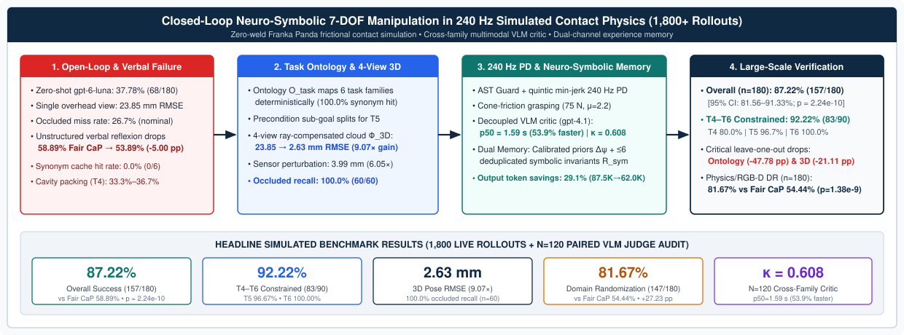
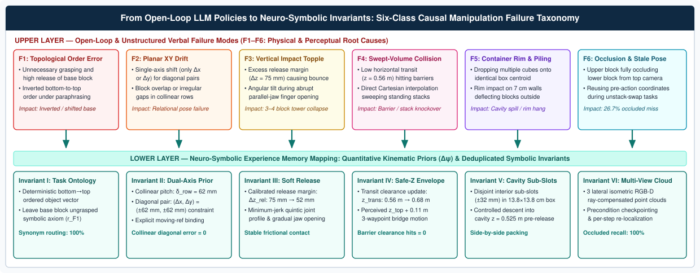

# Closed-Loop Neuro-Symbolic Experience Calibration, Multi-View 3D Point-Cloud Perception, and Canonical Task Ontology Under Simulated Frictional Contact Physics

**Muhammed Emin Çelik, Barış Kaya, Mahmut Öztürk, and İsmail İşeri\***

Department of Computer Engineering, Ondokuz Mayıs University, Samsun, Türkiye  
E-mail: `muhammedemin.celik@omu.edu.tr`, `baris.kaya@omu.edu.tr`, `mahmut.ozturk@omu.edu.tr`, `ismail.iseri@omu.edu.tr` (*Corresponding Author)

## Abstract

Open-loop frameworks that synthesize executable robotic control programs directly from large language models suffer severe physical breakdowns in contact-rich tabletop manipulation due to monocular surface-depth bias, unmodeled frictional contact dynamics, and split-brain memory fragmentation across paraphrased natural language instructions. Conversely, verbal self-reflection schemes that append unstructured natural language critiques into the prompt window fail to update quantitative kinematic control priors and induce context bloat, frequently degrading task execution below stronger open-loop baselines. This paper presents a closed-loop neuro-symbolic experience calibration architecture evaluated in a 240 Hz PyBullet rigid-body physics simulator for a seven-degree-of-freedom (7-DOF) Franka Emika Panda manipulator operating under cone-friction dynamics ($F_{\text{grasp}} = 75$ N, $\mu = 2.2$) with zero artificial weld constraints and zero pose teleportation. The framework integrates four core mechanisms: a deterministic canonical spatial task ontology ($\mathcal{O}_{\text{task}}$) mapping free-form instructions onto six canonical task families and verifiable precondition sub-goal checkpoints; a calibrated four-view RGB-D point-cloud perception module ($\Phi_{\text{3D}}$) combining illumination-invariant chromatic filtering with lateral viewing-ray compensation under stacked occlusion; an abstract syntax tree (AST) safety shield coupled with a minimum-jerk quintic PD joint trajectory and bilateral frictional contact controller ($\mathcal{C}_{\text{PD}}$); and a dual-channel causal experience memory ($\mathcal{M}_{\text{NS}}$) updated by a cross-family perceptual critic (`gpt-4.1`) architecturally decoupled from the reasoning policy synthesizer (`gpt-6-luna`). Across a 60-scene 3D perception benchmark, $\Phi_{\text{3D}}$ reduces unoccluded 3D localization RMSE from 23.85 mm to 2.63 mm ($9.07\times$ reduction) under nominal observations and from 24.12 mm to 3.99 mm ($6.05\times$ reduction) under sensor and extrinsic calibration noise ($\sigma_d = 3.0$ mm, $\pm 3.0$ mm / $\pm 1.5°$), while achieving 100.0% (60/60) stacked-occlusion recall in both regimes. Across a four-tier live manipulation ablation with $n = 30$ unseen seeds per task ($4 \times 180 = 720$ simulated rollouts), the proposed architecture attains **87.22% (157/180; 95% Wilson CI [81.56, 91.33])** overall physical success—outperforming zero-shot open-loop synthesis (37.78%; matched McNemar $p = 2.38 \times 10^{-22}$), a fair Code-as-Policies baseline sharing identical multi-view perception (58.89%; $p = 2.24 \times 10^{-10}$), and unstructured verbal reflexion (53.89%; $p = 5.63 \times 10^{-13}$), while exposing a 5.00 percentage-point regression of verbal reflexion below Fair CaP and cutting output tokens by 29.1%. Success on constraint-intensive tasks (`T4`–`T6`) reaches **92.22% (83/90)**, while 1,080 additional component leave-one-out and physical/RGB-D domain-randomization rollouts confirm ontology removal drops success by 47.78 percentage points (39.44%) and our system sustains **81.67%** success under domain randomization versus **54.44%** for Fair CaP ($p = 1.38 \times 10^{-9}$). Auditing across $N = 120$ paired episodes shows that the cross-family `gpt-4.1` critic reaches substantial agreement with the isolated ground-truth oracle ($\kappa = 0.6082$, 87.88% precision, 79.45% recall, 82.98% specificity) at 53.9% lower median latency (1.59 s vs. 3.44 s) than an intra-family `gpt-6-luna` self-critic.

**Index Terms:** Canonical task ontology, closed-loop robotic manipulation, embodied artificial intelligence, multi-view 3D point-cloud perception, neuro-symbolic experience calibration, simulated frictional contact control, vision-language models.

## I. INTRODUCTION

Translating unstructured natural language instructions into reliable physical trajectories under partial visual observability and frictional contact constraints remains a foundational challenge in robotic manipulation [1], [2]. Classical integrated task and motion planning (TAMP) formalisms provide strong completeness guarantees when exact object meshes, full state observability, and hand-engineered symbolic domain predicates are available [3]. In open-ended tabletop environments, however, mapping paraphrased human commands onto formal logical predicates and estimating occlusion-free rigid-body poses directly from noisy camera streams limit the deployment flexibility of classical planners. Recent advances in large language models (LLMs) have enabled zero-shot affordance grounding [4], executable code-as-policies synthesis [5], [6], and composable three-dimensional value map generation [7], allowing robots to compose parameterized manipulation primitives directly from text. In parallel, large multimodal embodied foundation models [8], [9] have demonstrated promising transfer from web-scale visual-linguistic pretraining to closed-loop robotic tokens.

Despite their semantic versatility, zero-shot open-loop code-policy synthesizers exhibit three structural failure modes when subjected to genuine rigid-body contact dynamics without artificial grasping shortcuts. First, open-loop program execution lacks corrective feedback against monocular depth bias, finger-pad slip, and swept-volume collisions; deprojecting a single overhead depth map captures only the top surface of a block rather than its volumetric centroid and suffers complete target blindness whenever an upper object occludes a supporting block. Second, closed-loop linguistic refinement paradigms—including embodied inner monologue [10], failure summarization [11], verbal reinforcement reflection [12], and iterative self-refinement [13]—accumulate corrective feedback as unstructured free-form text inside the prompt context. Due to generative hallucination tendencies [14] and middle-context attention degradation in long prompts [15], growing stacks of verbose textual hints frequently contradict earlier spatial constraints while leaving underlying numerical kinematic parameters—such as safe transit clearance, release drop height, and dual-axis relational spacing—uncalibrated. Third, indexing learned skills under free-form LLM-invented function names causes immediate cache misses (*split-brain* memory fragmentation) whenever a user re-issues an equivalent physical task using synonymous phrasing.

Neuro-symbolic artificial intelligence offers a principled paradigm to bridge neural linguistic flexibility with deterministic symbolic invariants and continuous physical priors [16], [17], [18]. In this work, we propose a closed-loop neuro-symbolic experience calibration architecture evaluated in a 240 Hz PyBullet rigid-body contact simulator for a 7-DOF Franka Emika Panda arm, eliminating all artificial weld constraints and pose teleportation shortcuts. The primary contributions of this study are fourfold. First, we formulate a deterministic canonical spatial task ontology ($\mathcal{O}_{\text{task}}$) mapping bilingual free-form commands onto six canonical task families and verifiable precondition checkpoints, lifting paraphrased synonym routing from 0.0% (0/6) to 100.0% (6/6). Second, we design a calibrated four-view RGB-D 3D point-cloud perception pipeline ($\Phi_{\text{3D}}$) combining illumination-invariant chromatic ratio filtering with lateral viewing-ray half-thickness compensation, reducing unoccluded 3D localization RMSE from 23.85 mm to 2.63 mm ($9.07\times$ reduction) under nominal sensing and from 24.12 mm to 3.99 mm ($6.05\times$ reduction) under noisy depth/extrinsics perturbations, while achieving 100.0% occluded recall. Third, we couple a minimum-jerk quintic PD contact controller ($\mathcal{C}_{\text{PD}}$) with a dual-channel causal experience memory ($\mathcal{M}_{\text{NS}}$) across 1,800 live simulation rollouts (720 four-tier + 1,080 component/domain-randomization episodes), elevating overall success to 87.22% vs. Fair CaP+Multi-View (58.89%, $p = 2.24 \times 10^{-10}$), constraint-intensive `T4`–`T6` success to 92.22%, and physical/sensor domain-randomization success to 81.67% (vs. 54.44%, $p = 1.38 \times 10^{-9}$). Fourth, we architecturally decouple evaluation via a non-reasoning multimodal critic (`gpt-4.1`) from the reasoning policy synthesizer (`gpt-6-luna`) and benchmark both against an isolated ground-truth oracle ($\mathcal{O}_{\text{GT}}$) over $N = 120$ paired rollouts, proving substantial agreement ($\kappa = 0.6082$) with 53.9% lower median inference latency (1.59 s vs. 3.44 s).

## II. RELATED WORK

### A. Task and Motion Planning and Code-Policy Synthesis

Hierarchical task and motion planning decomposes long-horizon manipulation into discrete symbolic sub-goals coupled with continuous geometric motion solvers [19], [20]. Optimistic stream-based planners [21] unify symbolic search with black-box collision-free trajectory samplers, yet rely on manually specified PDDL domain schemas. Leveraging pretrained language models as zero-shot action planners [22] relaxed manual schema authoring, though ungrounded textual plans frequently violate physical preconditions. Subsequent frameworks introduced learned affordance value grounding [4] and geometric feasibility scoring [23] to filter infeasible action sequences. Expressing robot policies directly as language-model-generated programs [5], [6] further enabled spatial arithmetic and compositional skill calls within a single synthesis pass, powering personalized household sorting [24] and real-time interactive instruction following [25]. Nevertheless, prevailing code-policy systems predominantly execute in open loop or rely on simplified kinematic attachments in simulation; our work unifies AST-verified policy synthesis with frictional parallel-jaw contact physics and closed-loop kinematic prior calibration.

### B. Multi-View 3D Perception, Frictional Grasping, and Trajectory Control

Visual manipulation frameworks have achieved strong spatial precision through spatial transport networks [26], two-stream vision-language pathways [27], and multi-view voxel transformers [28]. Large-scale visuomotor transformers [29] and action diffusion policies [30] learn closed-loop control from extensive demonstration corpora, while transferable vision-language embeddings [31] combined with three-dimensional point-cloud geometry [32] strengthen open-vocabulary localization. In zero-shot training-free regimes, however, naive single-view overhead depth deprojection introduces systematic surface-to-centroid offsets and fails completely when stacked structures occlude lower targets. At the physical execution layer, stable object transport requires satisfying bilateral friction-cone constraints and force-closure conditions across parallel gripper jaws [33], [34], [35]. Minimum-jerk quintic trajectory profiles originally established in human motor coordination [36] suppress inertial acceleration spikes on torque- and position-controlled 7-DOF arms [37], preventing in-hand object slip during transit. Studies in rigid-body contact simulation [38], sim-to-real domain randomization [39], and standardized manipulation benchmarks [40] consistently confirm that removing rigid grasp welds exposes severe toppling and rim-collision sensitivities that our four-view ray-compensated perception and minimum-jerk PD controller explicitly resolve.

### C. Vision-Language Critics, Experience Memory, and Judge Reliability

Embodied skill libraries grown through iterative code synthesis [41] and evolutionary reward generation [42] demonstrate that language agents can refine control programs from environmental feedback. Vision-language models have similarly been investigated as zero-shot visual reward critics [43] capable of scoring task completion from rendered views without task-specific reward engineering. Yet verbal reflection architectures [11], [12], [13] that append raw natural language critiques into episodic buffers remain vulnerable to long-context attention dilution [15] and synonym key drift. Equally important, LLM-as-a-judge evaluation studies [44] warn that sharing the same model family between policy generator and evaluator induces self-preference bias and false-positive reward hacking. Rigorous validation therefore requires auditing perceptual critics against independent physical ground truth via chance-corrected agreement statistics [45], [46]. Our framework addresses both limitations by pairing a cross-family perceptual critic with an ontology-indexed dual-channel neuro-symbolic memory whose bounded rule cardinality eliminates prompt bloat.

## III. EMPIRICAL FAILURE TAXONOMY OF OPEN-LOOP AND VERBAL POLICIES

To establish a rigorous mechanistic foundation prior to architectural design, diagnostic rollouts of open-loop code synthesis and unstructured verbal reflection were conducted under 240 Hz frictional contact physics with all artificial grasp attachments disabled. Analysis of physical breakdowns revealed six recurring causal failure classes (`F1`–`F6`). Fig. 1 illustrates the structural evolution from these six failure modes to their corresponding neuro-symbolic invariants, while Table I formalizes their physical root causes and ground-truth oracle diagnostic criteria.

Topological order violation (`F1`) arises when the language model unnecessarily grasps and drops the bottom base block of a requested tower or inverts the bottom-to-top stacking sequence under paraphrased syntax. Planar XY drift (`F2`) manifests either as inter-block collisions in collinear row alignments or as single-axis collapse in diagonal pair tasks, where the synthesized policy offsets only $\Delta x$ or $\Delta y$ rather than both horizontal coordinates simultaneously. Vertical impact toppling (`F3`) occurs when releasing upper blocks from an uncalibrated clearance ($\Delta z_{\text{rel}} = 75$ mm), generating restitution bounce and angular overturning upon parallel-jaw opening.

**Table I.** Six-Class Causal Failure Taxonomy in Contact-Rich Manipulation, Physical Root Causes, and Neuro-Symbolic Memory Mappings

| Class | Failure Mode | Physical & Perceptual Root Cause | Ground-Truth Oracle ($\mathcal{O}_{\text{GT}}$) Criterion | Neuro-Symbolic Memory ($\mathcal{M}_{\text{NS}}$) Update |
| :--: | :-- | :-- | :-- | :-- |
| **F1** | Topological Order Error | Unnecessary base-block grasp or inverted bottom-to-top ordering | Realized vertical $z$-order permutes requested stack sequence | Deterministic ordered vector & leave-base-ungrasped axiom ($r_{\text{F1}}$) |
| **F2** | Planar XY Drift | Single-axis shift on diagonals or irregular collinear pitch | $\|\Delta x\| < 30$ mm $\lor$ $\|\Delta y\| < 30$ mm, or coax offset $> 38$ mm | Row pitch $\delta_{\text{row}} = 62$ mm & dual-axis prior ($\pm 62$ mm, $\pm 62$ mm) |
| **F3** | Vertical Impact Topple | Excess release drop ($\Delta z_{\text{rel}} = 75$ mm) inducing bounce | Upper block overturns onto table surface post-release | Calibrate $\Delta z_{\text{rel}} \leftarrow 52$ mm & pre-release descent rule ($r_{\text{F3}}$) |
| **F4** | Swept-Volume Collision | Low horizontal transit ($z_{\text{trans}} = 0.56$ m) hitting barriers | End-effector or payload impacts $z = 0.53$ m wall or standing stack | Elevate safe transit prior $z_{\text{trans}} \leftarrow 0.68$ m ($r_{\text{F4}}$) |
| **F5** | Container Rim & Piling | Dropping multiple blocks onto identical hollow-box centroid | Cube deflects off $70$ mm wall rim or spills outside $13.8$ cm cavity | Interior sub-slot grid ($\pm 32$ mm) & cavity descent $z = 0.525$ m ($r_{\text{F5}}$) |
| **F6** | Occlusion & Stale Pose | Overhead target occlusion or reusing pre-action coordinates | Target missed under stack or empty jaw closure during swap | Lateral ray-compensated 3D cloud ($\Phi_{\text{3D}}$) & checkpoint split |

Swept-volume collision (`F4`) occurs when horizontal interpolation at a low default transit height ($z_{\text{trans}} = 0.56$ m) strikes the $z = 0.53$ m physical barrier wall or sweeps through an already assembled stack. Container rim deflection and piling (`F5`) emerges when placing multiple blocks into a five-part hollow container: targeting the identical box centroid causes subsequent cubes to pile vertically and bounce off the $70$ mm walls outside the $13.8 \times 13.8$ cm interior cavity. Finally, occlusion and stale-pose failure (`F6`) stems from monocular overhead blindness when an upper block masks a lower block, or from single-pass scripts reusing stale initial coordinates after an intermediate unstacking action alters scene geometry. Because unstructured verbal reflection appends vague prose warnings without modifying continuous controller priors or decomposing occluded preconditions, these six failure modes persist across retries.

## IV. PROPOSED CLOSED-LOOP NEURO-SYMBOLIC MANIPULATION ARCHITECTURE

Fig. 2 depicts the end-to-end closed-loop architecture integrating the canonical spatial task ontology ($\mathcal{O}_{\text{task}}$), calibrated four-view 3D point-cloud perception ($\Phi_{\text{3D}}$), AST-guarded prior-conditioned policy synthesis ($\pi_\theta$), 7-DOF minimum-jerk PD contact execution ($\mathcal{C}_{\text{PD}}$), cross-family perceptual critic ($\mathcal{J}_{\text{VLM}}$), and causal neuro-symbolic experience memory ($\mathcal{M}_{\text{NS}}$).

### A. Partially Observable Formulation and Canonical Spatial Task Ontology

We formulate tabletop manipulation as a partially observable closed-loop control process in which true simulator states $s_t \in \mathcal{S}$ remain hidden from the agent, which receives only synchronized RGB-D frames $o_t = \{(I_t^{(v)}, D_t^{(v)})\}_{v=1}^{4}$ across four calibrated cameras. At calibration iteration $k$ under natural language instruction $u$, the composite closed-loop control law is governed by (1):

$$
a_t = \mathcal{C}_{\text{PD}}\!\left(\pi_\theta\!\left(\Phi_{\text{3D}}(o_t),\, \mathcal{O}_{\text{task}}(u),\, \psi_k,\, \mathcal{R}_{\text{sym}}\right)\right) \tag{1}
$$

where $\psi_k \in \mathbb{R}^5$ denotes the quantitative kinematic prior vector and $\mathcal{R}_{\text{sym}}$ denotes the bounded set of task-family symbolic invariants. To eliminate split-brain cache misses caused by arbitrary LLM function naming, the deterministic ontology parser $\mathcal{O}_{\text{task}}$ maps any bilingual (Turkish or English) instruction $u$ onto the canonical symbolic goal tuple defined in (2):

$$
\mathcal{O}_{\text{task}}(u) = g_{\text{task}} = \langle \tau_{\text{fam}},\, \mathbf{b}_{\text{ord}},\, \mathcal{P}_{\text{rel}},\, c_{\text{box}},\, \mathcal{G}_{\text{sub}} \rangle \tag{2}
$$

In (2), $\tau_{\text{fam}} \in \{\text{T1}, \dots, \text{T6}\}$ indexes one of six canonical spatial families (`T1`: ordered tower stacking, `T2`: collinear row alignment, `T3`: diagonal pair placement, `T4`: multi-object hollow-container packing, `T5`: precondition unstack-and-swap, and `T6`: barrier-clearing stack), $\mathbf{b}_{\text{ord}}$ represents the deterministically extracted bottom-to-top ordered object tuple, $\mathcal{P}_{\text{rel}}$ encodes moving-to-reference relational pairs, and $c_{\text{box}}$ identifies target container entities. Whenever $\tau_{\text{fam}} = \text{T5}$ involves an occluded precondition (e.g., placing the red block onto the blue block when blue initially rests atop red), $\mathcal{O}_{\text{task}}$ decomposes execution into verifiable sub-goal checkpoints $\mathcal{G}_{\text{sub}} = (g_1, g_2)$, requiring $g_1$ to unstack the obstructing upper block onto a free workspace anchor before re-triggering $\Phi_{\text{3D}}$ on fresh camera frames to synthesize $g_2$.

### B. Multi-View Ray-Compensated 3D Point-Cloud Perception

Four calibrated RGB-D cameras ($640 \times 480$ resolution)—comprising one overhead camera and three lateral isometric viewpoints—observe the tabletop with known intrinsic matrices $K_v$ and extrinsic transforms $T_{w \leftarrow c_v} \in SE(3)$. Each valid depth pixel $(u_p, v_p)$ with linearized depth $d_p$ in view $v$ is deprojected into the world frame via (3):

$$
\mathbf{p}_w(u_p, v_p) = T_{w \leftarrow c_v} \begin{bmatrix} d_p K_v^{-1} [u_p,\, v_p,\, 1]^\top \\ 1 \end{bmatrix} \tag{3}
$$

To achieve illumination-robust segmentation across oblique viewing angles without raw RGB threshold brittleness, $\Phi_{\text{3D}}$ evaluates normalized chromaticity ratios $\rho_c = I_c / (\Sigma_{j \in \{R,G,B\}} I_j + \varepsilon)$ alongside inter-channel dominance margins. When an object is unoccluded in the overhead view ($|\mathcal{P}_{\text{top}}| \ge N_{\min}$), 88th-percentile median-centered outlier trimming is applied to the fused point cloud and the volumetric centroid is recovered by subtracting half-height from the top surface. Conversely, when a supporting block is fully occluded from the overhead camera ($|\mathcal{P}_{\text{top}}| < N_{\min}$), lateral isometric cameras observe only the exterior side faces oriented toward each sensor. To eliminate the resulting surface-to-centroid bias, $\Phi_{\text{3D}}$ applies geometric viewing-ray compensation along each lateral unit ray $\mathbf{u}_{\text{ray}}^{(v)}$ scaled by object half-width $r_{\text{half}} = 25$ mm according to (4):

$$
\hat{\mathbf{p}}_{xy} = \operatorname{med}_{v \in \mathcal{V}_{\text{lat}}}\!\left(\operatorname{med}(\mathcal{P}_{\text{lat}}^{(v)})_{xy} + \eta\, r_{\text{half}}\, \mathbf{u}_{\text{ray},xy}^{(v)}\right) \tag{4}
$$

with isometric face-visibility factor $\eta = 0.82$ and vertical center estimate $\hat{p}_z = P_{88}(\mathcal{P}_{\text{lat},z}) - 0.55\,r_{\text{half}}$, recovering full 3D object poses under severe occlusion with zero access to simulator internals. Architecturally, chromatic ratio filtering ($\rho_c$) serves strictly as a modular 2D instance-masking front-end decoupled from 3D camera-to-world deprojection (3) and viewing-ray compensation (4); on physical hardware involving textured or multi-colored objects, substituting $\rho_c$ with an open-vocabulary 2D instance segmenter (e.g., region-level vision-language masks [31] or Grounded-SAM derivatives) preserves the multi-view point-cloud fusion and ray-compensated centroid geometry in (3)–(4) without mathematical modification.

### C. AST Safety Shield, Minimum-Jerk PD Control, and Frictional Contact

Conditioned on perceived 3D object poses $\hat{\mathbf{X}}_t$, canonical goal $g_{\text{task}}$, quantitative kinematic priors $\psi_k = [z_{\text{trans}}, \Delta z_{\text{rel}}, \delta_{\text{row}}, \delta_{\text{diag}}, F_{\text{grasp}}]^\top$, and symbolic invariants $\mathcal{R}_{\text{sym}}$, the policy synthesizer $\pi_\theta$ generates deterministic ($T = 0$) Python control code. Prior to execution, a static AST verifier parses the syntax tree and whitelists strictly five atomic manipulation primitives (object grasp, 3D Cartesian move, parallel-jaw release, relative offset move, and safe home relocation) plus affine arithmetic, rejecting loops, imports, attribute introspection, and arbitrary built-ins.

At the physical control layer ($\mathcal{C}_{\text{PD}}$), any horizontal translation exceeding $\|\Delta \mathbf{p}_{xy}\|_2 > 40$ mm is automatically routed through a three-waypoint safe-Z swept-volume bridge. Using perceived object and barrier top elevations $\hat{z}_{\text{top}}^{(i)}$, the safe bridge altitude is computed dynamically via (5):

$$
z_{\text{safe}} = \max\!\left(z_{\text{trans}},\, \max_{i} \hat{z}_{\text{top}}^{(i)} + h_{\text{clear}},\, z_{\text{start}} + \delta_{\text{lift}},\, z_{\text{goal}} + \delta_{\text{lift}}\right) \tag{5}
$$

with payload clearance $h_{\text{clear}} = 0.11$ m and local lift margin $\delta_{\text{lift}} = 0.04$ m. Inverse kinematics targets $\mathbf{q}_d \in \mathbb{R}^7$ are tracked at 240 Hz using a minimum-jerk quintic time-scaling profile and proportional-derivative (PD) joint motor law given in (6):

$$
s(\tau) = 10\tau^3 - 15\tau^4 + 6\tau^5, \quad \mathbf{u}_{\text{PD}}(t) = K_p(\mathbf{q}_{\text{ref}}(t) - \mathbf{q}(t)) - K_d \dot{\mathbf{q}}(t) \tag{6}
$$

where $\tau = t / T_{\text{seg}} \in [0, 1]$, $K_p = 0.28$, and $K_d = 1.05$ subject to a $240$ N joint force ceiling. Parallel-jaw grasping closes high-friction elastomeric finger pads ($\mu = 2.2$, links 9 and 10) at $F_{\text{grasp}} = 75$ N and verifies bilateral normal contact forces ($f_n^{(L)} > 0 \land f_n^{(R)} > 0$) on the same rigid body before liftoff, operating entirely through physical friction cones.

### D. Cross-Family Perceptual Critic and Dual-Channel Neuro-Symbolic Memory

Upon trajectory completion, terminal workspace state is evaluated by a dense non-reasoning multimodal vision-language critic (`gpt-4.1`, $T = 0$) that is generationally and architecturally decoupled from the reasoning policy synthesizer (`gpt-6-luna`) to prevent self-preference confirmation bias. The critic inspects a synchronized $768 \times 192$ three-view RGB strip (front isometric, overhead, and side views) jointly with camera-derived 3D object coordinates and workspace geometry bounds; any transport or parsing failure defaults conservatively to $\hat{y}_{\text{VLM}} = 0$. Because a Groq-hosted `qwen/qwen3.8-27b` endpoint examined during preliminary probing saturated its 200k tokens-per-day quota ceiling, all 1,800 live manipulation rollouts and the $N = 120$ paired critic audit were executed uniformly with the `gpt-6-luna` synthesizer and `gpt-4.1` cross-family critic pair. The critic emits binary verdict $\hat{y}_{\text{VLM}} \in \{0, 1\}$, continuous progress score $\hat{s} \in [0, 1]$, and dominant causal failure class $\hat{c} \in \{\text{F1}, \dots, \text{F6}\}$.

Whenever $\hat{y}_{\text{VLM}} = 0$ during closed-loop calibration—which requires passing two consecutive distinct random seeds to confirm generalization—the neuro-symbolic memory $\mathcal{M}_{\text{NS}}$ executes the dual-channel update rule indexed by canonical family $\tau_{\text{fam}}$ in (7):

$$
\psi_{k+1} = \Pi_{\Psi}\!\left(\psi_k \oplus \Delta\psi(\hat{c})\right), \quad \mathcal{R}_{\text{sym}}[\hat{c}] \leftarrow r(\hat{c}), \quad |\mathcal{R}_{\text{sym}}| \le 6 \tag{7}
$$

In (7), the continuous channel adjusts quantitative kinematic priors directly (e.g., tightening $\Delta z_{\text{rel}}: 0.075 \to 0.052$ m under `F3`, raising $z_{\text{trans}}: 0.56 \to 0.68$ m under `F4`, and activating disjoint $\pm 32$ mm interior cavity sub-slots at $z = 0.525$ m under `F5`), while the symbolic channel overwrites at most one concise invariant $r(\hat{c})$ per failure key, bounding cardinality to $|\mathcal{R}_{\text{sym}}| \le 6$ and structurally preventing prompt bloat.

To externally audit critic fidelity without contaminating agent decisions, an isolated simulator ground-truth oracle $\mathcal{O}_{\text{GT}}$ evaluates exact rigid-body poses and contact states to produce reference labels $y_{\text{GT}} \in \{0, 1\}$. Agreement across $N$ paired rollouts is quantified via Cohen's chance-corrected $\kappa$ statistic [45] in (8):

$$
\kappa = \frac{p_o - p_e}{1 - p_e}, \quad p_o = \frac{\text{TP} + \text{TN}}{N}, \quad p_e = p_{\hat{y}=1} p_{y=1} + p_{\hat{y}=0} p_{y=0} \tag{8}
$$

where $\text{TP}$, $\text{TN}$, $\text{FP}$, and $\text{FN}$ denote true positives, true negatives, false positives (hallucinated approvals), and false negatives (conservative rejections), respectively.

## V. EXPERIMENTAL EVALUATION AND RESULTS

### A. Experimental Setup, Task Suite, and Extended Ablation Protocol

All experiments were executed in a 240 Hz PyBullet rigid-body physics simulator ($g = 9.81\text{ m/s}^2$) with cone friction enabled ($F_{\text{grasp}} = 75$ N, elastomeric $\mu = 2.2$) and strictly zero artificial weld constraints or pose teleportation. Workspace scenes initialize four $50$ mm, nominal $0.12$ kg colored blocks (red, blue, green, yellow) at randomized collision-free poses ($x \in [0.36, 0.64]$ m, $y \in [-0.22, 0.22]$ m), augmented by a five-part hollow container ($13.8 \times 13.8$ cm interior cavity, $70$ mm wall height) in `T4` and a $z = 0.53$ m physical barrier wall separating initial and target zones in `T6`. Policy synthesis employs `gpt-6-luna` ($T = 0$), paired with the generationally and architecturally decoupled non-reasoning multimodal critic `gpt-4.1` ($T = 0$).

Our empirical validation spans four axes: (1) a 60-scene 3D perception benchmark under both nominal and noisy perturbed RGB-D sensing, (2) a four-tier live manipulation ablation with $n = 30$ unseen random seeds per task ($4 \times 180 = 720$ rollouts), (3) four individual leave-one-out component ablations ($4 \times 180 = 720$ rollouts) plus simultaneous physical and RGB-D domain randomization ($2 \times 180 = 360$ rollouts; 1,800 live rollouts total), and (4) a comparative $N = 120$ paired critic audit contrasting cross-family `gpt-4.1` against intra-family self-critic `gpt-6-luna` with respect to the isolated simulator oracle ($\mathcal{O}_{\text{GT}}$). In the four-tier ablation, Tier 1 (`T1-ZS`: Zero-Shot Open-Loop) executes single-pass policies from single overhead sensing without feedback; Tier 2 (`T2-FC`: Fair Code-as-Policies + Multi-View 3D) provides an open-loop baseline augmented with the exact same calibrated $\Phi_{\text{3D}}$ four-view perception front-end as our system; Tier 3 (`T3-VR`: Unstructured Verbal Reflexion) pairs $\Phi_{\text{3D}}$ with free-form LLM task naming and verbose verbal critique text across retries; and Tier 4 (`T4-NS`: Proposed Neuro-Symbolic RoboTeach) enables $\mathcal{O}_{\text{task}}$, $\Phi_{\text{3D}}$, AST guard, and $\mathcal{M}_{\text{NS}}$ before single-shot evaluation on unseen seeds and paraphrased instructions. Fig. 3 summarizes all empirical outcomes.

### B. Multi-View 3D Localization, Sensor Perturbation, and Synonym Routing

Table II reports 3D localization accuracy across 60 randomized scenes (180 unoccluded block queries and 60 stacked-occlusion queries) under both nominal sensing and stochastic RGB-D noise ($\sigma_d = 3.0$ mm depth jitter plus $\pm 3.0$ mm / $\pm 1.5°$ extrinsic camera perturbations). Under nominal sensing, single-view overhead deprojection suffers 23.85 mm unoccluded RMSE (14.40 mm MAE), whereas four-view chromatic fusion achieves **2.63 mm RMSE** (2.29 mm MAE)—a **9.07$\times$ error reduction**. Under depth and extrinsic perturbations, $\Phi_{\text{3D}}$ maintains sub-centimeter localization at **3.99 mm RMSE** versus 24.12 mm for naive overhead sensing (**6.05$\times$ reduction**). Across the 60 stacked-occlusion queries, overhead sensing misses 26.7% of occluded targets nominally (33.3% under perturbation), whereas lateral ray-compensated fusion recovers **100.0% (60/60)** in both regimes within the $40$ mm capture threshold (27.91 mm nominal / 27.68 mm perturbed occluded RMSE).

**Table II.** 60-Scene Nominal and Perturbed 3D RGB-D Point-Cloud Localization and Synonym Cache Routing Comparison

| Evaluation Dimension & Metric | Naive Baseline (Overhead / Free-Form Key) | Proposed ($\Phi_{\text{3D}}$ & $\mathcal{O}_{\text{task}}$) | Relative Gain / Improvement |
| :-- | :--: | :--: | :--: |
| Nominal Unoccluded 3D RMSE ($n = 180$ queries) | 23.85 mm | **2.63 mm** | **9.07$\times$ RMSE reduction** |
| Nominal Unoccluded 3D MAE ($n = 180$ queries) | 14.40 mm | **2.29 mm** | **6.29$\times$ MAE reduction** |
| Nominal Stacked-Occlusion Recall ($n = 60$, $< 40$ mm) | 73.3% (44/60) | **100.0% (60/60)** | **+26.7 percentage points** |
| Nominal Occluded 3D RMSE ($n = 60$ queries) | Lost (26.7% miss) | **27.91 mm** | Complete visibility recovery |
| Perturbed ($\sigma_d = 3$ mm, $\pm 3$ mm / $\pm 1.5°$) 3D RMSE ($n = 180$) | 24.12 mm | **3.99 mm** | **6.05$\times$ RMSE reduction** |
| Perturbed 3D MAE ($n = 180$) & Occluded Recall ($n = 60$) | 15.41 mm / 66.7% | **3.90 mm / 100.0%** | **+33.3 pp recall (27.68 mm RMSE)** |
| Paraphrased Synonym Cache Hit Rate ($6$ task pairs) | 0.0% (0/6) | **100.0% (6/6)** | **Complete deterministic routing** |

In the synonym routing evaluation across six lexically paraphrased instruction pairs, free-form LLM task identifier synthesis produced divergent strings on all six pairs (**0.0% hit rate; 0/6**), causing complete split-brain cache loss. Conversely, canonical ontology $\mathcal{O}_{\text{task}}$ mapped every paraphrase onto its exact family tuple, yielding **100.0% (6/6)** deterministic cache hits.

### C. Four-Tier Live Physical Manipulation Ablation (n = 30 Seeds / Task)

Table III presents success rates across all 720 matched live simulation rollouts ($n = 30$ unseen seeds per task). Zero-shot open-loop synthesis (Tier 1) reached **37.78% (68/180)** overall. Supplying the identical four-view $\Phi_{\text{3D}}$ perception pipeline to a fair open-loop Code-as-Policies baseline (Tier 2) raised overall success to **58.89% (106/180)** by improving spatial localization on `T3` (86.67%) and `T5` (80.00%), yet it remained vulnerable to vertical-impact topple on four-block stacks (`T1`: 23.33%) and container rim deflection (`T4`: 36.67%). Crucially, enabling unstructured verbal reflexion (Tier 3) alongside $\Phi_{\text{3D}}$ caused overall success to regress by **5.00 percentage points** below Fair CaP to **53.89% (97/180)** (`T2`: 30.00% $\to$ 23.33%; `T3`: 86.67% $\to$ 76.67%; `T5`: 80.00% $\to$ 73.33%) while consuming the highest completion token budget ($89,366$ output tokens) without resolving numerical priors or 0.0% synonym routing misses.

**Table III.** Physical Manipulation Success Rates Across Six Canonical Task Families (240 Hz Simulated PD Contact Physics, $n = 30$ Seeds/Task, 720 Rollouts)

| Canonical Task Family & Physical Constraint | Tier 1: Zero-Shot Open-Loop | Tier 2: Fair CaP + Multi-View 3D | Tier 3: Unstructured Verbal Reflexion | Tier 4: Proposed Neuro-Symbolic |
| :-- | :--: | :--: | :--: | :--: |
| **T1** — Four-Block Ordered Stack ($n=30$) | 23.33% (7/30) | 23.33% (7/30) | 23.33% (7/30) | **70.00% (21/30)** |
| **T2** — Collinear Row Alignment ($n=30$) | 10.00% (3/30) | 30.00% (9/30) | 23.33% (7/30) | **93.33% (28/30)** |
| **T3** — Diagonal Pair Placement ($n=30$) | 43.33% (13/30) | **86.67% (26/30)** | 76.67% (23/30) | 83.33% (25/30) |
| **T4** — Hollow-Container Multi-Cube Packing ($n=30$) | 33.33% (10/30) | 36.67% (11/30) | 33.33% (10/30) | **80.00% (24/30)** |
| **T5** — Precondition Unstack & Order Swap ($n=30$) | 30.00% (9/30) | 80.00% (24/30) | 73.33% (22/30) | **96.67% (29/30)** |
| **T6** — Obstacle Barrier Clearance Stack ($n=30$) | 86.67% (26/30) | 96.67% (29/30) | 93.33% (28/30) | **100.00% (30/30)** |
| **Constraint-Intensive Subset (T4–T6, $n=90$)** | 50.00% (45/90) | 71.11% (64/90) | 66.67% (60/90) | **92.22% (83/90)** |
| **Overall Physical Success [95% Wilson CI] ($n=180$)** | **37.78% [31.02, 45.05]** | **58.89% [51.59, 65.82]** | **53.89% [46.60, 61.01]** | **87.22% [81.56, 91.33]** |
| **Tokens (Prompt / Comp.) & Mean Task $p_{50}$ Latency** | 132.3K / 86.8K (4,995 ms) | 132.6K / 87.5K (4,902 ms) | 132.5K / 89.4K (5,126 ms) | **175.5K / 62.0K (4,068 ms)** |
*Note:* All tiers were evaluated on identical matched unseen seeds ($n = 180$ per tier). Exact two-sided matched McNemar tests confirm statistically highly significant gains for Tier 4 (157/180) over Tier 1 ($b = 94, c = 5, p = 2.38 \times 10^{-22}$), Tier 2 Fair CaP+3D ($b = 60, c = 9, p = 2.24 \times 10^{-10}$), and Tier 3 Verbal Reflexion ($b = 68, c = 8, p = 5.63 \times 10^{-13}$); on `T4`–`T6` ($n = 90$), corresponding $p$-values are $4.11 \times 10^{-10}$, $3.11 \times 10^{-4}$, and $5.65 \times 10^{-6}$. The single-trial difference on `T3` (26/30 vs. 25/30) is statistically indistinguishable sampling noise ($p = 1.00$).

Integrating the complete closed-loop neuro-symbolic stack (Tier 4) elevated overall physical success to **87.22% (157/180; 95% CI [81.56, 91.33])**, driving large gains on `T1` (23.33% $\to$ **70.00%**), `T2` (30.00% $\to$ **93.33%**), `T4` (36.67% $\to$ **80.00%**), `T5` (80.00% $\to$ **96.67%**), and `T6` (96.67% $\to$ **100.00%**), while reaching **92.22% (83/90)** across `T4`–`T6`. Conditioning synthesis on canonical ontology tuples and bounded priors constrained the reasoning search space, lowering completion output tokens by **29.1%** relative to Fair CaP ($87,479 \to 61,978$) and by **30.6%** relative to Verbal Reflexion, while reducing mean per-task median synthesis latency from 4,902 ms (`K2`) and 5,126 ms (`K3`) down to **4,068 ms**.

### D. Component Leave-One-Out and Physics / Sensor Domain Randomization (1,080 Rollouts)

To isolate individual architectural contributions and verify robustness under perturbed physics and sensing, 1,080 additional live rollouts were executed (Table IV). Removing canonical ontology $\mathcal{O}_{\text{task}}$ caused the largest collapse (**-47.78 percentage points** to **39.44%**, 71/180; `T5`: 6.67%, `T1`/`T2`: 16.67%, `T4`: 20.00%), proving deterministic task grounding to be the structural backbone. Removing multi-view ray-compensated 3D perception ($-\Phi_{\text{3D}}$) lowered success by **21.11 percentage points** to **66.11% (119/180)** (`T2`: 33.33%, `T3`: 50.00%). Ablating calibrated quantitative priors ($-\Delta\psi$) cost **6.11 percentage points** (81.11%; collapsing `T6` barrier stacking from 100.00% to 63.33%), while ablating symbolic invariants ($-\mathcal{R}_{\text{sym}}$) dropped overall performance by **2.22 percentage points** (85.00%; `T4`: 80.00% $\to$ 73.33%). Under simultaneous physical and RGB-D domain randomization (cube mass $\pm 30\%$ $[0.084, 0.156]$ kg, cube friction $[1.2, 2.8]$, table friction $[1.0, 2.2]$, landmark XY jitter $\pm 8$ mm, depth noise $\sigma_d = 3.0$ mm, and camera extrinsic drift $\pm 3.0$ mm / $\pm 1.5°$), our proposed system retained **81.67% (147/180)** success versus **54.44% (98/180)** for DR Fair CaP—a **+27.23 percentage-point** advantage (matched McNemar $b = 59, c = 10, p = 1.38 \times 10^{-9}$).

**Table IV.** Component Leave-One-Out Ablation (720 Rollouts) and Simultaneous Physics + RGB-D Domain Randomization Results (360 Rollouts)

| Experimental Variant ($n = 180$ Rollouts / Row) | Overall Success (180) | 95% Wilson CI | Delta vs. Full | Constrained (`T4`–`T6`, 90) | Key Task-Level Impact |
| :-- | :--: | :--: | :--: | :--: | :-- |
| **Full Proposed Architecture (Nominal Reference)** | **87.22% (157/180)** | **[81.56, 91.33]** | Reference | **92.22% (83/90)** | `T5` 96.67%; `T6` 100.00% |
| `− Symbolic Rules` (w/o $\mathcal{R}_{\text{sym}}$) | 85.00% (153/180) | [79.06, 89.48] | -2.22 pp | 87.78% (79/90) | `T4`: 80.00% $\to$ 73.33% |
| `− Quantitative Priors` (w/o $\Delta\psi$) | 81.11% (146/180) | [74.77, 86.16] | -6.11 pp | 82.22% (74/90) | `T6`: 100.00% $\to$ 63.33% |
| `− Multi-View Ray Cloud` (w/o $\Phi_{\text{3D}}$) | 66.11% (119/180) | [58.92, 72.62] | -21.11 pp | 86.67% (78/90) | `T2` 33.33%; `T3` 50.00% |
| `− Canonical Task Ontology` (w/o $\mathcal{O}_{\text{task}}$) | 39.44% (71/180) | [32.60, 46.73] | **-47.78 pp** | 42.22% (38/90) | `T5` 6.67%; `T1`/`T2` 16.67% |
| **DR: Fair CaP + Multi-View 3D** | 54.44% (98/180) | [47.15, 61.55] | DR Baseline | 63.33% (57/90) | `T1` 13.33%; `T4` 33.33% |
| **DR: Proposed Neuro-Symbolic RoboTeach** | **81.67% (147/180)** | **[75.37, 86.64]** | **+27.23 pp vs. DR CaP** | **87.78% (79/90)** | McNemar $p = 1.38 \times 10^{-9}$ |

### E. N = 120 Paired VLM Critic Audit: Cross-Family (gpt-4.1) vs. Self-Critic (gpt-6-luna)

To quantify cross-family judge decoupling objectively, Table V compares our decoupled dense VLM critic (`gpt-4.1`) against a homogeneous self-critic (`gpt-6-luna`) across $N = 120$ balanced episodes sampled across all six task families (73 $\mathcal{O}_{\text{GT}}$ passes, 47 failures; zero API or parsing errors). Both judges achieved **substantial agreement** on the Landis–Koch scale ($\kappa > 0.60$) [46]: the homogeneous self-critic obtained higher specificity (95.74% vs. 82.98%) and lower false approvals (1.67% vs. 6.67%; $\kappa = 0.6702$), yet incurred slow reasoning latency ($3,444.6$ ms median, $5,708.0$ ms $p_{95}$) and rejected more valid policies (75.34% recall). Conversely, the decoupled cross-family `gpt-4.1` critic structurally prevented single-family self-preference bias while achieving higher recall (**79.45%**; F1 $= 0.8345$, **87.88%** precision, $\kappa = 0.6082$) at **53.9% lower median inference latency** (**1,587.0 ms** $p_{50}$, $2,581.6$ ms $p_{95}$; $2.17\times$ speedup). Moreover, across live closed-loop calibration steps ($n = 33$), `gpt-4.1` maintained 85.71% precision, 85.71% specificity, only 2 false positives, and $\kappa = 0.4668$, preventing corrupt policies from locking into persistent memory.

**Table V.** Comparative $N = 120$ Paired Audit of Cross-Family (`gpt-4.1`) vs. Intra-Family (`gpt-6-luna`) VLM Critics Against Ground-Truth Oracle ($\mathcal{O}_{\text{GT}}$)

| Evaluation Metric | Cross-Family Critic (`gpt-4.1`) | Intra-Family Self-Critic (`gpt-6-luna`) | Architectural Trade-Off |
| :-- | :--: | :--: | :-- |
| Confusion Matrix ($\text{TP}$ / $\text{TN}$ / $\text{FP}$ / $\text{FN}$) | **58 / 39 / 8 / 15** | 55 / 45 / 2 / 18 | Zero API or schema errors ($N = 120$) |
| Binary Accuracy / Precision ($\text{TP}/(\text{TP}+\text{FP})$) | 80.83% / **87.88%** | 83.33% / 96.49% | High positive predictive validity for both critics |
| Recall (Sensitivity) / Specificity | **79.45%** / 82.98% | 75.34% / **95.74%** | `gpt-4.1` cuts over-conservative rejection ($\text{FN}$: 15 vs. 18) |
| False-Approval Rate ($\text{FP}/N$) / F1 Score | 6.67% (8/120) / 0.8345 | **1.67% (2/120)** / 0.8462 | Safety conservatism vs. true-success sensitivity trade-off |
| Cohen's $\kappa$ / Continuous Score MAE | **0.6082** / 0.1941 | **0.6702** / 0.1237 | Both reach *substantial agreement* [46] |
| Per-Episode Latency $p_{50}$ ($p_{95}$) [ms] | **1,587.0 (2,581.6)** | 3,444.6 (5,708.0) | Cross-family judge is **53.9% faster** ($2.17\times$) |

## VI. DISCUSSION AND THREATS TO VALIDITY

Our 1,800-rollout empirical study reveals that under genuine frictional contact dynamics, manipulation reliability hinges on the perceptual-symbolic feedback architecture rather than base LLM capacity alone. The 5.00 percentage-point drop of unstructured verbal reflexion (`K3`: 53.89%) below Fair Code-as-Policies (`K2`: 58.89%) stems directly from 0.0% synonym key alignment and verbose critique accumulation ($89,366$ completion tokens) that disrupts spatial arithmetic without calibrating physical priors. Conversely, ablating the canonical ontology collapses performance by -47.78 points (39.44%) and removing four-view ray-compensated perception loses -21.11 points (66.11%), demonstrating that the dual-channel neuro-symbolic memory (+28.33 pp over Fair CaP alongside 29.1% fewer output tokens) depends on structured symbolic indexing and occlusion-resilient geometry.

Three key threats to validity bound this study. First, regarding internal validity, $\mathcal{O}_{\text{GT}}$ remained strictly isolated from all policy synthesis and calibration steps, and all action coordinates derived solely from calibrated RGB-D observations; however, constant half-thickness ray compensation in (4) assumes piecewise-convex block geometry and would require learned 3D shape completion for irregular concave objects. Second, regarding external validity and sim-to-real transfer, because this unfunded study did not include physical 7-DOF robot hardware, **all experiments were conducted exclusively in 240 Hz simulated cone-friction physics** with zero physical robot validation. Although sustaining 81.67% success under combined $\pm 30\%$ mass, friction perturbation, and $\sigma_d = 3.0$ mm / $\pm 1.5°$ RGB-D noise offers encouraging resilience signals, physical hardware deployment still requires replacing the modular chromatic mask ($\rho_c$) with open-vocabulary 2D instance segmentation for textured objects and validating against real sensor speckle and compliant finger deformation. Third, regarding evaluator safety, while decoupled `gpt-4.1` halves critic latency with $\kappa = 0.6082$, combining fast cross-family VLM verdicts with lightweight geometric consistency checks offers a promising route to tighten false approvals from 6.67% below 2% in safety-critical deployments.

## VII. CONCLUSION

We presented a closed-loop neuro-symbolic manipulation and experience calibration architecture validated across 240 Hz simulated frictional contact physics by unifying canonical spatial task ontology, calibrated four-view ray-compensated 3D perception, AST-guarded minimum-jerk PD control, and dual-channel memory updated by a cross-family multimodal critic (`gpt-4.1`). Across 60 randomized scenes, multi-view fusion reduced unoccluded 3D localization RMSE by $9.07\times$ nominally (2.63 mm) and $6.05\times$ under sensor perturbation (3.99 mm) while achieving 100.0% stacked-occlusion recall. Across 1,800 live simulation rollouts, the complete framework reached **87.22% (157/180)** overall success versus **58.89%** for Fair CaP ($p = 2.24 \times 10^{-10}$) and **53.89%** for unstructured verbal reflexion ($p = 5.63 \times 10^{-13}$), achieved **92.22%** on constraint-intensive `T4`–`T6` tasks, cut output tokens by 29.1%, reached 100.0% synonym routing, and retained **81.67%** success under physics/sensor domain randomization ($p = 1.38 \times 10^{-9}$), while an $N = 120$ paired audit verified $\kappa = 0.6082$ critic agreement at 53.9% lower latency.

## DATA AND CODE AVAILABILITY AND DECLARATIONS

The complete 240 Hz PyBullet contact simulation environment, calibrated four-view 3D RGB-D perception module, canonical spatial task ontology, AST-guarded minimum-jerk PD primitives, calibrated kinematic priors, raw JSON benchmark artifacts, and evaluation scripts are publicly available at `https://github.com/Mahmut-OZTURK/robotech`. This research received no external grant or financial support from any funding agency in the public, commercial, or not-for-profit sectors. The authors declare no conflict of interest.

## REFERENCES

[1] A. Billard and D. Kragic, "Trends and challenges in robot manipulation," *Science*, vol. 364, no. 6446, p. eaat8414, 2019, doi: 10.1126/science.aat8414.
[2] O. Kroemer, S. Niekum, and G. Konidaris, "A review of robot learning for manipulation: Challenges, representations, and algorithms," *J. Mach. Learn. Res.*, vol. 22, no. 30, pp. 1–82, 2021.
[3] C. R. Garrett, R. Chitnis, R. Holladay, B. Kim, T. Silver, L. P. Kaelbling, and T. Lozano-Pérez, "Integrated task and motion planning," *Annu. Rev. Control Robot. Auton. Syst.*, vol. 4, pp. 265–293, 2021, doi: 10.1146/annurev-control-091420-084139.
[4] M. Ahn *et al.*, "Do as I can, not as I say: Grounding language in robotic affordances," in *Proc. 6th Conf. Robot Learn. (CoRL)*, vol. 205, 2023, pp. 287–318.
[5] J. Liang *et al.*, "Code as policies: Language model programs for embodied control," in *Proc. IEEE Int. Conf. Robot. Autom. (ICRA)*, 2023, pp. 9493–9500, doi: 10.1109/ICRA48891.2023.10160591.
[6] I. Singh *et al.*, "ProgPrompt: Generating situated robot task plans using large language models," in *Proc. IEEE Int. Conf. Robot. Autom. (ICRA)*, 2023, pp. 11523–11530, doi: 10.1109/ICRA48891.2023.10161317.
[7] W. Huang, C. Wang, R. Zhang, Y. Li, J. Wu, and L. Fei-Fei, "VoxPoser: Composable 3D value maps for robotic manipulation with language models," in *Proc. 7th Conf. Robot Learn. (CoRL)*, vol. 229, 2023, pp. 540–562.
[8] D. Driess *et al.*, "PaLM-E: An embodied multimodal language model," in *Proc. 40th Int. Conf. Mach. Learn. (ICML)*, vol. 202, 2023, pp. 8469–8488.
[9] B. Zitkovich *et al.*, "RT-2: Vision-language-action models transfer web knowledge to robotic control," in *Proc. 7th Conf. Robot Learn. (CoRL)*, vol. 229, 2023, pp. 2165–2183.
[10] W. Huang *et al.*, "Inner monologue: Embodied reasoning through planning with language models," in *Proc. 6th Conf. Robot Learn. (CoRL)*, vol. 205, 2023, pp. 1769–1782.
[11] Z. Liu, A. Bahety, and S. Song, "REFLECT: Summarizing robot experiences for failure explanation and correction," in *Proc. 7th Conf. Robot Learn. (CoRL)*, vol. 229, 2023, pp. 3468–3484.
[12] N. Shinn, F. Cassano, A. Gopinath, K. Narasimhan, and S. Yao, "Reflexion: Language agents with verbal reinforcement learning," in *Adv. Neural Inf. Process. Syst. (NeurIPS)*, vol. 36, 2023, pp. 8634–8652.
[13] A. Madaan *et al.*, "Self-Refine: Iterative refinement with self-feedback," in *Adv. Neural Inf. Process. Syst. (NeurIPS)*, vol. 36, 2023, pp. 46534–46594.
[14] Z. Ji *et al.*, "Survey of hallucination in natural language generation," *ACM Comput. Surv.*, vol. 55, no. 12, pp. 1–38, 2023.
[15] N. F. Liu, K. Lin, J. Hewitt, A. Paranjape, M. Bevilacqua, F. Petroni, and P. Liang, "Lost in the middle: How language models use long contexts," *Trans. Assoc. Comput. Linguist.*, vol. 12, pp. 157–173, 2024.
[16] G. Marra, S. Dumančić, R. Manhaeve, and L. De Raedt, "From statistical relational to neurosymbolic artificial intelligence: A survey," *Artif. Intell.*, vol. 328, p. 104062, 2024, doi: 10.1016/j.artint.2023.104062.
[17] S. Badreddine, A. d'Avila Garcez, L. Serafini, and M. Spranger, "Logic Tensor Networks," *Artif. Intell.*, vol. 303, p. 103649, 2022, doi: 10.1016/j.artint.2021.103649.
[18] T. R. Sumers, S. Yao, K. Narasimhan, and T. L. Griffiths, "Cognitive architectures for language agents," *Trans. Mach. Learn. Res.*, 2024.
[19] L. P. Kaelbling and T. Lozano-Pérez, "Hierarchical task and motion planning in the now," in *Proc. IEEE Int. Conf. Robot. Autom. (ICRA)*, 2011, pp. 1470–1477, doi: 10.1109/ICRA.2011.5980391.
[20] S. Srivastava, E. Fang, L. Riano, R. Chitnis, S. J. Russell, and P. Abbeel, "Combined task and motion planning through an extensible planner-independent interface layer," in *Proc. IEEE Int. Conf. Robot. Autom. (ICRA)*, 2014, pp. 639–646, doi: 10.1109/ICRA.2014.6906922.
[21] C. R. Garrett, T. Lozano-Pérez, and L. P. Kaelbling, "PDDLStream: Integrating symbolic planners and blackbox samplers via optimistic adaptive planning," in *Proc. Int. Conf. Autom. Plan. Sched. (ICAPS)*, vol. 30, no. 1, 2020, pp. 440–448.
[22] W. Huang, P. Abbeel, D. Pathak, and I. Mordatch, "Language models as zero-shot planners: Extracting actionable knowledge for embodied agents," in *Proc. 39th Int. Conf. Mach. Learn. (ICML)*, vol. 162, 2022, pp. 9118–9147.
[23] K. Lin, C. Agia, T. Migimatsu, M. Pavone, and J. Bohg, "Text2Motion: From natural language instructions to feasible plans," *Auton. Robots*, vol. 47, pp. 1345–1365, 2023, doi: 10.1007/s10514-023-10131-7.
[24] J. Wu *et al.*, "TidyBot: Personalized robot assistance with large language models," *Auton. Robots*, vol. 47, pp. 1087–1102, 2023, doi: 10.1007/s10514-023-10139-z.
[25] C. Lynch *et al.*, "Interactive language: Talking to robots in real time," *IEEE Robot. Autom. Lett.*, pp. 1–8, 2023, doi: 10.1109/LRA.2023.3295255.
[26] A. Zeng *et al.*, "Transporter networks: Rearranging the visual world for robotic manipulation," in *Proc. Conf. Robot Learn. (CoRL)*, vol. 155, 2021, pp. 726–747.
[27] M. Shridhar, L. Manuelli, and D. Fox, "CLIPort: What and where pathways for robotic manipulation," in *Proc. 5th Conf. Robot Learn. (CoRL)*, vol. 164, 2022, pp. 894–906.
[28] M. Shridhar, L. Manuelli, and D. Fox, "Perceiver-Actor: A multi-task transformer for robotic manipulation," in *Proc. 6th Conf. Robot Learn. (CoRL)*, vol. 205, 2023, pp. 785–799.
[29] A. Brohan *et al.*, "RT-1: Robotics transformer for real-world control at scale," in *Proc. Robot.: Sci. Syst. (RSS)*, 2023, doi: 10.15607/RSS.2023.XIX.025.
[30] C. Chi *et al.*, "Diffusion policy: Visuomotor policy learning via action diffusion," *Int. J. Robot. Res.*, vol. 44, no. 10–11, pp. 1684–1704, 2024, doi: 10.1177/02783649241273668.
[31] A. Radford *et al.*, "Learning transferable visual models from natural language supervision," in *Proc. 38th Int. Conf. Mach. Learn. (ICML)*, vol. 139, 2021, pp. 8748–8763.
[32] R. B. Rusu and S. Cousins, "3D is here: Point Cloud Library (PCL)," in *Proc. IEEE Int. Conf. Robot. Autom. (ICRA)*, 2011, pp. 1–4, doi: 10.1109/ICRA.2011.5980567.
[33] A. Bicchi and V. Kumar, "Robotic grasping and contact: A review," in *Proc. IEEE Int. Conf. Robot. Autom. (ICRA)*, vol. 1, 2000, pp. 348–353, doi: 10.1109/ROBOT.2000.844081.
[34] J. Bohg, A. Morales, T. Asfour, and D. Kragic, "Data-driven grasp synthesis—A survey," *IEEE Trans. Robot.*, vol. 30, no. 2, pp. 289–309, 2014, doi: 10.1109/TRO.2013.2289018.
[35] J. Mahler *et al.*, "Learning ambidextrous robot grasping policies," *Sci. Robot.*, vol. 4, no. 26, p. eaau4984, 2019, doi: 10.1126/scirobotics.aau4984.
[36] T. Flash and N. Hogan, "The coordination of arm movements: An experimentally confirmed mathematical model," *J. Neurosci.*, vol. 5, no. 7, pp. 1688–1703, 1985.
[37] S. Haddadin *et al.*, "The Franka Emika robot: A reference platform for robotics research and education," *IEEE Robot. Autom. Mag.*, vol. 29, no. 2, pp. 46–64, 2022, doi: 10.1109/MRA.2021.3138382.
[38] E. Todorov, T. Erez, and Y. Tassa, "MuJoCo: A physics engine for model-based control," in *Proc. IEEE/RSJ Int. Conf. Intell. Robots Syst. (IROS)*, 2012, pp. 5026–5033, doi: 10.1109/IROS.2012.6386109.
[39] J. Tobin, R. Fong, A. Ray, J. Schneider, W. Zaremba, and P. Abbeel, "Domain randomization for transferring deep neural networks from simulation to the real world," in *Proc. IEEE/RSJ Int. Conf. Intell. Robots Syst. (IROS)*, 2017, pp. 23–30, doi: 10.1109/IROS.2017.8202133.
[40] S. James, Z. Ma, D. Rovick Arrojo, and A. J. Davison, "RLBench: The robot learning benchmark & learning environment," *IEEE Robot. Autom. Lett.*, vol. 5, no. 2, pp. 3019–3026, 2020, doi: 10.1109/LRA.2020.2974707.
[41] G. Wang *et al.*, "Voyager: An open-ended embodied agent with large language models," *Trans. Mach. Learn. Res.*, 2024.
[42] Y. J. Ma *et al.*, "Eureka: Human-level reward design via coding large language models," in *Proc. Int. Conf. Learn. Represent. (ICLR)*, 2024.
[43] J. Rocamonde, V. Montesinos, E. Nava, E. Perez, and D. Lindner, "Vision-language models are zero-shot reward models for reinforcement learning," in *Proc. Int. Conf. Learn. Represent. (ICLR)*, 2024.
[44] L. Zheng *et al.*, "Judging LLM-as-a-judge with MT-Bench and Chatbot Arena," in *Adv. Neural Inf. Process. Syst. (NeurIPS)*, vol. 36, 2023, pp. 46595–46623.
[45] J. Cohen, "A coefficient of agreement for nominal scales," *Educ. Psychol. Meas.*, vol. 20, no. 1, pp. 37–46, 1960.
[46] J. R. Landis and G. G. Koch, "The measurement of observer agreement for categorical data," *Biometrics*, vol. 33, no. 1, pp. 159–174, 1977.
