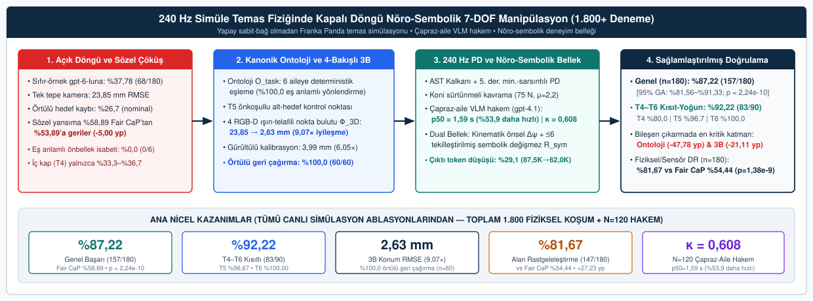
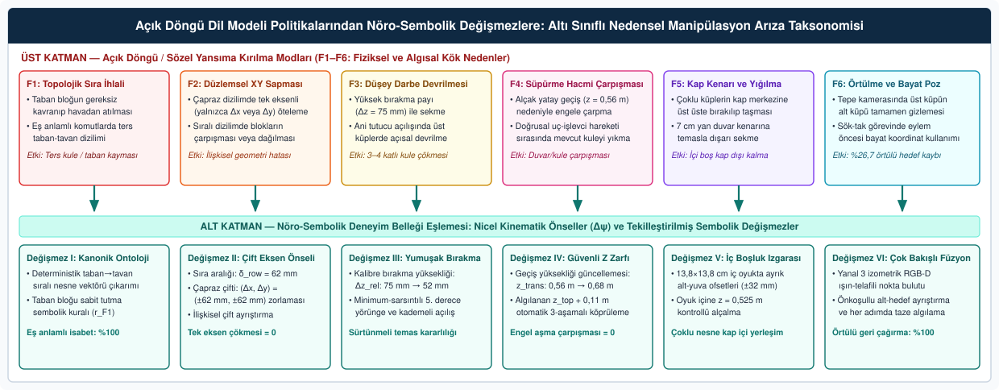
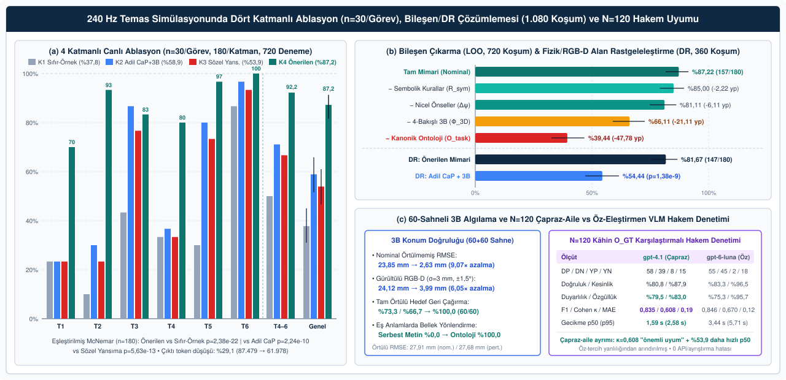

# Simüle Edilmiş Sürtünmeli Temas Fiziği Altında Kapalı Döngü Nöro-Sembolik Deneyim Kalibrasyonu, Çok Bakışlı 3B Nokta Bulutu Algılama ve Kanonik Görev Ontolojisi

**Muhammed Emin Çelik, Barış Kaya, Mahmut Öztürk ve İsmail İşeri\***

Bilgisayar Mühendisliği Bölümü, Ondokuz Mayıs Üniversitesi, Samsun, Türkiye  
E-posta: `muhammedemin.celik@omu.edu.tr`, `baris.kaya@omu.edu.tr`, `mahmut.ozturk@omu.edu.tr`, `ismail.iseri@omu.edu.tr` (*Sorumlu Yazar)

## Öz

Büyük dil modelleri aracılığıyla doğrudan yürütülebilir robotik kontrol politikaları sentezleyen açık döngü (*open-loop*) yaklaşımlar, algısal derinlik sapmaları, fiziksel sürtünme belirsizlikleri ve eş anlamlı doğal dil komutlarında ortaya çıkan bellek parçalanması nedeniyle temas açısından zengin masaüstü manipülasyon görevlerinde ciddi başarısızlıklar sergilemektedir. Öte yandan, başarısız denemelerden sonra istem metnine ham sözel özeleştiri (*verbal self-reflection*) cümleleri ekleyen yansıma mekanizmaları, nicel kinematik parametreleri güncelleyemedikleri gibi bağlam penceresi şişmesine yol açarak fiziksel başarıyı başlangıç politikasının da altına düşürebilmektedir. Bu çalışmada, 240 Hz PyBullet simülasyon ortamında yedi serbestlik dereceli (7-DOF) Franka Emika Panda manipülatörü üzerinde yapay sabit-bağ (*weld constraint*) yamaları veya poz ışınlaması olmaksızın koni sürtünmesi ($F_{\text{grasp}} = 75$ N, $\mu = 2,2$) fiziği altında çalışan kapalı döngü (*closed-loop*) bir nöro-sembolik deneyim kalibrasyonu mimarisi önerilmektedir. Çerçeve dört temel bileşeni bütünleştirmektedir: serbest biçimli komutları altı kanonik uzamsal görev ailesine ve doğrulanabilir alt-hedef kontrol noktalarına eşleyen deterministik görev ontolojisi ($\mathcal{O}_{\text{task}}$), dört kalibre RGB-D kameradan aydınlanma-değişmez kromatik oranlama ve örtülme altında yanal ışın telafisiyle 3B merkez kestirimi yapan nokta bulutu algılayıcısı ($\Phi_{\text{3D}}$), soyut sözdizimi ağacı (AST) güvenlik kalkanı ile minimum-sarsıntılı (*minimum-jerk*) beşinci derece eklem yörüngesi takipçisi ($\mathcal{C}_{\text{PD}}$) ve politika sentezleyicisinden (`gpt-6-luna`) mimari olarak ayrıştırılmış çapraz-aile çok kipli algısal hakem ($\mathcal{J}_{\text{VLM}}$, `gpt-4.1`) bulgularını hem nicel kinematik önsellere hem de tekilleştirilmiş sembolik değişmezlere dönüştüren nedensel deneyim belleği ($\mathcal{M}_{\text{NS}}$). Altmış rastgele sahneli 3B algılama kıyaslamasında $\Phi_{\text{3D}}$, tekil tepe kamerasına kıyasla örtülmemiş 3B konumlandırma karesel ortalama hatasını (RMSE) nominal koşullarda 23,85 mm'den 2,63 mm'ye (9,07 kat), derinlik ve kalibrasyon gürültüsü ($\sigma_d = 3,0$ mm, $\pm 3,0$ mm / $\pm 1,5°$) altında ise 24,12 mm'den 3,99 mm'ye (6,05 kat) düşürerek her iki rejimde de istiflenmiş örtülü hedeflerde %100,0 (60/60) geri çağırma elde etmektedir. Görev başına $n = 30$ görülmemiş tohum içeren dört katmanlı canlı manipülasyon kıyaslamasında ($4 \times 180 = 720$ simülasyon koşumu) önerilen mimari **%87,22 (157/180; %95 Wilson GA [81,56, 91,33])** genel başarıya ulaşarak sıfır-örnek açık döngüyü (%37,78; eşleştirilmiş McNemar $p = 2,38 \times 10^{-22}$), aynı çok bakışlı algılayıcıya sahip adil Code-as-Policies temel çizgisini (%58,89; $p = 2,24 \times 10^{-10}$) ve yapılandırılmamış sözel yansımayı (%53,89; $p = 5,63 \times 10^{-13}$) açık farkla geride bırakmakta; sözel yansımanın istem şişmesiyle Fair CaP'ın 5,00 puan altına gerilediğini gösterirken önerilen bellek çıktı token sayısını %29,1 azaltmaktadır. Kısıt-yoğun `T4`–`T6` görevlerinde başarı %92,22'ye (83/90) yükselmekte; ilave 1.080 koşumlu bileşen çıkarma ve fiziksel/sensör alan rastgeleleştirmesi (DR) deneylerinde ontoloji çıkarmasının (-47,78 puan) en kritik katman olduğu ve sistemin DR altında da %81,67 başarıyla Adil CaP'a (%54,44; $p = 1,38 \times 10^{-9}$) +27,23 puan fark attığı doğrulanmaktadır. Ayrıca $N = 120$ eşleştirilmiş denemede çapraz-aile hakem `gpt-4.1`, simülatör gerçek-durum kâhinine ($\mathcal{O}_{\text{GT}}$) karşı $\kappa = 0,6082$ uyum (%87,88 kesinlik, %79,45 duyarlılık, %82,98 özgüllük) sağlarken aynı-aile öz-eleştirmene (`gpt-6-luna`) göre medyan değerlendirme gecikmesini %53,9 (3,44 s $\to$ 1,59 s) düşürmektedir.

**Anahtar Kelimeler:** Bedenlenmiş yapay zekâ, çok bakışlı 3B nokta bulutu algılama, görsel-dil modelleri, kanonik görev ontolojisi, kapalı döngü robotik manipülasyon, nöro-sembolik deneyim kalibrasyonu, simüle sürtünmeli temas kontrolü.

## I. GİRİŞ

Fiziksel dünyada yapılandırılmamış doğal dil emirlerini algısal gözlemler ve temas kuvvetleri altında güvenilir motor eylemlere dönüştürmek, modern robotik manipülasyonun en çetin açık problemlerinden birini oluşturmaktadır [1], [2]. Klasik bütünleşik görev ve hareket planlama (TAMP) yaklaşımları, tam tanımlı geometrik sahne modelleri ve el yapımı sembolik önkoşul tanımları bulunduğunda uzun ufuklu manipülasyon dizilerini matematiksel tutarlılıkla çözebilmektedir [3]. Ne var ki açık uçlu masaüstü ortamlarda serbest biçimli kullanıcı ifadelerinin sembolik mantıksal yüklemlere eşlenmesi ve örtülme içeren kamera gözlemlerinden kusursuz durum kestirimi yapılması TAMP sistemlerinin pratik genellenebilirliğini sınırlamaktadır. Son yıllarda büyük dil modellerinin (LLM) ortak sağduyu ve programlama yeteneklerinden yararlanan eylem temellendirme [4], kod-politika (*code-as-policies*) sentezi [5], [6] ve üç boyutlu değer haritası üretimi [7] yaklaşımları, ek yörünge eğitimi gerektirmeksizin doğal dil komutlarından doğrudan robot kontrol betikleri üretebilmiştir. Benzer biçimde çok kipli bedenlenmiş temel modeller [8], [9], görsel gözlemler ile dil temsillerini uçtan uca eylem dizilerine bağlamada önemli ilerlemeler kaydetmiştir.

Bununla birlikte sıfır-örnek açık döngü kod-politika sentezi, temas açısından zengin rijit cisim fiziği altında üç temel yapısal darboğazla karşılaşmaktadır. İlk olarak açık döngü politikalar, yörünge yürütümü sırasında oluşan algısal derinlik sapmalarına, paralel çeneli tutucudan kaymalara ve süpürme hacmi (*swept-volume*) çarpışmalarına karşı geri bildirimden yoksundur; tekil tepe kamerasından elde edilen yüzey derinliği nesnenin geometrik kütle merkezini yansıtmadığı gibi, üst üste istiflenmiş nesnelerde alttaki hedef tamamen görünmez hale gelmektedir. İkinci olarak, yürütme sonrası kapalı döngü düzeltme sağlamak amacıyla önerilen içsel monolog [10], deneyim özetleme [11] ve sözel pekiştirmeli yansıma [12], [13] yöntemleri, hata geri bildirimini yapılandırılmamış ham metin yığınları olarak istem penceresine eklemektedir. Üretken dil modellerinde iyi bilinen halüsinasyon eğilimi [14] ve uzun bağlam pencerelerinde orta bölgedeki kısıtların dikkat ağırlığını yitirmesi (*lost-in-the-middle*) [15], ardışık denemelerde biriken sözel tavsiyelerin birbiriyle çelişmesine ve sayısal kinematik parametrelerin (güvenli geçiş irtifası, bırakma yüksekliği payı, çift eksenli dizilim aralığı) kararsızlaşmasına neden olmaktadır. Üçüncü olarak, kalibre edilen becerilerin dil modelinin serbestçe ürettiği fonksiyon adları altında saklanması, aynı fiziksel görevin eş anlamlı bir ifadeyle tekrar istendiği anda önbellek ıskasına (bölünmüş beyin / *split-brain* bellek parçalanması) yol açarak öğrenilen deneyimi işlevsiz bırakmaktadır.

Bu yapısal kısıtları aşmak için istatistiksel dil modellerinin esnek semantik ayrıştırma kapasitesini deterministik sembolik değişmezler ve fiziksel kinematik önsellerle birleştiren nöro-sembolik bilişsel mimariler güçlü bir kuramsal çerçeve sunmaktadır [16], [17], [18]. Bu makalede, 240 Hz PyBullet simülasyonunda 7-DOF Franka Emika Panda kolu üzerinde yapay sabit-bağ (*weld constraint*) veya küp ışınlaması gibi fizik dışı kısayolları tamamen ortadan kaldıran, yalnızca kalibre RGB-D kamera gözlemleri ve sürtünmeli paralel-çene temasıyla çalışan kapalı döngü bir nöro-sembolik manipülasyon mimarisi sunulmaktadır. Çalışmanın literatüre sunduğu dört özgün katkı şu şekilde özetlenmektedir. İlk olarak, serbest biçimli Türkçe ve İngilizce manipülasyon emirlerini altı kanonik uzamsal görev ailesine ve doğrulanabilir önkoşul alt-hedeflerine eşleyen deterministik bir görev ontolojisi ($\mathcal{O}_{\text{task}}$) tasarlanarak eş anlamlı komutlardaki bellek yönlendirme isabeti %0,0'dan (0/6) %100,0'a (6/6) çıkarılmıştır. İkinci olarak, dört kalibre RGB-D kameradan aydınlanma-değişmez kromatik oranlama yapan ve tepe örtülmesi altında yanal izometrik bakış ışını boyunca geometrik yarı-kalınlık telafisi uygulayan bir 3B nokta bulutu algılama modülü ($\Phi_{\text{3D}}$) geliştirilerek örtülmemiş 3B konumlandırma RMSE hatası nominal sahnelerde 23,85 mm'den 2,63 mm'ye (9,07 kat), sensör ve dışsal kalibrasyon gürültüsü altında 24,12 mm'den 3,99 mm'ye (6,05 kat) indirilmiş ve örtülü nesne yakalama oranı %100,0'a ulaştırılmıştır. Üçüncü olarak, algısal hata teşhislerini hem nicel kinematik önsellere ($\Delta\psi$) hem de tekilleştirilmiş sembolik değişmezlere ($\mathcal{R}_{\text{sym}}$) dönüştüren çift kanallı nedensel deneyim belleği ($\mathcal{M}_{\text{NS}}$) ile minimum-sarsıntılı beşinci derece PD yörünge kontrolcüsü ($\mathcal{C}_{\text{PD}}$) bütünleştirilerek 1.800 canlı simülasyon koşumu (720 dört-katmanlı + 1.080 bileşen/alan rastgeleleştirme) üzerinden genel başarı %87,22'ye (Adil Code-as-Policies + Çok Bakışlı 3B: %58,89; $p = 2,24 \times 10^{-10}$), kısıt-yoğun `T4`–`T6` başarısı %92,22'ye ve fiziksel/sensör alan rastgeleleştirmesi başarısı %81,67'ye (%54,44'e karşı $p = 1,38 \times 10^{-9}$) taşınmıştır. Dördüncü olarak, kendi kendini onaylama yanlılığını (*self-preference bias*) önlemek üzere politika sentezleyicisinden (`gpt-6-luna`) mimari olarak ayrıştırılan akıl yürütmesiz yoğun çok kipli hakem (`gpt-4.1`), $N = 120$ eşleştirilmiş denemede simülatör gerçek-durum kâhinine ($\mathcal{O}_{\text{GT}}$) karşı aynı-aile öz-eleştirmenle karşılaştırmalı olarak denetlenerek $\kappa = 0,6082$ uyum ve %53,9 daha düşük medyan gecikme (1,59 s'ye karşı 3,44 s) sergilediği nicel olarak kanıtlanmıştır.

## II. İLGİLİ ÇALIŞMALAR

### A. Görev ve Hareket Planlama ile Kod-Politika Sentezi

Klasik hiyerarşik görev ve hareket planlama yaklaşımları, ayrık sembolik eylem şemalarını sürekli geometrik kısıt çözücülerle birleştirerek uzun ufuklu manipülasyon problemlerini alt problemlere ayırmıştır [19], [20]. İyimser örnekleme tabanlı akış planlayıcıları [21], sembolik önkoşullar ile çarpışmasız yörünge örnekleyicilerini sıkı biçimde bağlasa da her yeni nesne topolojisi için uzman tarafından kodlanmış alan tanımları gerektirmektedir. Büyük dil modellerinin sıfır-örnekli eylem planlayıcıları olarak kullanılması [22], doğal dil talimatlarının doğrudan yüksek seviyeli adım dizilerine çevrilmesini sağlamış; ancak fiziksel yapılabilirlik denetimi olmadığında geometrik açıdan imkânsız planlar üretilmiştir. Bu açığı kapatmak üzere eylem olasılıklarını değer fonksiyonlarıyla ağırlıklandıran temellendirme yöntemleri [4] ve geometrik uygulanabilirlik kestirimcileri [23] geliştirilmiştir. Öte yandan dil modellerinin doğrudan Python tabanlı kontrol politikaları üretmesi [5], [6], aritmetik ofset hesaplarının ve parametrik beceri çağrılarının tek bir sentez adımında ifade edilmesine olanak tanımış; kişiselleştirilmiş masaüstü düzenleme [24] ve gerçek zamanlı etkileşimli yönlendirme [25] sistemlerinde esneklik sağlamıştır. Ancak mevcut kod-politika çerçeveleri çoğunlukla açık döngü çalışmakta ya da simülasyon ortamında nesnelerin tutucuya yapay sabit-bağlarla kenetlendiği basitleştirilmiş kinematik varsayımlara dayanmaktadır; önerilen mimari ise statik AST güvenlik doğrulamasını gerçek sürtünmeli temas fiziği ve kapalı döngü önsel kalibrasyonuyla birleştirmektedir.

### B. Çok Bakışlı 3B Algılama, Temas Tabanlı Kavrama ve Yörünge Kontrolü

Görsel gözlemlerden hassas manipülasyon pozları kestirmek amacıyla taşıyıcı ağlar [26], görsel-dil özellik birleştiricileri [27] ve çok bakışlı voksel dönüştürücüleri [28] önemli başarılar elde etmiştir. Ölçekli gerçek dünya dönüştürücüleri [29] ve eylem difüzyon politikaları [30] binlerce gösterim yörüngesinden kapalı döngü motor kontrolü öğrenebilmekte; açık-sözlüklü (*open-vocabulary*) görsel-dil temsilleri [31] ile nokta bulutu işleme teknikleri [32] birleştirildiğinde 3B uzamsal temellendirme güçlenmektedir. Ne var ki eğitim gerektirmeyen sıfır-örnek çerçevelerde tekil tepe RGB-D kameradan yapılan naif derinlik geri-projeksiyonu, nesnenin yalnızca üst yüzeyini görerek kütle merkezinde sistematik Z sapması yaratmakta ve istiflenmiş bloklarda tam örtülme hatasına düşmektedir. Fiziksel yürütme katmanında ise kararlı kavrama, paralel parmak yüzeyleri arasındaki sürtünme konisi kısıtlarının ve kuvvet kapanımı (*force-closure*) koşullarının sağlanmasını gerektirir [33], [34], [35]. İnsan kol hareketlerinin koordinasyonunda gözlemlenen minimum-sarsıntılı (*minimum-jerk*) beşinci derece yörünge profilleri [36], yedi serbestlik dereceli tork/konum kontrollü manipülatörlerde [37] ani ivme sıçramalarını bastırarak tutucu içindeki nesnenin kaymasını önlemektedir. Rijit cisim temas çözücüleri [38], alan rastgeleleştirmesi [39] ve standart manipülasyon kıyaslama ortamları [40] üzerinde yapılan çalışmalar, yapay kavrama kısıtları kaldırıldığında açık döngü politikaların darbe devrilmesi ve kenar çarpışması nedeniyle hızla çöktüğünü göstermektedir. Çalışmamızda dört bakışlı ışın-telafili nokta bulutu füzyonu ile minimum-sarsıntılı PD eklem takibi bütünleştirilerek bu fiziksel boşluk doğrudan kapatılmaktadır.

### C. Görsel-Dil Eleştirmenleri, Deneyim Belleği ve Hakem Güvenilirliği

Açık uçlu ajanlarda beceri kütüphanelerinin kod düzeyinde büyütülmesi [41] ve ödül fonksiyonlarının evrimsel kod senteziyle iyileştirilmesi [42], dil modellerinin yürütme geri bildiriminden öğrenebileceğini göstermiştir. Robotik ortamda görsel-dil modellerinin sıfır-örnekli ödül eleştirmenleri olarak kullanılması [43], ek ödül mühendisliği gerektirmeksizin görev başarısının görsel sahneden tahmin edilmesini mümkün kılmaktadır. Bununla birlikte yansıma tabanlı dil ajanları [11], [12], [13], hata geçmişini yapılandırılmamış serbest metin olarak biriktirdiklerinde hem bağlam penceresi bozulmasına [15] hem de eş anlamlı komutlarda bellek erişim kaybına uğramaktadır. Daha da kritik olarak, üretken modellerin hakem rolünde kullanıldığı değerlendirme döngülerinde [44] aynı model ailesinin hem politika üreticisi hem de yargıç olması şişirilmiş sahte-başarı onaylarına yol açabilmektedir. Bu nedenle görsel veya algısal hakemlerin bağımsız bir fiziksel gerçek-durum referansına karşı şans düzeltmeli uyum katsayılarıyla [45], [46] denetlenmesi bilimsel geçerlilik açısından zorunludur. Önerilen mimari, çapraz-aile algısal hakem tasarımını kanonik görev ontolojisi indeksli çift kanallı nöro-sembolik bellekle birleştirerek hem istem şişmesini ortadan kaldırmakta hem de hakem güvenilirliğini simülatör gerçek-durum kâhini üzerinden nicel olarak doğrulamaktadır.

## III. AÇIK DÖNGÜ VE SÖZEL YANSIMA POLİTİKALARININ AMPİRİK ARIZA TAKSONOMİSİ

Fiziksel temas tabanlı masaüstü manipülasyonda açık döngü kod-politika sentezinin ve yapılandırılmamış sözel yansımanın neden başarısız olduğunu anlamak amacıyla, 240 Hz rijit cisim simülasyonunda yapay kavrama yamaları kapatılarak yürütülen ön tanısal denemeler incelenmiş ve altı ayrık nedensel arıza sınıfından (`F1`–`F6`) oluşan bir taksonomi tanımlanmıştır. Söz konusu arıza modları, algısal kök nedenleri ve önerilen nöro-sembolik mimarideki karşılık gelen değişmez eşlemeleri Şekil 1'de görselleştirilmekte, nicel tanı ölçütleri ise Tablo I'de özetlenmektedir.

İlk kırılma modu olan topolojik sıra ihlali (`F1`), çok katlı kule inşasında dil modelinin taban bloğu masada sabit bırakmak yerine gereksiz biçimde kavrayıp havadan bırakması ya da eş anlamlı Türkçe/İngilizce komutlarda taban-tavan sırasını tersine çevirmesi sonucu oluşmaktadır. İkinci kırılma modu olan düzlemsel XY sapması (`F2`), doğrusal sıra diziliminde blokların birbirine çarpmasına veya çapraz çift yerleştirme görevlerinde dil modelinin her iki yatay eksen yerine yalnızca tek eksende ($\Delta x$ veya $\Delta y$) öteleme yaparak doğrusal dizilime çökmesine yol açmaktadır. Üçüncü kırılma modu olan düşey darbe devrilmesi (`F3`), varsayılan yüksek bırakma payı ($\Delta z_{\text{rel}} = 75$ mm) nedeniyle üst katlara bırakılan küplerin alt bloğa çarparak sekmesi ve ani parmak açılışı sırasında kuleyi devirmesidir.

**Tablo I.** Temas Tabanlı Manipülasyonda Altı Sınıflı Nedensel Arıza Taksonomisi, Fiziksel Kök Nedenler ve Nöro-Sembolik Kalibrasyon Eşlemeleri

| Sınıf | Arıza Modu Tanımı | Fiziksel ve Algısal Kök Neden | Gerçek-Durum Kâhini ($\mathcal{O}_{\text{GT}}$) Tanı Ölçütü | Nöro-Sembolik Bellek ($\mathcal{M}_{\text{NS}}$) Güncellemesi |
| :--: | :-- | :-- | :-- | :-- |
| **F1** | Topolojik Sıra İhlali | Taban bloğun gereksiz kavranması veya ters taban-tavan dizilimi | Hedef katman sırası ile gerçekleşen $z$ sırasının uyuşmaması | Deterministik sıra vektörü ve taban bloğu sabit tutma aksiyomu ($r_{\text{F1}}$) |
| **F2** | Düzlemsel XY Sapması | Çapraz görevde tek eksenli öteleme veya yetersiz sıra aralığı | $\|\Delta x\| < 30$ mm $\lor$ $\|\Delta y\| < 30$ mm ya da merkez kayması $> 38$ mm | Sıra aralığı $\delta_{\text{row}} = 62$ mm ve çift eksen çapraz önseli ($\pm 62$ mm, $\pm 62$ mm) |
| **F3** | Düşey Darbe Devrilmesi | Yüksek bırakma payı ($\Delta z_{\text{rel}} = 75$ mm) nedeniyle çarpma ve sekme | Üst bloğun temas sonrası açısal devrilmesi ve masa yüzeyine düşmesi | Bırakma payının $\Delta z_{\text{rel}} \leftarrow 52$ mm'ye çekilmesi ve yumuşak alçalma ($r_{\text{F3}}$) |
| **F4** | Süpürme Hacmi Çarpışması | Alçak geçiş irtifası ($z_{\text{trans}} = 0,56$ m) ile engel duvarına çarpma | Uç-işlevci veya taşınan küpün engel duvarı ya da mevcut kuleyi yıkması | Güvenli geçiş irtifasının $z_{\text{trans}} \leftarrow 0,68$ m'ye yükseltilmesi ($r_{\text{F4}}$) |
| **F5** | Kap Kenarı ve Yığılma | Çoklu nesnelerin içi boş kabın tam merkezine üst üste bırakılması | Küplerin $13,8 \times 13,8$ cm iç oyuk dışına sekmesi veya kenarda asılı kalması | Ayrık iç alt-yuva koordinatları ($\pm 32$ mm) ve $z = 0,525$ m oyuk içi bırakma ($r_{\text{F5}}$) |
| **F6** | Örtülme ve Bayat Poz | Tepe kamerasında alt küpün gizlenmesi veya eylem öncesi pozun tekrarı | İstif altında hedef kaybı veya sök-tak adımında boşa kavrama kapanışı | Yanal ışın-telafili 3B füzyon ($\Phi_{\text{3D}}$) ve önkoşul kontrol noktası ayrıştırması |

Dördüncü kırılma modu olan süpürme hacmi çarpışması (`F4`), alçak yatay geçiş yüksekliği ($z_{\text{trans}} = 0,56$ m) kullanıldığında uç-işlevcinin veya taşınan nesnenin $z = 0,53$ m tepe kotlu fiziksel engel duvarına ya da sahnedeki mevcut kuleye çarpmasıdır. Beşinci kırılma modu olan kap kenarı ve yığılma hatası (`F5`), beş parçalı içi boş bir kutuya birden fazla nesne yerleştirilirken tüm blokların aynı merkez koordinatına bırakılması sonucunda küplerin $70$ mm yüksekliğindeki yan duvarlardan dışarı sekmesi olarak ortaya çıkmaktadır. Altıncı kırılma modu olan örtülme ve bayat poz hatası (`F6`) ise üstteki bir bloğun alttaki bloğu tepe kamerasından tamamen gizlemesi veya çok adımlı sök-tak görevlerinde ilk adımda değişen sahne geometrisinin yeniden algılanmaması nedeniyle tutucunun boş uzayı kavramasıdır. Yapılandırılmamış sözel yansıma yöntemleri bu altı fiziksel arızayı yalnızca genel geçer metin tavsiyeleriyle ele aldığından hem nicel geçiş/bırakma irtifalarını düzeltememekte hem de eş anlamlı görev ifadelerinde belleği doğru anahtara yönlendirememektedir.

## IV. ÖNERİLEN KAPALI DÖNGÜ NÖRO-SEMBOLİK MANİPÜLASYON MİMARİSİ

Önerilen kapalı döngü nöro-sembolik robotik manipülasyon mimarisinin uçtan uca bilgi akışı Şekil 2'de gösterilmektedir. Sistem; kanonik uzamsal görev ontolojisi ($\mathcal{O}_{\text{task}}$), dört bakışlı 3B nokta bulutu algılayıcısı ($\Phi_{\text{3D}}$), AST doğrulamalı önsel-koşullu politika sentezleyicisi ($\pi_\theta$), minimum-sarsıntılı 7-DOF PD yörünge ve sürtünmeli temas yürütücüsü ($\mathcal{C}_{\text{PD}}$), çapraz-aile algısal hakem ($\mathcal{J}_{\text{VLM}}$) ve çift kanallı nedensel deneyim belleği ($\mathcal{M}_{\text{NS}}$) bileşenlerinden oluşmaktadır.

### A. Kısmi Gözlemlenebilir Manipülasyon Formülasyonu ve Kanonik Görev Ontolojisi

Masaüstü fiziksel manipülasyon problemi, gerçek simülatör durumunun $s_t \in \mathcal{S}$ ajan tarafından doğrudan gözlemlenemediği, bunun yerine dört kalibre RGB-D kameradan alınan görüntü ve derinlik demetleri $o_t = \{(I_t^{(v)}, D_t^{(v)})\}_{v=1}^{4}$ üzerinden kestirildiği kapalı döngü bir karar süreci olarak modellenmektedir. İterasyon $k$ ve görev komutu $u$ için birleşik kapalı döngü politika eşlemesi Eşitlik (1) ile tanımlanır:

$$
a_t = \mathcal{C}_{\text{PD}}\!\left(\pi_\theta\!\left(\Phi_{\text{3D}}(o_t),\, \mathcal{O}_{\text{task}}(u),\, \psi_k,\, \mathcal{R}_{\text{sym}}\right)\right) \tag{1}
$$

Burada $\psi_k \in \mathbb{R}^5$ kalibre edilmiş nicel kinematik önsel vektörünü, $\mathcal{R}_{\text{sym}}$ ise görev ailesine özgü tekilleştirilmiş sembolik değişmezler kümesini temsil etmektedir. Serbest biçimli doğal dil komutlarında dil modelinin rastgele fonksiyon adları üretmesinden kaynaklanan bellek parçalanmasını önlemek amacıyla deterministik kanonik görev ontolojisi $\mathcal{O}_{\text{task}}$, iki dilli (Türkçe/İngilizce) emir dizgesi $u$'yu Eşitlik (2)'deki yapılandırılmış sembolik görev demetine dönüştürür:

$$
\mathcal{O}_{\text{task}}(u) = g_{\text{task}} = \langle \tau_{\text{fam}},\, \mathbf{b}_{\text{ord}},\, \mathcal{P}_{\text{rel}},\, c_{\text{box}},\, \mathcal{G}_{\text{sub}} \rangle \tag{2}
$$

Eşitlik (2)'de $\tau_{\text{fam}} \in \{\text{T1}, \dots, \text{T6}\}$ altı kanonik uzamsal görev ailesinden birini (`T1`: sıralı kule istifleme, `T2`: doğrusal sıra hizalama, `T3`: çapraz çift yerleştirme, `T4`: içi boş kap içine çoklu nesne yerleştirme, `T5`: önkoşullu sök-tak ve sıra tersleme, `T6`: fiziksel engel duvarı aşarak istifleme), $\mathbf{b}_{\text{ord}}$ metin içi geçiş sırasına ve yön belirteçlerine göre deterministik olarak çıkarılan taban-tavan nesne vektörünü, $\mathcal{P}_{\text{rel}}$ ilişkisel hedef-referans çiftlerini ve $c_{\text{box}}$ hedef kap varlığını göstermektedir. Önkoşul bağımlılığı içeren `T5` görev ailesinde (örneğin mavi bloğun başlangıçta kırmızı bloğun üzerinde oturduğu, ancak hedef durumun kırmızı bloğun mavi blok üzerine konmasını gerektirdiği durum) ontoloji katmanı görevi $\mathcal{G}_{\text{sub}} = (g_1, g_2)$ şeklinde iki doğrulanabilir alt-hedef kontrol noktasına ayırmaktadır: $g_1$ üstteki engelleyici bloğun masadaki serbest bir geçici bölgeye indirilmesini, $g_2$ ise yeniden algılanan güncel 3B koordinatlar üzerinden nihai istiflemenin tamamlanmasını zorunlu kılar.

### B. Çok Bakışlı Işın-Telafili 3B Nokta Bulutu Algılama

Çalışma alanı, masa merkezine yönlendirilmiş bir tepe kamerası ve üç yanal izometrik kamera ($640 \times 480$ çözünürlük) olmak üzere bilinen içsel ($K_v$) ve dışsal ($T_{w \leftarrow c_v} \in SE(3)$) matrislerle kalibre edilmiş dört RGB-D sensör ile gözlemlenmektedir. Kamera $v$'deki geçerli bir $(u_p, v_p)$ pikseli ve doğrusal derinlik ölçümü $d_p$ için dünya çerçevesindeki 3B nokta geri-projeksiyonu Eşitlik (3) uyarınca hesaplanır:

$$
\mathbf{p}_w(u_p, v_p) = T_{w \leftarrow c_v} \begin{bmatrix} d_p K_v^{-1} [u_p,\, v_p,\, 1]^\top \\ 1 \end{bmatrix} \tag{3}
$$

Farklı bakış açılarındaki gölge ve parlaklık değişimlerine karşı gürbüz renk bölütlemesi sağlamak amacıyla ham RGB eşiklemesi yerine aydınlanma-değişmez kromatik oran süzgeci uygulanmaktadır; her renk kanalı için baskın kanal oranı $\rho_c = I_c / (\Sigma_{j \in \{R,G,B\}} I_j + \varepsilon)$ ve kanal fark marjları değerlendirilerek nesne maskesi elde edilmektedir. Görünür nesne piksellerinin dört kameradan birleştirilen 3B nokta bulutu $\mathcal{P}_{\text{vis}}$ oluşturulduğunda, nesnenin tepe kamerasından açıkça görülebildiği ($|\mathcal{P}_{\text{top}}| \ge N_{\min}$) durumlarda %88 medyan-merkezli aykırı uç budaması uygulanmakta ve üst yüzey derinliğinden nesne yarı-kalınlığı düşülerek merkez kestirilmektedir. Buna karşılık istiflenmiş bir kulenin alt katmanındaki hedef blok üstteki blok tarafından tepe kamerasına karşı tamamen örtüldüğünde ($|\mathcal{P}_{\text{top}}| < N_{\min}$), yanal kameralar nesnenin yalnızca kendisine bakan dış yan yüzeylerini görmektedir. Bu yüzey-merkez sapmasını gidermek amacıyla $\Phi_{\text{3D}}$, her yanal kameranın birim bakış ışını $\mathbf{u}_{\text{ray}}^{(v)}$ boyunca nesne yarı-genişliği $r_{\text{half}}$ ile ölçeklenmiş geometrik ışın telafisini Eşitlik (4) ile uygular:

$$
\hat{\mathbf{p}}_{xy} = \operatorname{med}_{v \in \mathcal{V}_{\text{lat}}}\!\left(\operatorname{med}(\mathcal{P}_{\text{lat}}^{(v)})_{xy} + \eta\, r_{\text{half}}\, \mathbf{u}_{\text{ray},xy}^{(v)}\right) \tag{4}
$$

Burada $\eta = 0,82$ izometrik yan yüzey görünürlük katsayısını, $r_{\text{half}} = 25$ mm ise blok yarı-genişliğini ifade etmektedir; düşey merkez bileşeni ise yanal nokta bulutunun üst yüzdelik diliminden $\hat{p}_z = P_{88}(\mathcal{P}_{\text{lat},z}) - 0,55\,r_{\text{half}}$ olarak kestirilmektedir. Böylece simülatörün içsel nesne pozlarına hiçbir erişim yapılmaksızın hem açık hem de örtülü nesneler milimetre altı-üstü hassasiyetle 3B dünya koordinatlarına taşınmaktadır. Mimari açıdan kromatik oran süzgeci ($\rho_c$), 3B geri-projeksiyon (Eşitlik 3) ve yanal bakış ışını telafisi (Eşitlik 4) katmanlarından tamamen yalıtılmış modüler bir 2B örnek-maskeleme ön-yüzü (*modular 2D instance-masking front-end*) olarak tasarlanmıştır; gerçek donanımdaki dokulu veya çok renkli nesnelerde yalnızca bu 2B maske üreticisinin açık-sözlüklü bölütleme modelleriyle (*open-vocabulary instance segmentation*, örn. bölge-tabanlı görsel-dil maskeleri [31] veya Grounded-SAM türevleri) değiştirilmesi halinde Eşitlik (3) ve Eşitlik (4)'teki çok bakışlı nokta bulutu füzyonu ve ışın-telafili merkez kestirimi hiçbir matematiksel değişiklik gerektirmeksizin aynen çalışmaktadır.

### C. AST Güvenlik Kalkanı, Minimum-Sarsıntılı PD Kontrol ve Sürtünmeli Temas

Politika sentezleyicisi $\pi_\theta$, algılanan 3B nesne koordinatları $\hat{\mathbf{X}}_t$, kanonik görev demeti $g_{\text{task}}$, kalibre kinematik önsel vektörü $\psi_k = [z_{\text{trans}}, \Delta z_{\text{rel}}, \delta_{\text{row}}, \delta_{\text{diag}}, F_{\text{grasp}}]^\top$ ve sembolik kurallar kümesi $\mathcal{R}_{\text{sym}}$ ile koşullandırılarak deterministik ($T = 0$) bir Python eylem dizisi üretir. Sentezlenen kod yürütülmeden önce statik bir soyut sözdizimi ağacı (AST) doğrulayıcısından geçirilir; yalnızca beş atomik manipülasyon eylemine (nesne kavrama, 3B hedefe taşıma, nesne bırakma, göreli eksen öteleme ve güvenli başlangıç pozuna dönme) ve temel aritmetik ifadelere izin verilirken döngüler, modül içe aktarmaları, nitelik erişimleri ve yerleşik sistem çağrıları reddedilir.

Fiziksel yürütme katmanında ($\mathcal{C}_{\text{PD}}$), sahnedeki engellere veya mevcut kulelere çarpmayı önlemek üzere iki nokta arasındaki yatay mesafe $\|\Delta \mathbf{p}_{xy}\|_2 > 40$ mm olduğunda hareket üç aşamalı güvenli-Z köprüleme zarfına ayrıştırılır. Algılanan tüm nesne ve engel tepe noktaları $\hat{z}_{\text{top}}^{(i)}$ üzerinden güvenli yatay geçiş irtifası Eşitlik (5) ile belirlenir:

$$
z_{\text{safe}} = \max\!\left(z_{\text{trans}},\, \max_{i} \hat{z}_{\text{top}}^{(i)} + h_{\text{clear}},\, z_{\text{start}} + \delta_{\text{lift}},\, z_{\text{goal}} + \delta_{\text{lift}}\right) \tag{5}
$$

Burada $h_{\text{clear}} = 0,11$ m taşınan blok ve tutucu parmak payını, $\delta_{\text{lift}} = 0,04$ m ise yerel kalkış payını göstermektedir. Ters kinematik ile çözülen hedef eklem açıları $\mathbf{q}_d \in \mathbb{R}^7$, sürekli hız ve ivme sınır koşulları sağlayan beşinci derece minimum-sarsıntılı zaman ölçekleme polinomu ve 240 Hz konum-türev (PD) eklem kontrol yasası ile Eşitlik (6) uyarınca sürülür:

$$
s(\tau) = 10\tau^3 - 15\tau^4 + 6\tau^5, \quad \mathbf{u}_{\text{PD}}(t) = K_p(\mathbf{q}_{\text{ref}}(t) - \mathbf{q}(t)) - K_d \dot{\mathbf{q}}(t) \tag{6}
$$

Burada $\tau = t / T_{\text{seg}} \in [0, 1]$ normalize hareket zamanını, $K_p = 0,28$ ve $K_d = 1,05$ ise $240$ N azami eklem kuvvetiyle sınırlandırılmış PD kazançlarını temsil etmektedir. Kavrama eylemi sırasında paralel çene parmakları (bağ 9 ve 10) yüksek yanal sürtünme katsayılı ($\mu = 2,2$) elastomerik yüzeylerle $F_{\text{grasp}} = 75$ N kuvvet altında kapatılır ve her iki parmağın da aynı fiziksel gövde üzerinde sıfırdan büyük temas normal kuvveti ($f_n^{(L)} > 0 \land f_n^{(R)} > 0$) ürettiği doğrulandıktan sonra kaldırma aşamasına geçilir; simülasyonun hiçbir aşamasında yapay sabit-bağ kısıtı oluşturulmaz.

### D. Çapraz-Aile Algısal Hakem ve Çift Kanallı Nöro-Sembolik Deneyim Belleği

Politika yürütümü tamamlandığında sahnenin nihai durumu, kendi kendini onaylama (*self-preference*) yanlılığını engellemek üzere akıl yürütme tabanlı politika sentezleyicisinden (`gpt-6-luna`) nesilsel ve mimari olarak ayrıştırılmış akıl yürütmesiz yoğun çok kipli görsel-dil modeli (`gpt-4.1`, $T = 0$) tarafından değerlendirilir. Hakem üç eşzamanlı RGB kamera görünümünü (ön izometrik, tepe ve yan) $768 \times 192$ piksellik birleşik bir görsel şerit halinde alırken aynı zamanda kamera-türevli 3B nokta bulutu koordinatlarını ve çalışma alanı geometri özetini inceler; herhangi bir API veya ayrıştırma hatasında sistem sahte-başarı üretmeksizin muhafazakâr $\hat{y}_{\text{VLM}} = 0$ kararını döndürür. Ön deneylerde denenen Groq barındırmalı `qwen/qwen3.8-27b` uç noktası günlük 200 bin token kota tavanına takıldığı için 1.800 canlı manipülasyon koşumunun ve $N = 120$ eşleştirilmiş hakem denetiminin tamamı standartlaştırılmış olarak `gpt-6-luna` sentezleyici ve `gpt-4.1` hakem çiftiyle yürütülmüştür. Hakem çıktısı ikili başarı kararı $\hat{y}_{\text{VLM}} \in \{0, 1\}$, sürekli ilerleme skoru $\hat{s} \in [0, 1]$ ve başarısızlık durumunda baskın nedensel arıza sınıfı $\hat{c} \in \{\text{F1}, \dots, \text{F6}\}$'dan oluşur.

Kalibrasyon döngüsünde $\hat{y}_{\text{VLM}} = 0$ gözlemlendiğinde veya bir aday politikanın genellenebilirliğini teyit etmek üzere ardışık iki farklı rastgele tohum doğrulaması çalıştırıldığında, nedensel deneyim belleği $\mathcal{M}_{\text{NS}}$ kanonik görev ailesi $\tau_{\text{fam}}$ anahtarı altında çift kanallı güncelleme operatörünü Eşitlik (7) ile işletir:

$$
\psi_{k+1} = \Pi_{\Psi}\!\left(\psi_k \oplus \Delta\psi(\hat{c})\right), \quad \mathcal{R}_{\text{sym}}[\hat{c}] \leftarrow r(\hat{c}), \quad |\mathcal{R}_{\text{sym}}| \le 6 \tag{7}
$$

Eşitlik (7)'de birinci kanal, teşhis edilen nedensel sınıfa göre nicel kinematik önselleri doğrudan günceller (örneğin $\hat{c} = \text{F3}$ için bırakma payının $\Delta z_{\text{rel}}: 0,075 \to 0,052$ m'ye düşürülmesi; $\hat{c} = \text{F4}$ için yatay geçiş irtifasının $z_{\text{trans}}: 0,56 \to 0,68$ m'ye yükseltilmesi; $\hat{c} = \text{F5}$ için kap üstü yaklaşım marjının ayarlanması ve $13,8 \times 13,8$ cm iç oyukta $\pm 32$ mm ayrık alt-yuva ızgarasının etkinleştirilmesi). İkinci kanal ise ilgili arıza sınıfına karşılık gelen atomik sembolik değişmezi $r(\hat{c})$ sınıf anahtarıyla tekilleştirerek ($\mathcal{R}_{\text{sym}}[\hat{c}]$) belleğe yazar. Kural kümesinin kardinalitesi $|\mathcal{R}_{\text{sym}}| \le 6$ ile kesin olarak sınırlandırıldığından, yapılandırılmamış sözel yansımada görülen bağlam şişmesi ve çelişkili metin birikimi matematiksel olarak imkânsız hale gelir.

Algısal hakemin güvenilirliğini dışsal olarak denetlemek amacıyla, ajan döngüsünden tamamen yalıtılmış simülatör gerçek-durum kâhini $\mathcal{O}_{\text{GT}}$, gerçek 3B cisim pozları ve temas kuvvetleri üzerinden ikili referans kararı $y_{\text{GT}} \in \{0, 1\}$ üretir. $N$ eşleştirilmiş deneme üzerinden hakem ve kâhin arasındaki şans düzeltmeli uyum, Cohen'in $\kappa$ katsayısı [45] ile Eşitlik (8) uyarınca ölçülür:

$$
\kappa = \frac{p_o - p_e}{1 - p_e}, \quad p_o = \frac{\text{DP} + \text{DN}}{N}, \quad p_e = p_{\hat{y}=1} p_{y=1} + p_{\hat{y}=0} p_{y=0} \tag{8}
$$

Burada $\text{DP}$, $\text{DN}$, $\text{YP}$ ve $\text{YN}$ sırasıyla doğru pozitif, doğru negatif, yanlış pozitif (sahte başarı onayı) ve yanlış negatif (ihtiyatlı ret) sayılarını göstermektedir. Kapalı döngü beceri kalibrasyonu açısından en kritik güvenlik ölçütü, bozuk bir fiziksel politikayı yanlışlıkla kalibre edilmiş sayarak belleğe kilitleyen yanlış pozitif oranının ($\text{YP} / N$) sıfıra yakın tutulmasıdır.

## V. DENEYSEL DEĞERLENDİRME VE BULGULAR

### A. Deneysel Kurulum, Görev Aileleri ve Genişletilmiş Ablasyon Protokolü

Tüm deneysel değerlendirmeler, PyBullet rijit cisim fizik motorunda 240 Hz entegrasyon frekansı, yerçekimi ivmesi $g = 9,81\text{ m/s}^2$ ve koni sürtünmesi ($F_{\text{grasp}} = 75$ N, elastomerik $\mu = 2,2$) etkinleştirilmiş simülasyon ortamında, yapay sabit-bağ veya poz ışınlaması olmaksızın yürütülmüştür. Sahne üzerinde masa merkezinde ($x \in [0,36,\, 0,64]$ m, $y \in [-0,22,\, 0,22]$ m) kenar uzunluğu $50$ mm ve nominal kütlesi $0,12$ kg olan dört renkli rijit blok (kırmızı, mavi, yeşil, sarı), `T4` görev ailesinde $13,8 \times 13,8$ cm iç oyuk genişliğine ve $70$ mm duvar yüksekliğine sahip beş parçalı içi boş kahverengi kap ve `T6` görev ailesinde başlangıç ile hedef bölgeler arasına yerleştirilen $z = 0,53$ m tepe kotlu fiziksel engel duvarı yer almaktadır. Politika sentezleyicisi olarak `gpt-6-luna` ($T = 0$), nesilsel ve mimari olarak ayrıştırılmış çapraz-aile çok kipli görsel hakem olarak ise akıl yürütmesiz `gpt-4.1` ($T = 0$) kullanılmıştır.

Deneysel doğrulama dört ana eksende tasarlanmıştır: (1) 60 sahneli nominal ve gürültülü sensör 3B algılama kıyaslaması, (2) görev başına $n = 30$ görülmemiş rastgele tohum içeren dört katmanlı canlı manipülasyon ablasyonu ($4 \times 180 = 720$ simülasyon koşumu), (3) her bir mimari modülün tekil katkısını ölçen dört adet bireysel bileşen çıkarma (*leave-one-out*) deneyi ($4 \times 180 = 720$ koşum) ile eş zamanlı fiziksel ve RGB-D alan rastgeleleştirmesi (*domain randomization*, DR) testi ($2 \times 180 = 360$ koşum; toplam 1.800 canlı manipülasyon koşumu) ve (4) çapraz-aile hakem (`gpt-4.1`) ile aynı-aile öz-eleştirmenin (`gpt-6-luna`) $N = 120$ eşleştirilmiş bölümde gerçek-durum kâhinine ($\mathcal{O}_{\text{GT}}$) karşı karşılaştırmalı uyum denetimi. Dört katmanlı ablasyonda Katman 1 (`K1`: Sıfır-Örnek Açık Döngü) tekil tepe kamerası ve geri bildirimsiz politika ile; Katman 2 (`K2`: Adil *Code-as-Policies* + Çok Bakışlı 3B) önerilen sistemle özdeş $\Phi_{\text{3D}}$ dört-bakışlı nokta bulutu algılayıcısına sahip geri bildirimsiz güçlü bir temel çizgiyle; Katman 3 (`K3`: Yapılandırılmamış Sözel Yansıma) çok bakışlı algılamaya ek olarak serbest biçimli LLM görev adlandırması ve ham metin özeleştirisiyle; Katman 4 (`K4`: Önerilen Nöro-Sembolik Mimari) ise $\mathcal{O}_{\text{task}}$, $\Phi_{\text{3D}}$ ve $\mathcal{M}_{\text{NS}}$ ile tam kalibrasyon döngüsü sonrasında görülmemiş tohumlar ve eş anlamlı komutlar üzerinde test edilmiştir. Tüm deneysel bulguların özeti Şekil 3'te sunulmaktadır.

### B. Çok Bakışlı 3B Nokta Bulutu Algılama, Sensör Gürültüsü ve Eş Anlamlı Yönlendirme

Algılama modülü $\Phi_{\text{3D}}$'nin konumlandırma doğruluğu, rastgele nesne yerleşimleri ve istiflenmiş örtülme durumları içeren 60 bağımsız sahne (180 örtülmemiş sorgu ve 60 tam tepe örtülmeli sorgu) üzerinde gerçek simülatör kütle merkezlerine karşı hem nominal hem de stokastik gürültülü rejimlerde ölçülmüştür. Tablo II'de görüldüğü üzere, nominal koşullarda tekil tepe kamerasından yapılan naif yüzey geri-projeksiyonu örtülmemiş nesnelerde 23,85 mm 3B RMSE (14,40 mm MAE) hata üretirken, dört kameralı aydınlanma-değişmez kromatik füzyon hatayı 2,63 mm RMSE (2,29 mm MAE) düzeyine indirerek **9,07 kat** hata azaltımı sağlamaktadır. Derinlik sensörüne $\sigma_d = 3,0$ mm Gauss gürültüsü ile kamera dışsal parametrelerine $\pm 3,0$ mm öteleme ve $\pm 1,5°$ açısal sapma eklendiğinde dahi $\Phi_{\text{3D}}$, RMSE hatasını 24,12 mm'den **3,99 mm** düzeyine (**6,05 kat** iyileşme) indirerek santimetre-altı kararlılığını korumaktadır. Üstteki bloğun alttaki bloğu tepe kamerasından gizlediği 60 örtülü sorguda tekil tepe yaklaşımı nominal koşullarda olguların %26,7'sini (gürültü altında %33,3'ünü) tamamen kaçırırken, önerilen yanal ışın-telafili füzyon ($40$ mm yakalama eşiği altında) her iki rejimde de **%100,0 (60/60)** geri çağırma ve sırasıyla 27,91 mm ile 27,68 mm örtülü 3B RMSE elde etmektedir.

**Tablo II.** 60 Sahneli Nominal ve Gürültülü 3B RGB-D Konumlandırma Doğruluğu ile Eş Anlamlı Komut Önbellek Yönlendirme Kıyaslaması

| Değerlendirme Boyutu ve Metrik | Naif Temel (Tekil Tepe / Serbest Ad) | Önerilen ($\Phi_{\text{3D}}$ ve $\mathcal{O}_{\text{task}}$) | Göreli Kazanım / İyileşme |
| :-- | :--: | :--: | :--: |
| Nominal Örtülmemiş 3B RMSE ($n = 180$ sorgu) | 23,85 mm | **2,63 mm** | **9,07$\times$ hata azalması** |
| Nominal Örtülmemiş 3B MAE ($n = 180$ sorgu) | 14,40 mm | **2,29 mm** | **6,29$\times$ hata azalması** |
| Nominal Örtülü Geri Çağırma ($n = 60$, $< 40$ mm) | %73,3 (44/60) | **%100,0 (60/60)** | **+26,7 yüzde puan** |
| Nominal Örtülü 3B RMSE ($n = 60$ sorgu) | %26,7 kayıp | **27,91 mm** | Tam görünürlük kurtarma |
| Gürültülü ($\sigma_d = 3$ mm, $\pm 3$ mm / $\pm 1,5°$) 3B RMSE ($n = 180$) | 24,12 mm | **3,99 mm** | **6,05$\times$ hata azalması** |
| Gürültülü 3B MAE ($n = 180$) ve Örtülü Geri Çağırma ($n = 60$) | 15,41 mm / %66,7 | **3,90 mm / %100,0** | **+33,3 yp kurtarma (27,68 mm RMSE)** |
| Eş Anlamlı Komut Önbellek İsabeti ($6$ görev çifti) | %0,0 (0/6) | **%100,0 (6/6)** | **Tam deterministik yönlendirme** |

Aynı tabloda sunulan eş anlamlı bellek yönlendirme deneyinde, kalibrasyon aşamasındaki komutlardan sözcüksel olarak farklılaştırılmış altı eş anlamlı test komutu değerlendirilmiştir. Dil modelinin serbest biçimli alt-çizgili dizge anahtar üretimi, altı görev çiftinin tamamında (%0,0 isabet; 0/6) farklı tanımlayıcılar üreterek tam önbellek ıskasına uğramıştır. Buna karşılık kanonik uzamsal görev ontolojisi $\mathcal{O}_{\text{task}}$, tüm eş anlamlı ifadeleri deterministik olarak aynı altı görev ailesine eşleyerek **%100,0 (6/6)** önbellek isabeti sağlamış ve *split-brain* bellek kaybını tamamen ortadan kaldırmıştır.

### C. Dört Katmanlı Geniş Ölçekli Fiziksel Manipülasyon Ablasyonu (n = 30 / Görev)

Görev başına $n = 30$ görülmemiş tohum üzerinde yürütülen 720 canlı fiziksel değerlendirme koşumunun sonuçları Tablo III'te sunulmaktadır. Sıfır-örnek açık döngü (`K1`) **%37,78 (68/180)** başarıda kalırken, aynı çok bakışlı 3B algılayıcıyla donatılmış adil *Code-as-Policies* (`K2`) başarısını **%58,89 (106/180)** düzeyine çıkarmıştır; buna karşın içi boş kap içi yerleştirmede (`T4`: %36,67) ve dört katlı kulede (`T1`: %23,33) düşey darbe ile kap kenarı çarpışmalarını önleyememiştir. Yapılandırılmamış sözel yansıma (`K3`), ek çok bakışlı algılamaya rağmen serbest metin ipuçlarının birikmesi ve %0,0 eş anlamlı önbellek isabeti nedeniyle adil CaP temel çizgisinin **5,00 yüzde puan** gerisine düşerek **%53,89 (97/180)** oranında kalmıştır (`T2`: %30,00 $\to$ %23,33; `T3`: %86,67 $\to$ %76,67; `T5`: %80,00 $\to$ %73,33) ve en yüksek çıktı token tüketimini ($89.366$ tamamlama tokenı) üretmiştir.

**Tablo III.** Altı Kanonik Görev Ailesinde Dört Katmanlı Fiziksel Başarı Oranları (240 Hz Simüle PD Temas Fiziği, $n = 30$ Tohum/Görev, 720 Koşum)

| Görev Ailesi ve Fiziksel Kısıt Tanımı | K1: Sıfır-Örnek Açık Döngü | K2: Adil CaP + Çok Bakışlı 3B | K3: Yapılandırılmamış Sözel Yansıma | K4: Önerilen Nöro-Sembolik Mimari |
| :-- | :--: | :--: | :--: | :--: |
| **T1** — Dört Katlı Sıralı Kule İstifleme ($n=30$) | %23,33 (7/30) | %23,33 (7/30) | %23,33 (7/30) | **%70,00 (21/30)** |
| **T2** — Doğrusal Sıra Hizalama ($n=30$) | %10,00 (3/30) | %30,00 (9/30) | %23,33 (7/30) | **%93,33 (28/30)** |
| **T3** — Çapraz Çift Yerleştirme ($n=30$) | %43,33 (13/30) | **%86,67 (26/30)** | %76,67 (23/30) | %83,33 (25/30) |
| **T4** — İçi Boş Kaba Çoklu Nesne Yerleştirme ($n=30$) | %33,33 (10/30) | %36,67 (11/30) | %33,33 (10/30) | **%80,00 (24/30)** |
| **T5** — Önkoşullu Sök-Tak ve Sıra Tersleme ($n=30$) | %30,00 (9/30) | %80,00 (24/30) | %73,33 (22/30) | **%96,67 (29/30)** |
| **T6** — Fiziksel Engel Duvarı Aşarak İstifleme ($n=30$) | %86,67 (26/30) | %96,67 (29/30) | %93,33 (28/30) | **%100,00 (30/30)** |
| **Kısıt-Yoğun Görevler Alt Toplamı (T4–T6, $n=90$)** | %50,00 (45/90) | %71,11 (64/90) | %66,67 (60/90) | **%92,22 (83/90)** |
| **Genel Fiziksel Başarı [%95 Wilson GA] ($n=180$)** | **%37,78 [31,02, 45,05]** | **%58,89 [51,59, 65,82]** | **%53,89 [46,60, 61,01]** | **%87,22 [81,56, 91,33]** |
| **Token (Girdi / Çıktı) & Ort. Görev $p_{50}$ Gecikme** | 132,3K / 86,8K (4.995 ms) | 132,6K / 87,5K (4.902 ms) | 132,5K / 89,4K (5.126 ms) | **175,5K / 62,0K (4.068 ms)** |
*Not:* Tüm katmanlar aynı 180 görülmemiş rastgele tohum üzerinde eşleştirilmiş olarak değerlendirilmiştir. Kesin iki yönlü eşleştirilmiş McNemar testleri ($n = 180$), Önerilen Mimarinin (`K4`: 157/180) Sıfır-Örnek (`K1`: $b = 94, c = 5, p = 2,38 \times 10^{-22}$), Adil CaP + Çok Bakışlı 3B (`K2`: $b = 60, c = 9, p = 2,24 \times 10^{-10}$) ve Yapılandırılmamış Sözel Yansıma (`K3`: $b = 68, c = 8, p = 5,63 \times 10^{-13}$) yöntemlerine göre istatistiksel olarak çok yüksek anlamlılıkla üstün olduğunu doğrulamaktadır; `T4`–`T6` alt kümesinde ($n = 90$) sırasıyla $p = 4,11 \times 10^{-10}$, $p = 3,11 \times 10^{-4}$ ve $p = 5,65 \times 10^{-6}$ elde edilmiştir. `T3` görevindeki tekil deneme farkı (26/30'a karşı 25/30) istatistiksel olarak farksız örneklem varyansıdır ($p = 1,00$).

Tüm bileşenleri birleştiren önerilen nöro-sembolik mimari (`K4`), genel başarıyı **%87,22 (157/180; %95 GA [81,56, 91,33])** düzeyine yükseltmiş ve `T1` (%23,33 $\to$ **%70,00**), `T2` (%30,00 $\to$ **%93,33**), `T4` (%36,67 $\to$ **%80,00**), `T5` (%80,00 $\to$ **%96,67**) ve `T6` (%96,67 $\to$ **%100,00**) ailelerinde belirleyici sıçramalar sağlamıştır; kısıt-yoğun `T4`–`T6` başarısı ise **%92,22 (83/90)** seviyesine ulaşmıştır. Yapılandırılmış ontoloji ve bellek koşullandırması, politika sentezleyicisinin gereksiz akıl yürütme arama uzayını daraltarak çıktı token tüketimini `K2`'ye göre **%29,1** ($87.479 \to 61.978$), `K3`'e göre **%30,6** düşürmüş ve ortalama görev medyan sentez gecikmesini **4.068 ms** düzeyine çekmiştir (`K2`: 4.902 ms, `K3`: 5.126 ms).

### D. Bileşen Çıkarma (Leave-One-Out) ve Fiziksel / Sensör Alan Rastgeleleştirmesi (1.080 Koşum)

Sistemin her bir modülünün nedensel katkısını izole etmek ve fiziksel/algısal parametre kaymaları altındaki gürbüzlüğü sınamak için 1.080 ek canlı koşum yürütülmüştür (Tablo IV). Bileşen çıkarmada kanonik görev ontolojisinin devre dışı bırakılması ($-\mathcal{O}_{\text{task}}$) başarıyı **47,78 yüzde puan** çökertip **%39,44 (71/180)** seviyesine düşürmüş (`T5`: %6,67, `T1`/`T2`: %16,67, `T4`: %20,00), böylece yapılandırılmış görev ayrıştırmasının mimarinin birincil yapısal omurgası olduğunu göstermiştir. Dört bakışlı ışın-telafili 3B algılamanın çıkarılması ($-\Phi_{\text{3D}}$) genel başarıyı **21,11 yüzde puan** aşağı çekerek **%66,11 (119/180)** düzeyinde bırakmıştır (`T2`: %33,33, `T3`: %50,00). Nicel kinematik önsellerin ($-\Delta\psi$) çıkarılması özellikle `T6` engel aşma başarısını %100,00'dan %63,33'e düşürerek toplamda **6,11 yüzde puan** kayba (%81,11), sembolik kuralların ($-\mathcal{R}_{\text{sym}}$) çıkarılması ise `T4` kap içi disiplinindeki kayıpla **2,22 yüzde puan** kayba (%85,00) yol açmıştır. Fiziksel ve algısal alan rastgeleleştirmesi (*domain randomization*: blok kütlesi $\pm \%30$ $[0,084,\, 0,156]$ kg, blok sürtünmesi $[1,2,\, 2,8]$, masa sürtünmesi $[1,0,\, 2,2]$, sabit hedef kayması $\pm 8$ mm, RGB-D derinlik gürültüsü $\sigma_d = 3,0$ mm ve kamera dışsal sapması $\pm 3,0$ mm / $\pm 1,5°$) uygulandığında Adil CaP + Çok Bakışlı 3B **%54,44 (98/180)** düzeyine gerilerken, Önerilen Nöro-Sembolik Mimari **%81,67 (147/180)** başarısını koruyarak **+27,23 yüzde puanlık** ($p = 1,38 \times 10^{-9}$) gürbüzlük üstünlüğünü sürdürmüştür.

**Tablo IV.** Bireysel Bileşen Çıkarma (LOO, 720 Koşum) ve Eş Zamanlı Fiziksel + RGB-D Alan Rastgeleleştirmesi Sonuçları (360 Koşum)

| Deneysel Varyant ($n = 180$ Koşum / Satır) | Genel Başarı (180) | %95 Wilson Güven Aralığı | Tam Referanstan Fark | Kısıt-Yoğun (`T4`–`T6`, 90) | Öne Çıkan Görev Etkisi |
| :-- | :--: | :--: | :--: | :--: | :-- |
| **Tam Önerilen Mimari (Nominal Referans)** | **%87,22 (157/180)** | **[81,56, 91,33]** | Referans | **%92,22 (83/90)** | `T5` %96,67; `T6` %100,00 |
| `− Sembolik Kurallar` ($\mathcal{R}_{\text{sym}}$ hariç) | %85,00 (153/180) | [79,06, 89,48] | -2,22 yp | %87,78 (79/90) | `T4`: %80,00 $\to$ %73,33 |
| `− Nicel Kinematik Önseller` ($\Delta\psi$ hariç) | %81,11 (146/180) | [74,77, 86,16] | -6,11 yp | %82,22 (74/90) | `T6`: %100,00 $\to$ %63,33 |
| `− Çok Bakışlı Işın-Telafili 3B` ($\Phi_{\text{3D}}$ hariç) | %66,11 (119/180) | [58,92, 72,62] | -21,11 yp | %86,67 (78/90) | `T2` %33,33; `T3` %50,00 |
| `− Kanonik Görev Ontolojisi` ($\mathcal{O}_{\text{task}}$ hariç) | %39,44 (71/180) | [32,60, 46,73] | **-47,78 yp** | %42,22 (38/90) | `T5` %6,67; `T1`/`T2` %16,67 |
| **DR: Adil CaP + Çok Bakışlı 3B** | %54,44 (98/180) | [47,15, 61,55] | DR Temel | %63,33 (57/90) | `T1` %13,33; `T4` %33,33 |
| **DR: Önerilen Nöro-Sembolik Mimari** | **%81,67 (147/180)** | **[75,37, 86,64]** | **+27,23 yp vs DR CaP** | **%87,78 (79/90)** | McNemar $p = 1,38 \times 10^{-9}$ |

### E. N = 120 Eşleştirilmiş Bölümde Çapraz-Aile (gpt-4.1) vs Aynı-Aile (gpt-6-luna) VLM Hakem Denetimi

Algısal hakem tasarımında çapraz-aile ayrımının etkisini nesnel olarak nicelleştirmek üzere, altı görev ailesinden dengeli biçimde örneklenen $N = 120$ eşleştirilmiş fiziksel bölümde ($\mathcal{O}_{\text{GT}}$ referansına göre 73 başarılı, 47 başarısız) hem çapraz-aile hakem (`gpt-4.1`) hem de politika sentezleyicisiyle özdeş model ailesinden öz-eleştirmen (`gpt-6-luna`) sıfır API veya ayrıştırma hatasıyla değerlendirilmiştir (Tablo V). Her iki değerlendirici de Landis ve Koch ölçeğinde [46] **önemli uyum** (*substantial agreement*, $\kappa > 0,60$) düzeyine ulaşmıştır: öz-eleştirmen `gpt-6-luna` daha yüksek özgüllük (%95,74'e karşı %82,98) ve daha düşük sahte onay (%1,67'ye karşı %6,67; $\kappa = 0,6702$) sunarken, akıl yürütme adımları nedeniyle medyan $3.444,6$ ms ($p_{95} = 5.708,0$ ms) gecikme üretmiş ve geçerli politikaları daha sık reddetmiştir (%75,34 duyarlılık). Buna karşılık mimari olarak ayrıştırılmış çapraz-aile hakem `gpt-4.1`, kendi kendini onaylama yanlılığını yapısal olarak dışlarken daha yüksek duyarlılık (**%79,45**; F1 $= 0,8345$, keskinlik **%87,88**, $\kappa = 0,6082$) elde etmiş ve medyan değerlendirme süresini **1.587,0 ms** ($p_{95} = 2.581,6$ ms) düzeyine çekerek öz-eleştirmene göre **%53,9 daha hızlı** ($2,17\times$) çalışmıştır. Ek olarak canlı kapalı döngü kalibrasyon yörüngeleri üzerinde ($n = 33$ kontrol adımı) `gpt-4.1` hakeminin $\mathcal{O}_{\text{GT}}$ ile %85,71 kesinlik, %85,71 özgüllük, yalnızca 2 yanlış pozitif ve $\kappa = 0,4668$ uyum sergileyerek hatalı politikaların belleğe sızmasını başarıyla önlediği gözlenmiştir.

**Tablo V.** $N = 120$ Eşleştirilmiş Simülasyon Bölümünde Çapraz-Aile (`gpt-4.1`) ve Aynı-Aile (`gpt-6-luna`) VLM Hakemlerinin Gerçek-Durum Kâhini ($\mathcal{O}_{\text{GT}}$) ile Karşılaştırmalı Denetimi

| Değerlendirme Ölçütü | Çapraz-Aile Hakem (`gpt-4.1`) | Aynı-Aile Öz-Eleştirmen (`gpt-6-luna`) | Mimari Yorum |
| :-- | :--: | :--: | :-- |
| Karmaşıklık Matrisi ($\text{DP}$ / $\text{DN}$ / $\text{YP}$ / $\text{YN}$) | **58 / 39 / 8 / 15** | 55 / 45 / 2 / 18 | 0 API veya ayrıştırma hatası ($N = 120$) |
| İkili Doğruluk / Kesinlik ($\text{DP}/(\text{DP}+\text{YP})$) | %80,83 / **%87,88** | %83,33 / %96,49 | Her iki hakemde yüksek onay güvenilirliği |
| Duyarlılık (Recall) / Özgüllük | **%79,45** / %82,98 | %75,34 / **%95,74** | `gpt-4.1` gereksiz reddi azaltır ($\text{YN}$: 15 vs 18) |
| Yanlış Pozitif (Sahte Onay) / F1 Skoru | %6,67 (8/120) / 0,8345 | **%1,67 (2/120)** / 0,8462 | Güvenlik-ihtiyatlılık ile duyarlılık ödünleşimi |
| Cohen'in $\kappa$ Katsayısı / Skor MAE | **0,6082** / 0,1941 | **0,6702** / 0,1237 | Her ikisi de Landis-Koch *önemli uyum* bandında |
| Bölüm Başına Gecikme $p_{50}$ ($p_{95}$) [ms] | **1.587,0 (2.581,6)** | 3.444,6 (5.708,0) | Çapraz-aile hakem **%53,9 daha hızlı** ($2,17\times$) |

## VI. TARTIŞMA VE GEÇERLİLİK TEHDİTLERİ

Büyük ölçekli (1.800 koşum) simülasyon bulguları, sürtünmeli temas fiziği altında çalışan dil tabanlı robotik ajanlarda başarının yalnızca daha büyük veya akıl yürütücü bir temel modele geçmekle elde edilemeyeceğini, belirleyici etkenin algısal-sembolik geri bildirim mimarisi olduğunu net biçimde ortaya koymaktadır. Yapılandırılmamış sözel yansımanın (`K3`: %53,89), aynı çok bakışlı 3B algılamaya sahip tek-geçişli adil *Code-as-Policies* (`K2`: %58,89) çizgisinin dahi gerisinde kalması iki yapısal nedenden kaynaklanmaktadır: ücretsiz LLM görev adlandırmasının yol açtığı **%100 önbellek ıskası** (`0/6`) ve uzun metin tavsiyelerinin nicel kinematik önselleri güncelleyemeden akıl yürütme token tüketimini artırması ($89.366$ token). Buna karşılık kanonik görev ontolojisi ($\mathcal{O}_{\text{task}}$) çıkarıldığında performansın -47,78 yüzde puan çökmesi (%39,44) ve dört bakışlı 3B algılamanın çıkarılmasının -21,11 puan kaybettirmesi (%66,11), önerilen çift kanallı belleğin (`+28,33` pp `K2` üzeri net kazanç, %29,1 daha az çıktı tokenı) ancak yapılandırılmış sembolik indeksleme ve çok bakışlı geometri üzerine kurulduğunda tam potansiyeline ulaştığını kanıtlamaktadır.

Çalışmanın iç ve dış geçerliliğine ilişkin üç temel sınır açıkça belirtilmelidir. İlk olarak iç geçerlilik açısından, simülatör gerçek-durum kâhini $\mathcal{O}_{\text{GT}}$ ajan yürütme döngüsünden tamamen yalıtılmış olup tüm kavrama ve yerleştirme koordinatları yalnızca dört RGB-D kameradan kestirilmiştir; ancak kullanılan rijit küp ve dikdörtgen prizma kap geometrileri dışbükey veya parçalı-düzlemsel yüzeylerden oluştuğundan, karmaşık içbükey nesnelerde Eşitlik (4)'teki sabit yarı-kalınlık telafisi yerine öğrenilmiş 3B şekil tamamlama ağlarına ihtiyaç duyulacaktır. İkinci olarak dış geçerlilik ve simülasyondan gerçeğe (*sim-to-real*) aktarım açısından, bu çalışma dış finansman veya fiziksel robot kolu donanım bütçesi bulunmaksızın yürütüldüğünden tüm deneyler yüksek doğruluklu 240 Hz koni sürtünmesi ve sıfır sabit-bağ **simülasyon** protokolüyle sınırlandırılmıştır; gerçek fiziksel donanımda deney yapılmamıştır. Fiziksel alan rastgeleleştirmesi ($\pm \%30$ kütle, değişken sürtünme, $\sigma_d = 3$ mm derinlik ve $\pm 3$ mm / $\pm 1,5°$ dışsal kalibrasyon gürültüsü) altında başarının %81,67 düzeyinde kalması donanım aktarımına yönelik olumlu bir sinyal verse de gerçek dünyada modüler kromatik maskeleme ön-yüzünün ($\rho_c$) açık-sözlüklü 2B bölütleme maskeleriyle değiştirilmesi, sensör benek gürültüsü ve esnek parmak deformasyonu sınamaları gerekli olmaya devam etmektedir. Üçüncü olarak değerlendirici seçimi açısından, $N = 120$ hakem denetimi çapraz-aile hakemlerin öz-eleştirmene kıyasla yarı yarıya daha düşük gecikmeyle önemli uyum ($\kappa = 0,6082$) yakalayabildiğini gösterirken, güvenlik-kritik alanlarda sahte-onay oranını (%6,67 $\to$ <%2) daha da düşürmek üzere çoklu-model oylaması veya geometrik tutarlılık süzgeçleriyle birleştirilmesi umut verici bir iyileştirme alanıdır.

## VII. SONUÇ

Bu makalede, açık döngü kod-politika sentezinin ve yapılandırılmamış sözel yansımanın sürtünmeli fiziksel temas altındaki kırılma modlarını gidermek üzere 240 Hz simüle temas fiziğinde kapalı döngü bir nöro-sembolik robotik manipülasyon ve deneyim kalibrasyonu mimarisi geliştirilmiştir. Deterministik kanonik uzamsal görev ontolojisi, dört bakışlı ışın-telafili 3B nokta bulutu algılama, AST doğrulamalı minimum-sarsıntılı 7-DOF PD temas kontrolü ve çapraz-aile algısal hakem (`gpt-4.1`) güdümlü çift kanallı nedensel deneyim belleğinin bütünleştirilmesiyle, 60 sahneli 3B algılama kıyaslamasında örtülmemiş konumlandırma hatası nominal koşullarda 9,07 kat (2,63 mm), sensör gürültüsü altında 6,05 kat (3,99 mm) azaltılmış ve istiflenmiş örtülü hedeflerde %100,0 geri çağırma sağlanmıştır. Toplam 1.800 canlı simülasyon koşumu üzerinde önerilen mimari, dört katmanlı ablasyonda **%87,22 (157/180)** genel başarıya (Adil CaP %58,89'a karşı $p = 2,24 \times 10^{-10}$; Sözel Yansıma %53,89'a karşı $p = 5,63 \times 10^{-13}$) ve kısıt-yoğun `T4`–`T6` görevlerinde **%92,22** başarıya ulaşırken çıktı token maliyetini %29,1 azaltmış, eş anlamlı yönlendirmeyi %100,0'a taşımış ve fiziksel/RGB-D alan rastgeleleştirmesi altında %81,67 başarıyla (%54,44'e karşı $p = 1,38 \times 10^{-9}$) gürbüzlüğünü kanıtlamıştır. Ayrıca $N = 120$ eşleştirilmiş hakem denetimi, çapraz-aile hakem ayrımının $\kappa = 0,6082$ uyum ve %53,9 daha düşük medyan gecikme sağladığını doğrulamıştır.

## VERİ VE KOD ERİŞİLEBİLİRLİĞİ VE BİLDİRİMLER

Bu çalışmada geliştirilen 240 Hz PyBullet temas simülasyonu ortamı, kalibre dört bakışlı 3B RGB-D nokta bulutu algılama modülü, kanonik uzamsal görev ontolojisi, AST güvenlik kalkanlı minimum-sarsıntılı PD kontrol ilkelleri, kalibre edilmiş kinematik önseller, ham JSON kıyaslama kayıtları ve tüm değerlendirme betikleri açık kaynaklı olarak `https://github.com/Mahmut-OZTURK/robotech` adresinde erişime sunulmuştur. Bu araştırma kamu, ticari veya kâr amacı gütmeyen herhangi bir kuruluştan dış finansman ya da proje desteği almamıştır. Yazarlar bu çalışmayla ilgili herhangi bir çıkar çatışması bulunmadığını beyan eder.

## KAYNAKLAR

[1] A. Billard and D. Kragic, "Trends and challenges in robot manipulation," *Science*, vol. 364, no. 6446, p. eaat8414, 2019, doi: 10.1126/science.aat8414.
[2] O. Kroemer, S. Niekum, and G. Konidaris, "A review of robot learning for manipulation: Challenges, representations, and algorithms," *J. Mach. Learn. Res.*, vol. 22, no. 30, pp. 1–82, 2021.
[3] C. R. Garrett, R. Chitnis, R. Holladay, B. Kim, T. Silver, L. P. Kaelbling, and T. Lozano-Pérez, "Integrated task and motion planning," *Annu. Rev. Control Robot. Auton. Syst.*, vol. 4, pp. 265–293, 2021, doi: 10.1146/annurev-control-091420-084139.
[4] M. Ahn *et al.*, "Do as I can, not as I say: Grounding language in robotic affordances," in *Proc. 6th Conf. Robot Learn. (CoRL)*, vol. 205, 2023, pp. 287–318.
[5] J. Liang *et al.*, "Code as policies: Language model programs for embodied control," in *Proc. IEEE Int. Conf. Robot. Autom. (ICRA)*, 2023, pp. 9493–9500, doi: 10.1109/ICRA48891.2023.10160591.
[6] I. Singh *et al.*, "ProgPrompt: Generating situated robot task plans using large language models," in *Proc. IEEE Int. Conf. Robot. Autom. (ICRA)*, 2023, pp. 11523–11530, doi: 10.1109/ICRA48891.2023.10161317.
[7] W. Huang, C. Wang, R. Zhang, Y. Li, J. Wu, and L. Fei-Fei, "VoxPoser: Composable 3D value maps for robotic manipulation with language models," in *Proc. 7th Conf. Robot Learn. (CoRL)*, vol. 229, 2023, pp. 540–562.
[8] D. Driess *et al.*, "PaLM-E: An embodied multimodal language model," in *Proc. 40th Int. Conf. Mach. Learn. (ICML)*, vol. 202, 2023, pp. 8469–8488.
[9] B. Zitkovich *et al.*, "RT-2: Vision-language-action models transfer web knowledge to robotic control," in *Proc. 7th Conf. Robot Learn. (CoRL)*, vol. 229, 2023, pp. 2165–2183.
[10] W. Huang *et al.*, "Inner monologue: Embodied reasoning through planning with language models," in *Proc. 6th Conf. Robot Learn. (CoRL)*, vol. 205, 2023, pp. 1769–1782.
[11] Z. Liu, A. Bahety, and S. Song, "REFLECT: Summarizing robot experiences for failure explanation and correction," in *Proc. 7th Conf. Robot Learn. (CoRL)*, vol. 229, 2023, pp. 3468–3484.
[12] N. Shinn, F. Cassano, A. Gopinath, K. Narasimhan, and S. Yao, "Reflexion: Language agents with verbal reinforcement learning," in *Adv. Neural Inf. Process. Syst. (NeurIPS)*, vol. 36, 2023, pp. 8634–8652.
[13] A. Madaan *et al.*, "Self-Refine: Iterative refinement with self-feedback," in *Adv. Neural Inf. Process. Syst. (NeurIPS)*, vol. 36, 2023, pp. 46534–46594.
[14] Z. Ji *et al.*, "Survey of hallucination in natural language generation," *ACM Comput. Surv.*, vol. 55, no. 12, pp. 1–38, 2023.
[15] N. F. Liu, K. Lin, J. Hewitt, A. Paranjape, M. Bevilacqua, F. Petroni, and P. Liang, "Lost in the middle: How language models use long contexts," *Trans. Assoc. Comput. Linguist.*, vol. 12, pp. 157–173, 2024.
[16] G. Marra, S. Dumančić, R. Manhaeve, and L. De Raedt, "From statistical relational to neurosymbolic artificial intelligence: A survey," *Artif. Intell.*, vol. 328, p. 104062, 2024, doi: 10.1016/j.artint.2023.104062.
[17] S. Badreddine, A. d'Avila Garcez, L. Serafini, and M. Spranger, "Logic Tensor Networks," *Artif. Intell.*, vol. 303, p. 103649, 2022, doi: 10.1016/j.artint.2021.103649.
[18] T. R. Sumers, S. Yao, K. Narasimhan, and T. L. Griffiths, "Cognitive architectures for language agents," *Trans. Mach. Learn. Res.*, 2024.
[19] L. P. Kaelbling and T. Lozano-Pérez, "Hierarchical task and motion planning in the now," in *Proc. IEEE Int. Conf. Robot. Autom. (ICRA)*, 2011, pp. 1470–1477, doi: 10.1109/ICRA.2011.5980391.
[20] S. Srivastava, E. Fang, L. Riano, R. Chitnis, S. J. Russell, and P. Abbeel, "Combined task and motion planning through an extensible planner-independent interface layer," in *Proc. IEEE Int. Conf. Robot. Autom. (ICRA)*, 2014, pp. 639–646, doi: 10.1109/ICRA.2014.6906922.
[21] C. R. Garrett, T. Lozano-Pérez, and L. P. Kaelbling, "PDDLStream: Integrating symbolic planners and blackbox samplers via optimistic adaptive planning," in *Proc. Int. Conf. Autom. Plan. Sched. (ICAPS)*, vol. 30, no. 1, 2020, pp. 440–448.
[22] W. Huang, P. Abbeel, D. Pathak, and I. Mordatch, "Language models as zero-shot planners: Extracting actionable knowledge for embodied agents," in *Proc. 39th Int. Conf. Mach. Learn. (ICML)*, vol. 162, 2022, pp. 9118–9147.
[23] K. Lin, C. Agia, T. Migimatsu, M. Pavone, and J. Bohg, "Text2Motion: From natural language instructions to feasible plans," *Auton. Robots*, vol. 47, pp. 1345–1365, 2023, doi: 10.1007/s10514-023-10131-7.
[24] J. Wu *et al.*, "TidyBot: Personalized robot assistance with large language models," *Auton. Robots*, vol. 47, pp. 1087–1102, 2023, doi: 10.1007/s10514-023-10139-z.
[25] C. Lynch *et al.*, "Interactive language: Talking to robots in real time," *IEEE Robot. Autom. Lett.*, pp. 1–8, 2023, doi: 10.1109/LRA.2023.3295255.
[26] A. Zeng *et al.*, "Transporter networks: Rearranging the visual world for robotic manipulation," in *Proc. Conf. Robot Learn. (CoRL)*, vol. 155, 2021, pp. 726–747.
[27] M. Shridhar, L. Manuelli, and D. Fox, "CLIPort: What and where pathways for robotic manipulation," in *Proc. 5th Conf. Robot Learn. (CoRL)*, vol. 164, 2022, pp. 894–906.
[28] M. Shridhar, L. Manuelli, and D. Fox, "Perceiver-Actor: A multi-task transformer for robotic manipulation," in *Proc. 6th Conf. Robot Learn. (CoRL)*, vol. 205, 2023, pp. 785–799.
[29] A. Brohan *et al.*, "RT-1: Robotics transformer for real-world control at scale," in *Proc. Robot.: Sci. Syst. (RSS)*, 2023, doi: 10.15607/RSS.2023.XIX.025.
[30] C. Chi *et al.*, "Diffusion policy: Visuomotor policy learning via action diffusion," *Int. J. Robot. Res.*, vol. 44, no. 10–11, pp. 1684–1704, 2024, doi: 10.1177/02783649241273668.
[31] A. Radford *et al.*, "Learning transferable visual models from natural language supervision," in *Proc. 38th Int. Conf. Mach. Learn. (ICML)*, vol. 139, 2021, pp. 8748–8763.
[32] R. B. Rusu and S. Cousins, "3D is here: Point Cloud Library (PCL)," in *Proc. IEEE Int. Conf. Robot. Autom. (ICRA)*, 2011, pp. 1–4, doi: 10.1109/ICRA.2011.5980567.
[33] A. Bicchi and V. Kumar, "Robotic grasping and contact: A review," in *Proc. IEEE Int. Conf. Robot. Autom. (ICRA)*, vol. 1, 2000, pp. 348–353, doi: 10.1109/ROBOT.2000.844081.
[34] J. Bohg, A. Morales, T. Asfour, and D. Kragic, "Data-driven grasp synthesis—A survey," *IEEE Trans. Robot.*, vol. 30, no. 2, pp. 289–309, 2014, doi: 10.1109/TRO.2013.2289018.
[35] J. Mahler *et al.*, "Learning ambidextrous robot grasping policies," *Sci. Robot.*, vol. 4, no. 26, p. eaau4984, 2019, doi: 10.1126/scirobotics.aau4984.
[36] T. Flash and N. Hogan, "The coordination of arm movements: An experimentally confirmed mathematical model," *J. Neurosci.*, vol. 5, no. 7, pp. 1688–1703, 1985.
[37] S. Haddadin *et al.*, "The Franka Emika robot: A reference platform for robotics research and education," *IEEE Robot. Autom. Mag.*, vol. 29, no. 2, pp. 46–64, 2022, doi: 10.1109/MRA.2021.3138382.
[38] E. Todorov, T. Erez, and Y. Tassa, "MuJoCo: A physics engine for model-based control," in *Proc. IEEE/RSJ Int. Conf. Intell. Robots Syst. (IROS)*, 2012, pp. 5026–5033, doi: 10.1109/IROS.2012.6386109.
[39] J. Tobin, R. Fong, A. Ray, J. Schneider, W. Zaremba, and P. Abbeel, "Domain randomization for transferring deep neural networks from simulation to the real world," in *Proc. IEEE/RSJ Int. Conf. Intell. Robots Syst. (IROS)*, 2017, pp. 23–30, doi: 10.1109/IROS.2017.8202133.
[40] S. James, Z. Ma, D. Rovick Arrojo, and A. J. Davison, "RLBench: The robot learning benchmark & learning environment," *IEEE Robot. Autom. Lett.*, vol. 5, no. 2, pp. 3019–3026, 2020, doi: 10.1109/LRA.2020.2974707.
[41] G. Wang *et al.*, "Voyager: An open-ended embodied agent with large language models," *Trans. Mach. Learn. Res.*, 2024.
[42] Y. J. Ma *et al.*, "Eureka: Human-level reward design via coding large language models," in *Proc. Int. Conf. Learn. Represent. (ICLR)*, 2024.
[43] J. Rocamonde, V. Montesinos, E. Nava, E. Perez, and D. Lindner, "Vision-language models are zero-shot reward models for reinforcement learning," in *Proc. Int. Conf. Learn. Represent. (ICLR)*, 2024.
[44] L. Zheng *et al.*, "Judging LLM-as-a-judge with MT-Bench and Chatbot Arena," in *Adv. Neural Inf. Process. Syst. (NeurIPS)*, vol. 36, 2023, pp. 46595–46623.
[45] J. Cohen, "A coefficient of agreement for nominal scales," *Educ. Psychol. Meas.*, vol. 20, no. 1, pp. 37–46, 1960.
[46] J. R. Landis and G. G. Koch, "The measurement of observer agreement for categorical data," *Biometrics*, vol. 33, no. 1, pp. 159–174, 1977.
