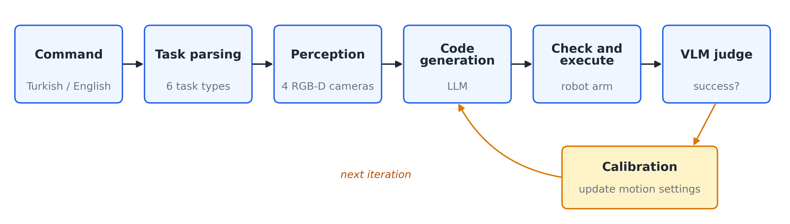
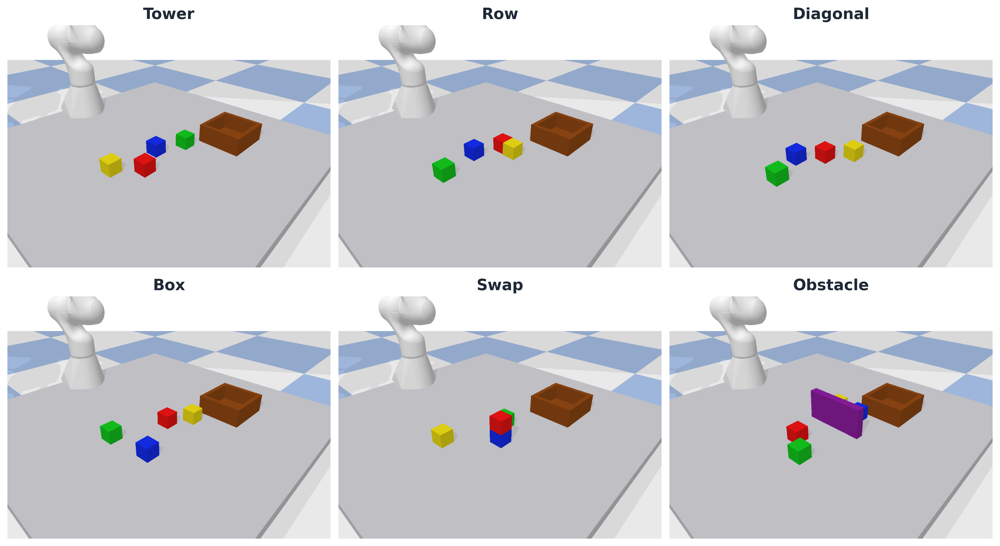
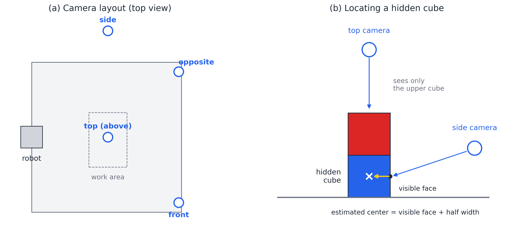
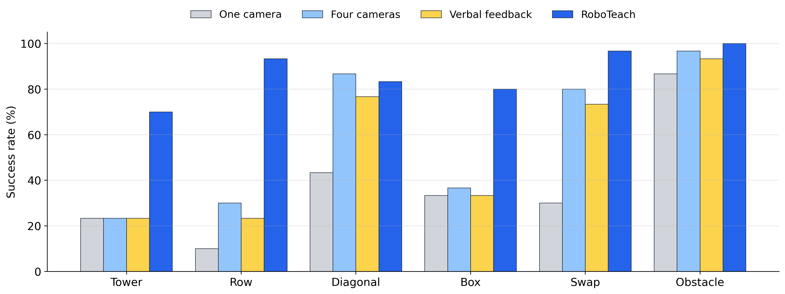

**Muhammed Emin Çelik, Barış Kaya, Mahmut Öztürk ve İsmail İşeri\***

Bilgisayar Mühendisliği Bölümü, Ondokuz Mayıs Üniversitesi, Samsun, Türkiye
E-posta: muhammedemin.celik@omu.edu.tr, baris.kaya@omu.edu.tr, mahmut.ozturk@omu.edu.tr, ismail.iseri@omu.edu.tr (\*Sorumlu Yazar)

**Öz:** Doğal dil komutlarının güvenilir robot hareketlerine dönüştürülmesi, sahnenin yalnızca kısmen görülebildiği ve nesnelerle temasın sürtünmeye bağlı olduğu durumlarda zorlaşmaktadır. Bu çalışmada, eğitim gerektirmeyen ve robot kodunu büyük dil modeli (large language model, LLM) ile üreten RoboTeach sistemi sunulmaktadır. Sistem, Türkçe ve İngilizce komutları kural tabanlı bir ayrıştırıcı ile altı görev türünden birine atamakta, nesne konumlarını dört kameradan kestirmekte, üretilen kodu çalıştırmadan önce denetlemekte ve her iterasyon sonunda bir görsel-dil modelinden alınan geri bildirimle o görev türünün hareket ayarlarını güncellemektedir. Sistem, PyBullet simülasyonunda Franka Emika Panda robot kolu ile altı masaüstü görevinde, her görev için 30 rastgele başlangıç sahnesinde sınanmıştır. RoboTeach 180 denemenin 157'sini (%87,2) tamamlamış, aynı dört kamerayı kullanan açık çevrim karşılaştırma yöntemi ise 106 denemede (%58,9) başarılı olmuştur. Fizik ve sensör parametreleri rastgele değiştirildiğinde bu oranlar sırasıyla %81,7 ve %54,4 olarak ölçülmüştür. Ayrıştırıcı, 180 farklı komut ifadesinin tamamını doğru görev türüne atamıştır. Bileşen çıkarma deneyleri, başarının büyük bölümünün görev ayrıştırma ve çok kameralı algılamadan kaynaklandığını göstermektedir. Kayıtlı kalibrasyon ayarları, otomatik güvenli yükselme açıkken ek kazanç sağlamamıştır (154/180'e karşı 159/180, p = 0,332). Güvenli yükselme kapatıldığında kalibrasyon başarıyı %80,0'dan %82,8'e çıkarmış, ancak bu fark istatistiksel olarak anlamlı bulunmamıştır (p = 0,442).

**Anahtar Kelimeler:** Robotik manipülasyon, Büyük dil modelleri, Geri bildirimli kalibrasyon, Çok bakışlı algılama, Görsel-dil hakemleri, Robotik simülasyon

# 1. Giriş

Masaüstü manipülasyonda doğal dil komutlarının güvenilir fiziksel hareketlere dönüştürülmesi henüz çözülmüş bir problem değildir [1], [2]. Kameraların sahneyi yalnızca kısmen görmesi ve nesnelerle kurulan temasın sürtünmeye bağlı olması bu dönüşümü zorlaştırmaktadır. Bütünleşik görev ve hareket planlama (task and motion planning, TAMP) yaklaşımları, nesne modelleri eksiksiz olduğunda ve alan bilgisi el ile tanımlandığında geometrik olarak uygulanabilir planlar üretebilmektedir [3]. Ancak serbest biçimli bir kullanıcı komutunun gürültülü sahne gözlemleriyle anında eşleştirilmesi gerektiğinde bu yaklaşımların esnekliği azalmaktadır. Önceden eğitilmiş dil ve çok kipli modeller ise el ile kural yazma yükünü önemli ölçüde azaltmıştır. Bu yöndeki çalışmalar arasında eylem uygunluğu (affordance) puanlaması [4], Code-as-Policies ile kod üretimi [5], [6], üç boyutlu değer haritaları [7] ve OpenVLA [8], Octo [9], π0 [10] gibi görüntüden doğrudan eylem üreten görsel-dil-eylem (vision-language-action, VLA) politikaları yer almaktadır.

Eğitim gerektirmeyen (training-free) dil tabanlı manipülasyon sistemleri, simülasyondaki yapay kavrama bağları ve nesne ışınlama gibi kolaylıklar kaldırıldığında üç tür hatayla karşılaşmaktadır. Birincisi, açık çevrim (open-loop) kod politikaları nesne konumunu yalnızca tepe kamerasının derinlik görüntüsünden kestirmektedir. Bu görüntü yalnızca üst yüzeyi ölçtüğü için üst üste dizilmiş bloklarda alttaki bloğun konumu hatalı hesaplanmaktadır. Düşük tutulan varsayılan geçiş yüksekliği de robotun engellere ya da kurulmuş kulelere çarpmasına yol açmaktadır. İkincisi, içsel monolog [11], deneyim özetleme [12], sözel pekiştirme [13] ve yinelemeli öz-iyileştirme [14] gibi kapalı çevrim (closed-loop) yöntemler, başarısız denemelerden çıkarılan düzeltme önerilerini dil modelinin girdisine düz metin olarak eklemektedir. Uzun girdilerde dil modelleri ortada kalan bilgiyi gözden kaçırabildiği için [15] bu öneriler hareket parametrelerini doğrudan değiştirmemekte ve konum hesaplarını bozabilmektedir. Üçüncüsü, düzeltme önerileri dil modelinin her seferinde kendisinin ürettiği görev adlarıyla kaydedildiğinde, aynı görev farklı sözcüklerle istenirse kayıtlı öneri bulunamamaktadır.

Nöro-sembolik ve ajantik robotik mimariler, dil modellerinin esnekliğini açıkça tanımlanmış görev temsilleriyle birleştirerek bu eksiklikleri gidermeyi amaçlamaktadır [16]–[18]. Bu çalışmada sunulan RoboTeach yeni bir temel model değildir. RoboTeach, mevcut bir LLM'i kural tabanlı görev ayrıştırma, çok kameralı algılama, kod denetimi ve geri bildirimli kalibrasyon ile bir araya getiren, eğitim gerektirmeyen bir sistemdir. Çalışmanın katkıları şunlardır:

- Türkçe ve İngilizce komutları altı görev türünden birine atayan ve her görev türü için dil modeline yerleşim talimatı veren kural tabanlı bir görev ayrıştırıcı,
- üstü örtülü blokların konumunu yan kameralardan kestiren dört kameralı bir algılama yöntemi,
- hareket ayarlarını görev türüne göre güncelleyen ve simülatörden okunan gerçek konumlarla ayrıca denetlenen bir kalibrasyon döngüsü,
- her bileşenin katkısını ve kalibrasyonun hangi koşullarda gerekli olduğunu ayrı ayrı ölçen deneyler.

# 2. İlgili Çalışmalar

## 2.1. Görev ve Hareket Planlama, Kod Üretimi ve Genelci Politikalar

Hiyerarşik TAMP çözücüleri ayrık sembolik operatörleri sürekli geometrik örnekleyicilerle birleştirmektedir [19], [20]. Ancak bu yaklaşımlar, alan bilgisinin bir uzman tarafından planlama alanı tanım dili (Planning Domain Definition Language, PDDL) ile yazılmasını gerektirmektedir. Büyük dil modelleri bu bağımlılığı azaltmaktadır. Text2Motion [21] doğal dil komutlarından uygulanabilir planlar üretmekte, TidyBot [22] ise kullanıcının yerleşim tercihlerini birkaç örnekten genelleştirmektedir. ReKep [23], bir görsel-dil modelinin ürettiği ilişkisel anahtar nokta kısıtlarını, tutucunun konumunu ve yönelimini birlikte tanımlayan yörüngeler üzerinde eniyilemektedir. Genelci çok kipli politikalar farklı bir yol izlemektedir. PaLM-E [24], RT-2 [25], TinyVLA [26], π0 [10] ve OpenVLA-OFT [27] gibi modeller, görüntüleri doğrudan eylemlere eşlemeyi büyük ölçekli gerçek dünya gösterim verilerinden öğrenmektedir. RoboTeach bu politikalardan farklı olarak gösterim verisi ya da ince ayar gerektirmemektedir. Sistem, Code-as-Policies [5] ve ProgPrompt [6] yaklaşımlarını temel almakta ve bunları kod denetimi, sürtünmeli temas fiziği ve görev türüne göre tutulan kalibrasyon kayıtlarıyla genişletmektedir.

## 2.2. Çok Bakışlı Algılama, Kavrama ve Hareket Kontrolü

PerAct [28], dil komutlarını ve üç boyutlu voksel gözlemlerini bir dönüştürücü (transformer) ağı ile işleyerek manipülasyon eylemleri üretmektedir. Diffusion Policy [29] ise robot eylemlerini bir difüzyon süreciyle üreterek aynı görev için birden fazla geçerli hareket biçimini öğrenebilmektedir. Görsel-dil özellikleri [30] nesnelerin göreve özgü eğitim olmadan tanınmasına, nokta kümesi (point cloud) işleme yöntemleri [31] ise üç boyutlu geometrinin çıkarılmasına olanak tanımaktadır. Ancak tek bir tepe kamerasından alınan derinlik görüntüsü, yüksek nesnelerin ve üstü örtülü blokların konumunu sistematik olarak hatalı kestirmektedir. Paralel çeneli bir tutucuyla güvenilir kavrama için temas noktalarında sürtünme ve kuvvet kapanımı koşullarının sağlanması gerekmektedir [32]. Uygun kavrama noktasının seçilmesi için analitik ve veriye dayalı yöntemler geliştirilmiştir [33]. Ani hızlanmaları önlemek için hareketler beşinci dereceden minimum sarsıntılı profillerle yumuşatılmaktadır [34]. Bu çalışmada Franka Emika Panda robot kolu [35] kullanılmıştır. Simülasyon parametrelerinin rastgele değiştirilmesi, yani alan rastgeleleştirmesi (domain randomization) [36], simülasyonda geliştirilen sistemlerin dayanıklılığını sınamak için kullanılmaktadır.

## 2.3. Görsel-Dil Hakemleri ve Geri Bildirimle Kalibrasyon

Voyager [37], Eureka [38] ve görsel-dil modellerini ödül fonksiyonu olarak kullanan çalışmalar [39], ortamdan alınan sonuçlara göre robot kodunu ya da ödül fonksiyonunu yinelemeli olarak güncellemektedir. AHA [40], manipülasyon hatalarını tespit edip gerekçelendiren bir görsel-dil hakemi geliştirmiştir. ReflectVLM [41], çok aşamalı planlamada görsel öngörüye dayalı bir yansıtma adımı kullanmaktadır. Zhao vd. [18] ise beceri keşfinde LLM görev önerilerini görsel-dil modeli doğrulamasıyla birleştirmiştir. Öte yandan bir dil modelinin hakem olarak kullanıldığı çalışmalar [42], aynı model ailesinden bir hakeme ya da denetlenmemiş metinsel değerlendirmelere güvenmenin sistematik hataları gizleyebileceğini göstermiştir. Bu nedenle bu çalışmada hakem kararları doğrudan kullanılmamış, iki farklı hakem modelinin kararları simülatörden okunan gerçek nesne konumlarıyla karşılaştırılmıştır. Uyum, Cohen kappa katsayısı [43] ve Landis–Koch uyum aralıkları [44] ile ölçülmüştür.

# 3. Yöntem

## 3.1. Sistem Mimarisi

RoboTeach, bir doğal dil komutunu altı adımda robot hareketine dönüştürmektedir (Şekil 1). İlk adımda komut, kural tabanlı bir ayrıştırıcı ile altı görev türünden birine atanmakta ve komutta geçen nesneler sıralanmaktadır. İkinci adımda sahnedeki nesnelerin konumları dört renk ve derinlik (RGB-D) kamerasından kestirilmektedir. Üçüncü adımda bir LLM, nesne konumları, görev türüne özgü yerleşim talimatı ve güncel hareket ayarları verilerek kısa bir Python programı üretmektedir. Dördüncü adımda program, yalnızca izin verilen komutları içerip içermediği denetlendikten sonra robot üzerinde çalıştırılmaktadır. Beşinci adımda bir görsel-dil modeli (vision-language model, VLM), sahnenin üç kameradan alınan görüntülerine bakarak görevin başarılı olup olmadığına karar vermektedir. Son adımda, başarısızlık durumunda hata türü belirlenmekte ve o görev türünün hareket ayarları ile kısa bir düzeltme kuralı güncellenmektedir. Bu kalibrasyon döngüsü, art arda iki iterasyon başarılı bulunana ya da beş iterasyon tamamlanana kadar sürmektedir. Kalibrasyondan sonra yapılan değerlendirme denemelerinde başarı, VLM kararı yerine simülatörden okunan gerçek nesne konumlarıyla belirlenmektedir.

## 3.2. Simülasyon Ortamı ve Görevler

Deneyler, PyBullet fizik motorunda 240 Hz adım frekansıyla yürütülmüştür. Simülasyonda nesneleri robota bağlayan yapay kısıtlar ya da nesneleri doğrudan hedefe taşıyan ışınlama kullanılmamıştır. Yedi eklemli Franka Emika Panda robot kolu, 1,10 m × 1,10 m boyutlarındaki bir masanın kenarına yerleştirilmiştir. Masada kırmızı, mavi, yeşil ve sarı renkte dört adet 50 mm'lik küp bulunmaktadır. Küplerin başlangıç konumları her denemede rastgele belirlenmektedir. Masada ayrıca üstü açık bir kutu (iç ölçüleri 13,8 cm × 13,8 cm, duvar yüksekliği 70 mm) bulunmaktadır. Obstacle görevinde başlangıç ve hedef bölgeleri arasına 11 cm yüksekliğinde bir duvar eklenmektedir.

Sistem altı masaüstü görevinde sınanmıştır. Görevler, komutları ve başarı koşulları Tablo 1'de verilmektedir. Başarı, her denemenin sonunda simülatörden okunan gerçek nesne konumlarıyla belirlenmektedir. Herhangi bir küpün masadan düşmesi, görev türünden bağımsız olarak başarısızlık sayılmaktadır. Görevlerin simülasyondaki görünümü Şekil 2'de gösterilmektedir.

**Tablo 1.** Görevler, örnek komutlar ve başarı koşulları.

| Görev | Örnek komut | Başarı koşulu |
|:--|:--|:--|
| Tower | "Kutuları kule gibi üst üste diz: en altta mavi, üstünde kırmızı, üstünde yeşil, en üstte sarı" | Dört küp verilen sırayla üst üste durmaktadır. |
| Row | "Kırmızı, mavi, yeşil ve sarı küpleri yan yana tek sıra halinde diz" | Dört küp tek sırada, aralarında 46–95 mm boşlukla durmaktadır. |
| Diagonal | "Kırmızının çaprazına mavi kutuyu, sarının çaprazına yeşil kutuyu koy" | Taşınan küp, referans küpe göre iki eksende de 35–115 mm kaymıştır. |
| Box | "Kırmızı, mavi ve yeşil küpleri kahverengi kutunun içine koy" | Üç küp de kutunun içindedir. |
| Swap | "Mavi küpü kırmızının üstüne koy ama kırmızı zaten mavinin üstünde" | Mavi küp kırmızı küpün üstündedir. |
| Obstacle | "Engelin üzerinden aşırarak mavi küpü kırmızı küpün üstüne koy" | Mavi küp kırmızı küpün üstündedir. |

*Not:* Üst üste dizme gerektiren görevlerde (Tower, Swap, Obstacle) her küpün altındaki küpe göre yatay kayması en fazla 32 mm, eğimi en fazla 0,35 radyan olmalıdır. Obstacle görevinde robotun duvara çarpıp çarpmadığı ayrıca denetlenmemekte, yalnızca son durum değerlendirilmektedir.

## 3.3. Görev Ayrıştırma

Ayrıştırıcı, Türkçe ve İngilizce anahtar sözcüklere ve kalıplara dayanan kural tabanlı bir programdır. Örneğin "üst üste", "kule" ya da "stack" sözcükleri istifleme görevine, "yan yana" ya da "in a row" ifadeleri Row görevine, "içine" ya da "inside" ifadeleri Box görevine yönlendirmektedir. Ayrıştırıcı, komutu altı görev türünden birine atamanın yanı sıra nesnelerin sırasını, taşınacak ve referans alınacak küp çiftlerini, hedef kutuyu, başlangıçta üst üste duran küpleri ve engelin varlığını çıkarmaktadır.

Bu bilgiler, dil modeline kod üretimi sırasında görev türüne özgü bir yerleşim talimatı olarak verilmektedir. Örneğin Row görevinde küplerin dizileceği hat ve küpler arası mesafe, Box görevinde ise kutunun içindeki üç ayrı yerleşim noktası talimatta açıkça belirtilmektedir. Swap görevinde mavi küp başlangıçta kırmızı küpün altında durduğu için görev iki alt adıma bölünmektedir. İlk adımda üstteki küp boş bir alana indirilmekte, ikinci adımda küplerin konumları yeniden ölçülerek mavi küp kırmızının üstüne konmaktadır. Ayrıştırıcı yalnızca Türkçe ve İngilizce sözcükleri tanıdığı için başka dillerdeki komutlar doğru görev türüne atanamamaktadır.

## 3.4. Çok Kameralı Algılama

Çalışma alanı, 640 × 480 çözünürlükte dört RGB-D kamera ile gözlemlenmektedir. Kameralardan biri masanın tam üstünde, diğer üçü ise masanın ön, yan ve karşı köşelerinde eğik açıyla konumlandırılmıştır (Şekil 3a). Her kamerada nesneye ait pikseller renk eşikleriyle ayrılmakta ve her piksel, Denklem (1) ile üç boyutlu dünya koordinatına çevrilmektedir:

$$\mathbf{p}_w = T_{w \leftarrow c}\begin{bmatrix} d\,K^{-1}[u,\, v,\, 1]^\top \\ 1 \end{bmatrix} \qquad (1)$$

Burada $(u, v)$ piksel koordinatlarını, $d$ derinliği, $K$ kameranın iç parametre matrisini ve $T_{w \leftarrow c}$ kameradan dünya koordinatına dönüşümü göstermektedir.

Tepe kamerası bir küpün üst yüzeyinden en az 24 nokta görebildiğinde, küpün yatay konumu bu noktaların ortancasından, yüksekliği ise üst yüzeyin yüksekliğinden hesaplanmaktadır. Başka bir küpün altında kalan bir küpte tepe kamerası yeterli nokta görememektedir. Bu durumda yan kameralar küpün kendilerine bakan yüzünü görmektedir (Şekil 3b). Her yan kamera, gördüğü yüzeyin ortanca noktasını küpün yarı genişliği kadar kameradan uzaklaştırarak küpün merkezini Denklem (2) ile kestirmektedir:

$$\hat{\mathbf{p}}_{xy} = \operatorname{med}(\mathbf{P}_{xy}) + 0{,}82\, r\, \mathbf{u}_{xy} \qquad (2)$$

Burada $\operatorname{med}(\mathbf{P}_{xy})$ görülen yüzey noktalarının yatay ortancasını, $\mathbf{u}_{xy}$ kameradan bu noktaya doğru birim vektörü ve $r = 25$ mm küpün yarı genişliğini göstermektedir. Birden fazla yan kamera küpü gördüğünde, kestirimlerin ortancası alınmaktadır.

## 3.5. Kod Üretimi ve Güvenli Yürütme

Kod üretiminde gpt-6-luna modeli kullanılmıştır. Modele nesnelerin ölçülen konumları, görev türüne özgü yerleşim talimatı, güncel hareket ayarları ve varsa kalibrasyondan gelen düzeltme kuralları verilmektedir. Model, yalnızca beş komut kullanan düz bir Python programı üretmektedir: bir nesnenin konumunu okuyan `get_object_position`, bir küpü kavrayıp kaldıran `grasp`, tutucuyu verilen noktaya götüren `move_to`, küpü bırakan `release` ve robotu başlangıç duruşuna döndüren `home`. Program çalıştırılmadan önce soyut sözdizimi ağacı (abstract syntax tree, AST) üzerinden denetlenmektedir. Döngü, koşul, modül içe aktarma ve bu beş komut dışındaki fonksiyon çağrılarını içeren programlar reddedilmektedir.

Hareket ayarları dört değerden oluşmaktadır: yatay hareketlerin yapılacağı geçiş yüksekliği, bir küpün diğerinin üstüne bırakılacağı yükseklik, sıra dizmede küpler arası mesafe ve çapraz yerleştirmede kaydırma miktarı. Bu değerlerin başlangıç ayarları sırasıyla 0,56 m, 0,075 m, 0,062 m ve 0,062 m'dir.

Otomatik güvenli yükselme açık olduğunda, robot 35 mm'den uzun her yatay hareketten önce, algılanan en yüksek nesnenin üzerinde kalacak bir yüksekliğe çıkmaktadır. Bu yükseklik Denklem (3) ile hesaplanmaktadır:

$$z_{\text{güvenli}} = \max\left(z_{\text{geçiş}},\ \min\left(0{,}82,\ \max(0{,}47,\ z_{\text{en yüksek}}) + 0{,}11\right),\ \min\left(0{,}82,\ z_{\text{hedef}} + 0{,}085\right)\right) \qquad (3)$$

Burada $z_{\text{geçiş}}$ hareket ayarlarındaki geçiş yüksekliğini, $z_{\text{en yüksek}}$ algılanan en yüksek nesnenin üst yüzeyini, $z_{\text{hedef}}$ ise hareketin hedef yüksekliğini metre cinsinden göstermektedir.

Hedef eklem açıları ters kinematikle çözülmekte ve robot bu açılara beşinci dereceden minimum sarsıntılı bir zaman profiliyle götürülmektedir [34]. Her eklem, Denklem (4)'teki oransal-türevsel (proportional-derivative, PD) denetleyici ile 240 Hz'de kontrol edilmektedir:

$$s(\tau) = 10\tau^3 - 15\tau^4 + 6\tau^5, \qquad \mathbf{u}(t) = K_p\left(\mathbf{q}_{\text{ref}}(t) - \mathbf{q}(t)\right) - K_d\,\dot{\mathbf{q}}(t) \qquad (4)$$

Burada $\tau \in [0, 1]$ normalize edilmiş zamanı, $\mathbf{q}$ eklem açılarını, $\mathbf{q}_{\text{ref}}$ hedef yörüngeyi, $K_p$ ve $K_d$ ise denetleyici kazançlarını göstermektedir. Tutucu küpü 75 N'lik kuvvet sınırıyla kavramakta ve robot, iki parmağın da küpe temas ettiği doğrulanmadan yatay harekete geçmemektedir.

## 3.6. Görsel-Dil Hakemi ve Kalibrasyon

Kalibrasyon iterasyonlarının sonunda görevin başarısına bir VLM hakemi karar vermektedir. Hakem olarak gpt-4.1 modeli kullanılmıştır. Hakeme sahnenin ön, üst ve yan kameralardan alınan görüntüleri ile algılanan nesne konumları verilmekte ve hakemden görevin başarılı olup olmadığına ilişkin bir karar ile hata türü istenmektedir. Hakem yanıtı belirsiz olduğunda ya da beklenen biçimde olmadığında, yanıt başarı olarak sayılmamakta ve değerlendirme hatası olarak kaydedilmektedir.

Ön denemelerde altı hata türü gözlenmiştir. Hata türleri ve her birinde kalibrasyonun yaptığı değişiklik Tablo 2'de verilmektedir. Bir iterasyon başarısız olduğunda, ilgili görev türünün hareket ayarları tablodaki değerlere göre güncellenmekte ve hata türüne ait kısa bir düzeltme kuralı kaydedilmektedir. Her hata türü için en fazla bir kural tutulmaktadır. Kayıtlar görev türüne göre tutulduğu için, aynı görev farklı sözcüklerle istendiğinde de aynı kayıt kullanılmaktadır.

**Tablo 2.** Hata türleri ve kalibrasyonun yaptığı değişiklikler.

| Hata türü | Açıklama | Kalibrasyonun yaptığı değişiklik |
|:--|:--|:--|
| Sıra hatası | Küpler yanlış sırayla dizilmiştir. | Alttaki küpe dokunulmaması ve küplerin aşağıdan yukarıya dizilmesi kuralı eklenir. |
| Hizalama hatası | Küpler sırada ya da çaprazda yanlış mesafede durmaktadır. | Küpler arası mesafe 62 mm'ye sabitlenir. |
| Devrilme | Yüksekten bırakılan küp sekip devrilmiştir. | Bırakma yüksekliği 0,075 m'den 0,052 m'ye düşürülür. |
| Çarpma | Robot ya da taşınan küp engele veya kuleye çarpmıştır. | Geçiş yüksekliği 0,56 m'den 0,68 m'ye çıkarılır. |
| Kutu kenarı | Küpler kutunun aynı noktasına bırakılıp kenardan taşmıştır. | Kutunun içinde üç ayrı yerleşim noktası kullanılır. |
| Görünmeyen küp | Altta kalan küp görülememiş ya da eski konum kullanılmıştır. | Her bırakmadan sonra küplerin konumları yeniden ölçülür. |

# 4. Deneysel Düzen ve Bulgular

## 4.1. Karşılaştırılan Yöntemler ve Değerlendirme

RoboTeach dört yöntemle karşılaştırılmıştır. Tüm yöntemlerde kod üretimi için aynı model (gpt-6-luna) kullanılmıştır.

- **Tek kamera:** Dil modeli, yalnızca tepe kamerasından ölçülen nesne konumlarıyla kod üretmektedir. Görev ayrıştırma, güvenli yükselme ve kalibrasyon kullanılmamaktadır.
- **Dört kamera:** Tek kamera yöntemiyle aynıdır, ancak nesne konumları dört kameradan ölçülmektedir. Bu yöntem, Code-as-Policies [5] yaklaşımının RoboTeach ile aynı algılama koşullarında çalıştırılmış halidir ve ana karşılaştırma yöntemi olarak kullanılmıştır.
- **Sözel düzeltme:** Dört kamera yöntemine ek olarak, kalibrasyon denemelerinde hakemin yazdığı düzeltme önerileri kaydedilmekte ve sonraki denemelerde dil modeline verilmektedir. Öneriler, dil modelinin ürettiği görev adıyla kaydedilmektedir.
- **Sözel düzeltme (doğrudan):** Sözel düzeltme yöntemiyle aynıdır, ancak kaydedilen öneriler görev adı eşleşmesine bakılmadan doğrudan ilgili görevin komutuna eklenmektedir.

Her görev için 30 farklı rastgele başlangıç sahnesi kullanılmış ve tüm yöntemler aynı 180 sahnede sınanmıştır. Kalibrasyon iterasyonlarında bu sahnelerden farklı sahneler kullanılmıştır. RoboTeach'in değerlendirmesinde, kalibrasyonda kullanılan komutlarla aynı anlama gelen fakat farklı sözcüklerle yazılmış komutlar verilmiştir. Sistemin dayanıklılığını ölçmek için ayrıca fizik ve sensör parametrelerinin rastgele değiştirildiği bozulmalı bir ortamda da deney yapılmıştır. Bu ortamda küplerin kütlesi 0,084–0,156 kg, küp sürtünme katsayısı 1,2–2,8 ve masa sürtünme katsayısı 1,0–2,2 aralığında rastgele seçilmiş, derinlik ölçümlerine 3 mm gürültü eklenmiş ve kameralar en fazla 3 mm ve 1,5° kaydırılmıştır.

Başarı oranları için %95 Wilson güven aralıkları hesaplanmıştır. İki yöntemin aynı sahnelerdeki sonuçları kesin McNemar testi ile karşılaştırılmıştır. Başarı farklarının güven aralıkları, görevler arasındaki farkı koruyan bootstrap yöntemiyle 5.000 yeniden örnekleme kullanılarak hesaplanmıştır.

## 4.2. Ana Sonuçlar

Tablo 3, dört yöntemin her görevdeki başarılı deneme sayısını göstermektedir. Her hücredeki sayı, o görevin 30 denemesinden kaçının başarılı olduğunu belirtmektedir. Son satır, altı görevin toplamını ve genel başarı oranını vermektedir.

**Tablo 3.** Yöntemlerin görev bazında başarılı deneme sayıları (her görevde 30 deneme).

| Görev | Tek kamera | Dört kamera | Sözel düzeltme | RoboTeach |
|:--|:--:|:--:|:--:|:--:|
| Tower | 7 | 7 | 7 | 21 |
| Row | 3 | 9 | 7 | 28 |
| Diagonal | 13 | 26 | 23 | 25 |
| Box | 10 | 11 | 10 | 24 |
| Swap | 9 | 24 | 22 | 29 |
| Obstacle | 26 | 29 | 28 | 30 |
| **Toplam (180)** | **68 (%37,8)** | **106 (%58,9)** | **97 (%53,9)** | **157 (%87,2)** |

RoboTeach, 180 denemenin 157'sini tamamlamış ve dört kamera yönteminden 28,3 yüzde puan daha başarılı olmuştur (%95 güven aralığı: 21,1–35,6 yüzde puan, p < 0,001). En büyük farklar Row (9'a karşı 28), Box (11'e karşı 24) ve Tower (7'ye karşı 21) görevlerinde ortaya çıkmıştır. Bu görevlerde dört kamera yöntemi küpleri çoğunlukla yanlış aralıklarla dizmiş, kutunun aynı noktasına bırakmış ya da yüksekten bırakarak devirmiştir. Diagonal görevinde ise iki yöntem arasında belirgin bir fark gözlenmemiştir (26'ya karşı 25). Tek kameradan dört kameraya geçiş, özellikle Diagonal (13'ten 26'ya) ve Swap (9'dan 24'e) görevlerinde başarıyı artırmıştır. Bu iki görevde küplerden biri başlangıçta ya da yerleştirme sırasında başka bir küpün altında kalmaktadır.

Sözel düzeltme yöntemi dört kamera yönteminin 5,0 yüzde puan gerisinde kalmıştır (97'ye karşı 106, p = 0,272). Bu yöntemde altı görevin hiçbirinde kalibrasyonda kaydedilen öneri değerlendirmede bulunamamıştır, çünkü dil modeli aynı görev için iki komutta farklı adlar üretmiştir. Öneriler doğrudan ilgili göreve verildiğinde başarı 71/180'e (%39,4) düşmüştür. Bu sonuç, düz metin olarak verilen düzeltme önerilerinin bu görevlerde başarıyı artırmadığını, aksine azalttığını göstermektedir.

Fizik ve sensör parametrelerinin değiştirildiği bozulmalı ortamda RoboTeach'in başarısı %87,2'den %81,7'ye (147/180), dört kamera yönteminin başarısı ise %58,9'dan %54,4'e (98/180) düşmüştür. İki yöntem arasındaki fark bu ortamda da 27,2 yüzde puan olarak korunmuştur (p < 0,001). En büyük düşüş, dört küplük kulenin kurulduğu Tower görevinde gözlenmiştir (21'den 15'e).

## 4.3. Bileşen Çıkarma Deneyleri

Her bileşenin katkısını ölçmek için RoboTeach'in bileşenleri tek tek kapatılmış ve sistem aynı 180 sahnede yeniden sınanmıştır. Sonuçlar Tablo 4'te verilmektedir. Fark sütunu, bileşen kapatıldığında başarının tam sisteme göre kaç yüzde puan değiştiğini göstermektedir.

**Tablo 4.** Bileşenler tek tek kapatıldığında başarı (180 deneme).

| Kapatılan bileşen | Başarılı deneme | Fark (yüzde puan) | p |
|:--|:--:|:--:|:--:|
| Yok (tam sistem) | 157 | – | – |
| Düzeltme kuralları | 153 | −2,2 | 0,503 |
| Hareket ayarları ve güvenli yükselme | 146 | −6,1 | 0,071 |
| Yan kameralar (yalnızca tepe kamerası) | 119 | −21,1 | < 0,001 |
| Görev ayrıştırma | 71 | −47,8 | < 0,001 |

En büyük düşüş görev ayrıştırma kapatıldığında gözlenmiştir. Bu durumda dil modeline görev türüne özgü yerleşim talimatı verilmemekte ve Swap görevi alt adımlara bölünmemektedir. Swap görevindeki başarı 29'dan 2'ye, Tower ve Row görevlerindeki başarı ise 5'e düşmüştür. Yan kameraların kapatılması özellikle Row (28'den 10'a) ve Diagonal (25'ten 15'e) görevlerini etkilemiştir. Hareket ayarlarının başlangıç değerlerine döndürülmesi ve güvenli yükselmenin kapatılması genel başarıyı anlamlı düzeyde değiştirmemiş, ancak Obstacle görevindeki başarıyı 30'dan 19'a düşürmüştür (p < 0,001). Bu görevde robot duvarın üzerinden yeterli yükseklikte geçememektedir. Düzeltme kurallarının kapatılması anlamlı bir fark yaratmamıştır. Bu deneyde hareket ayarları ve güvenli yükselme aynı anda kapatıldığı için iki bileşenin katkısı ayrı ayrı ölçülememiştir. Bu nedenle kalibrasyonun katkısı 4.4. Bölüm'de ayrı deneylerle incelenmiştir.

## 4.4. Kalibrasyonun Katkısı

Ana deneydeki kalibrasyonda, altı görev türünün dördünde (Tower, Row, Box, Obstacle) hakem ilk iki iterasyonu başarılı bulmuş ve başlangıç ayarları değiştirilmemiştir. Ayarlar yalnızca Diagonal ve Swap görevlerinde güncellenmiştir. Her iki görevde de geçiş yüksekliği 0,68 m'ye, bırakma yüksekliği 0,052 m'ye getirilmiş ve birer kural kaydedilmiştir. Swap görevinde simülatör beş iterasyonun hepsini başarılı bulmasına rağmen hakem iterasyonların bir kısmını reddettiği için kalibrasyon beş iterasyon sınırına ulaşmıştır.

Kalibrasyon kayıtlarının etkisi iki ayrı deneyle ölçülmüştür. İlk deneyde görev ayrıştırma, dört kamera ve otomatik güvenli yükselme açık tutulmuş, iki deney kolu yalnızca kalibrasyon kayıtlarının (hareket ayarları ve düzeltme kuralları) kullanılıp kullanılmaması bakımından ayrılmıştır. Kalibre edilmiş ayarlarla 154/180 (%85,6), başlangıç ayarlarıyla 159/180 (%88,3) başarı elde edilmiş ve fark anlamlı bulunmamıştır (p = 0,332). Bu sonuç, güvenli yükselmenin düşük geçiş yüksekliğinin etkisini zaten ortadan kaldırdığını göstermektedir.

İkinci deneyde otomatik güvenli yükselme kapatılmış ve kalibrasyon döngüsü bu koşulda her görev türü için yeniden çalıştırılmıştır. Kalibrasyon Tower, Diagonal ve Swap görevlerinde ayarları güncellemiş, Row, Box ve Obstacle görevlerinde ise başlangıç ayarlarını değiştirmemiştir. Başlangıç ayarlarıyla 144/180 (%80,0), kalibre edilmiş ayarlarla 149/180 (%82,8) başarı elde edilmiştir. Kalibrasyon başarıyı 2,8 yüzde puan artırmış, ancak bu fark anlamlı bulunmamıştır (%95 güven aralığı: −2,8 ile 8,3 yüzde puan, p = 0,442).

Bu deneyde iki önemli gözlem yapılmıştır. Birincisi, Obstacle görevinde başlangıç ayarlarıyla 30 denemenin 11'i başarısız olmasına rağmen, kalibrasyonda hakem ilk iki iterasyonu başarılı bulmuş ve ayarlar değiştirilmemiştir. Art arda iki başarılı iterasyonla duran kalibrasyon, bu tür orta başarı oranlı görevlerde hatayı yakalayamamaktadır. İkincisi, ayarların değişmediği görevlerde iki deney kolu aynı ayarlarla çalıştığı halde görev başına dörde varan başarı farkları gözlenmiştir (örneğin Box görevinde 24'e karşı 28). Bu farklar dil modelinin her çalıştırmada farklı kod üretmesinden kaynaklanmaktadır. Görev düzeyindeki küçük farklar bu nedenle dikkatle yorumlanmalıdır.

## 4.5. Algılama ve Komut Ayrıştırma Doğruluğu

Algılama doğruluğu, 60 sahnede ölçülen konumların simülatördeki gerçek konumlarla karşılaştırılmasıyla değerlendirilmiştir. Sahnelerin 30'unda tüm küpler görünür durumdadır, 30'unda ise bir küp başka bir küpün altında kalmaktadır. Tablo 5, tek tepe kamerası ile dört kameranın konum hatasını ve hatanın 40 mm'nin altında kaldığı ölçümlerin oranını göstermektedir. Hata, kök ortalama kare hata (root mean square error, RMSE) olarak milimetre cinsinden verilmektedir. 40 mm sınırı, kavramanın başarılı olabilmesi için kabul edilebilir en büyük hatayı temsil etmektedir.

**Tablo 5.** Konum kestirim hatası (RMSE, mm) ve hatanın 40 mm'nin altında kaldığı ölçümlerin oranı.

| Koşul | Tek kamera hatası | Tek kamera, 40 mm altı | Dört kamera hatası | Dört kamera, 40 mm altı |
|:--|:--:|:--:|:--:|:--:|
| Tüm nesneler görünür | 23,9 | %83,3 | 2,6 | %100 |
| Üstü örtülü küp | 43,9 | %73,3 | 27,9 | %100 |
| Derinlik gürültüsü, tüm nesneler | 24,1 | %83,3 | 4,0 | %100 |
| Derinlik gürültüsü, üstü örtülü küp | 44,1 | %66,7 | 27,7 | %100 |
| Kamera konum hatası, tüm nesneler | 28,5 | %83,3 | 15,3 | %100 |
| Kamera konum hatası, üstü örtülü küp | 47,2 | %50,0 | 32,9 | %80,0 |

*Not:* Derinlik gürültüsü koşulunda derinlik ölçümlerine 3 mm standart sapmalı gürültü eklenmiştir. Kamera konum hatası koşulunda görüntüler kameralar 3 mm ve 1,5° kaydırılarak oluşturulmuş, ancak konum hesabında kaydırılmamış kamera parametreleri kullanılmıştır.

Tek tepe kamerasının hatası, kutu ve duvar gibi yüksek nesnelerde artmaktadır, çünkü kamera bu nesnelerin merkezi yerine üst kenarlarını görmektedir. Dört kameranın hatası tüm nesneler görünür olduğunda 2,6 mm'dir. Üstü örtülü bir küpte hata 27,9 mm'ye çıkmakta, ancak ölçümlerin tamamı 40 mm sınırının altında kalmaktadır. Kamera konumları hatalı olduğunda örtülü küplerde bu oran %80'e düşmektedir. Küp dışındaki nesnelerde de dört kameranın hatası düşük kalmıştır. 48 mm çapında bir silindirde 4,6 mm, 96 mm uzunluğunda bir prizmada 4,7 mm hata ölçülmüş ve her iki nesne de 30 farklı açıda 30 denemenin tamamında kavranmıştır.

Komut ayrıştırma doğruluğu, her görev için 15 Türkçe ve 15 İngilizce olmak üzere toplam 180 farklı komut ifadesiyle ölçülmüştür. Ayrıştırıcı 180 ifadenin tamamında görev türünü, nesne sırasını, küp çiftlerini, hedef kutuyu ve başlangıçta üst üste duran küpleri doğru çıkarmıştır. Cümle yapısını ve başlangıç durumunu dikkate almadan yalnızca anahtar sözcüklere bakan basit bir eşleştirici ise 76 ifadede (%42,2) doğru sonuç vermiştir. Dil modelinden her komut için serbestçe bir görev adı üretmesi istendiğinde, aynı anlama gelen 60 komut çiftinin yalnızca 2'sinde aynı ad üretilmiştir. Bu sonuç, 4.2. Bölüm'de sözel düzeltme yönteminin kayıtlı önerileri neden bulamadığını açıklamaktadır.

## 4.6. Görsel-Dil Hakemlerinin Doğruluğu

Hakem kararlarının güvenilirliği, 120 denemede iki farklı hakem modelinin kararlarının simülatörden okunan gerçek sonuçlarla karşılaştırılmasıyla ölçülmüştür. Denemelerin 73'ü başarılı, 47'si başarısızdır. Karşılaştırılan modeller, kalibrasyonda kullanılan gpt-4.1 ile kod üretiminde kullanılan gpt-6-luna'dır. Tablo 6'da "hatalı onay", başarısız bir denemenin hakem tarafından başarılı sayılmasını, "haksız ret" ise başarılı bir denemenin başarısız sayılmasını ifade etmektedir. Kalibrasyon açısından en zararlı hata türü hatalı onaydır, çünkü bu durumda hatalı ayarlar değiştirilmeden kalmaktadır.

**Tablo 6.** Hakem kararlarının simülatör sonuçlarıyla karşılaştırılması (120 deneme).

| | gpt-4.1 | gpt-6-luna |
|:--|:--:|:--:|
| Doğru onay | 58 | 55 |
| Doğru ret | 39 | 45 |
| Hatalı onay | 8 | 2 |
| Haksız ret | 15 | 18 |
| Doğruluk | %80,8 | %83,3 |
| Cohen kappa | 0,61 | 0,67 |
| Ortanca karar süresi | 1,6 s | 3,4 s |

Cohen kappa değerleri, Landis ve Koch'un sınıflandırmasına göre her iki hakemde de "önemli düzeyde uyum" aralığındadır [44]. gpt-6-luna, başarısız denemeleri onaylama oranını %17,0'dan (8/47) %4,3'e (2/47) düşürmüş, buna karşılık kararlarını yaklaşık iki kat daha uzun sürede vermiştir. Bağımsız olarak tekrarlanan ikinci bir denetimde (72 başarılı, 48 başarısız deneme) iki hakemin doğrulukları arasında anlamlı bir fark bulunmamış (%78,3'e karşı %80,8, p = 0,736), ancak gpt-4.1 13, gpt-6-luna ise 3 başarısız denemeyi onaylamış ve hatalı onaylardaki bu fark anlamlı bulunmuştur (p = 0,002).

# 5. Tartışma ve Sınırlılıklar

Bulgular, RoboTeach'in başarısının büyük bölümünün iki bileşenden kaynaklandığını göstermektedir. Birincisi görev ayrıştırmadır. Ayrıştırıcının dil modeline verdiği görev türüne özgü yerleşim talimatları, dört kamera yöntemine göre elde edilen artışın en büyük kaynağıdır. Bu talimatlar her görev türü için el ile yazılmıştır. Bu durum, sistemin yeni bir görev türüne genişletilmesi için o görev türüne ait talimatın da yazılması gerektiği anlamına gelmektedir. İkincisi çok kameralı algılamadır. Yan kameralar, özellikle üstü örtülü küplerin bulunduğu görevlerde konum hatasını azaltmaktadır.

Kalibrasyonun katkısı ise sınırlı kalmıştır. Güvenli yükselme açıkken kalibrasyon ek kazanç sağlamamış, güvenli yükselme kapalıyken ayarları beklenen yönde güncellemiş fakat başarıdaki artış anlamlı düzeye ulaşmamıştır. Kalibrasyonun bu koşullarda sınırlı kalmasının iki nedeni bulunmaktadır. Birincisi, başlangıç ayarları ile güvenli yükselme çoğu görev için zaten yeterlidir. İkincisi, art arda iki başarılı iterasyonla duran kalibrasyon ölçütü, hataları her denemede değil ancak bazı denemelerde ortaya çıkan görevlerde bu hataları yakalayamamaktadır. Daha fazla iterasyon kullanan ya da başarı oranını birden fazla denemede ölçen bir durma ölçütü bu sınırlılığı azaltabilir.

Çalışmanın diğer sınırlılıkları şunlardır. Birincisi, tüm deneyler PyBullet simülasyonunda yürütülmüş, sistem gerçek bir robot üzerinde sınanmamıştır. Gerçek ortamda simülasyonda bulunmayan sensör gürültüsü, aydınlatma değişimleri, kamera kalibrasyon hataları ve parmak esnemesi gibi etkiler bulunmaktadır. Gerçek Franka Emika Panda robotuna geçişte renk eşiklerine dayalı nesne ayırma yerine görsel-dil özelliklerine dayalı bir yöntem [30] kullanılması, kameraların robota göre kalibre edilmesi ve her görev için en az 30 denemelik bir doğrulama yapılması gerekmektedir. İkincisi, Obstacle görevinde robotun duvara çarpıp çarpmadığı denetlenmemekte, yalnızca son durum değerlendirilmektedir. Üçüncüsü, ayrıştırıcı yalnızca Türkçe ve İngilizce komutları tanımaktadır. Kod üretiminde kullanılan dil modeli başka dilleri anlayabilse de, bu dillerdeki komutlar doğru görev türüne atanamamaktadır. Dördüncüsü, gpt-4.1 ve gpt-6-luna hem model ailesi hem de akıl yürütme yeteneği bakımından farklı olduğu için, Tablo 6'daki farkın bu iki etkenden hangisinden kaynaklandığı ayırt edilememektedir. Beşincisi, algılama yöntemi küp, silindir ve prizma gibi düzenli şekiller için tasarlanmıştır. Düzensiz şekilli nesneler için şekil tamamlama yöntemleri gerekecektir.

# 6. Sonuç

Bu çalışmada, doğal dil komutlarını robot hareketine dönüştüren ve eğitim gerektirmeyen RoboTeach sistemi sunulmuştur. Sistem, simülasyonda altı masaüstü görevinde dört kamera kullanan açık çevrim karşılaştırma yönteminden 28,3 yüzde puan daha başarılı olmuştur. Başarının büyük bölümü görev ayrıştırma ve çok kameralı algılamadan kaynaklanmaktadır. Kalibrasyon döngüsü, güvenli yükselme açıkken ek kazanç sağlamamış, güvenli yükselme kapalıyken ise başarıyı anlamlı olmayan bir düzeyde artırmıştır. Bulgular altı görev türü ve sınanan simülasyon koşullarıyla sınırlıdır.

# Veri ve Kod Erişimi

Simülasyon ortamı, algılama, görev ayrıştırma, kod üretimi ve kalibrasyon modülleri, deney betikleri ve tüm sonuç dosyaları https://github.com/Mahmut-OZTURK/robotech adresinde açık erişimle sunulmaktadır. Deneylerde kullanılan rastgele sahne numaraları ve model ayarları depodaki deney betiklerinde yer almaktadır.

# Beyanlar

**Finansman:** Bu araştırma herhangi bir kamu, ticari ya da kâr amacı gütmeyen kuruluştan finansman almamıştır.

**Çıkar çatışması:** Yazarlar herhangi bir çıkar çatışması bulunmadığını beyan eder.

**Yazar katkıları (CRediT):** [Yazarlar tarafından doldurulacaktır.]

**Üretken yapay zekâ kullanımı:** [Yazarlar tarafından doldurulacaktır.]

# Kaynaklar

[1] A. Billard and D. Kragic, "Trends and challenges in robot manipulation," *Science*, vol. 364, no. 6446, p. eaat8414, 2019, doi: 10.1126/science.aat8414.

[2] O. Kroemer, S. Niekum, and G. Konidaris, "A review of robot learning for manipulation: Challenges, representations, and algorithms," *J. Mach. Learn. Res.*, vol. 22, no. 30, pp. 1–82, 2021.

[3] C. R. Garrett, R. Chitnis, R. Holladay, B. Kim, T. Silver, L. P. Kaelbling, and T. Lozano-Pérez, "Integrated task and motion planning," *Annu. Rev. Control Robot. Auton. Syst.*, vol. 4, pp. 265–293, 2021, doi: 10.1146/annurev-control-091420-084139.

[4] M. Ahn et al., "Do as I can, not as I say: Grounding language in robotic affordances," in *Proc. 6th Conf. Robot Learn. (CoRL)*, vol. 205, 2023, pp. 287–318.

[5] J. Liang et al., "Code as policies: Language model programs for embodied control," in *Proc. IEEE Int. Conf. Robot. Autom. (ICRA)*, 2023, pp. 9493–9500, doi: 10.1109/ICRA48891.2023.10160591.

[6] I. Singh et al., "ProgPrompt: Generating situated robot task plans using large language models," in *Proc. IEEE Int. Conf. Robot. Autom. (ICRA)*, 2023, pp. 11523–11530, doi: 10.1109/ICRA48891.2023.10161317.

[7] W. Huang, C. Wang, R. Zhang, Y. Li, J. Wu, and L. Fei-Fei, "VoxPoser: Composable 3D value maps for robotic manipulation with language models," in *Proc. 7th Conf. Robot Learn. (CoRL)*, vol. 229, 2023, pp. 540–562.

[8] M. J. Kim et al., "OpenVLA: An open-source vision-language-action model," in *Proc. 8th Conf. Robot Learn. (CoRL)*, vol. 270, 2024, pp. 2679–2713, doi: 10.48550/arXiv.2406.09246.

[9] D. Ghosh et al., "Octo: An open-source generalist robot policy," in *Proc. Robot.: Sci. Syst. (RSS)*, 2024, doi: 10.15607/RSS.2024.XX.090.

[10] K. Black et al., "π0: A vision-language-action flow model for general robot control," in *Proc. Robot.: Sci. Syst. (RSS)*, 2025, doi: 10.15607/RSS.2025.XXI.010.

[11] W. Huang et al., "Inner monologue: Embodied reasoning through planning with language models," in *Proc. 6th Conf. Robot Learn. (CoRL)*, vol. 205, 2023, pp. 1769–1782.

[12] Z. Liu, A. Bahety, and S. Song, "REFLECT: Summarizing robot experiences for failure explanation and correction," in *Proc. 7th Conf. Robot Learn. (CoRL)*, vol. 229, 2023, pp. 3468–3484.

[13] N. Shinn, F. Cassano, A. Gopinath, K. Narasimhan, and S. Yao, "Reflexion: Language agents with verbal reinforcement learning," in *Adv. Neural Inf. Process. Syst. (NeurIPS)*, vol. 36, 2023, pp. 8634–8652.

[14] A. Madaan et al., "Self-Refine: Iterative refinement with self-feedback," in *Adv. Neural Inf. Process. Syst. (NeurIPS)*, vol. 36, 2023, pp. 46534–46594.

[15] N. F. Liu, K. Lin, J. Hewitt, A. Paranjape, M. Bevilacqua, F. Petroni, and P. Liang, "Lost in the middle: How language models use long contexts," *Trans. Assoc. Comput. Linguist.*, vol. 12, pp. 157–173, 2024.

[16] G. Marra, S. Dumančić, R. Manhaeve, and L. De Raedt, "From statistical relational to neurosymbolic artificial intelligence: A survey," *Artif. Intell.*, vol. 328, p. 104062, 2024, doi: 10.1016/j.artint.2023.104062.

[17] L. Frering, G. Steinbauer-Wagner, and A. Holzinger, "Integrating Belief-Desire-Intention agents with large language models for reliable human-robot interaction and explainable Artificial Intelligence," *Eng. Appl. Artif. Intell.*, vol. 141, p. 109771, 2025, doi: 10.1016/j.engappai.2024.109771.

[18] X. Zhao, C. Weber, and S. Wermter, "Agentic skill discovery," *Robot. Auton. Syst.*, vol. 196, p. 105248, 2026, doi: 10.1016/j.robot.2025.105248.

[19] L. P. Kaelbling and T. Lozano-Pérez, "Hierarchical task and motion planning in the now," in *Proc. IEEE Int. Conf. Robot. Autom. (ICRA)*, 2011, pp. 1470–1477, doi: 10.1109/ICRA.2011.5980391.

[20] C. R. Garrett, T. Lozano-Pérez, and L. P. Kaelbling, "PDDLStream: Integrating symbolic planners and blackbox samplers via optimistic adaptive planning," in *Proc. Int. Conf. Autom. Plan. Sched. (ICAPS)*, vol. 30, no. 1, 2020, pp. 440–448.

[21] K. Lin, C. Agia, T. Migimatsu, M. Pavone, and J. Bohg, "Text2Motion: From natural language instructions to feasible plans," *Auton. Robots*, vol. 47, pp. 1345–1365, 2023, doi: 10.1007/s10514-023-10131-7.

[22] J. Wu et al., "TidyBot: Personalized robot assistance with large language models," *Auton. Robots*, vol. 47, pp. 1087–1102, 2023, doi: 10.1007/s10514-023-10139-z.

[23] W. Huang, C. Wang, Y. Li, R. Zhang, and L. Fei-Fei, "ReKep: Spatio-temporal reasoning of relational keypoint constraints for robotic manipulation," in *Proc. 8th Conf. Robot Learn. (CoRL)*, vol. 270, 2024, pp. 4573–4602, doi: 10.48550/arXiv.2409.01652.

[24] D. Driess et al., "PaLM-E: An embodied multimodal language model," in *Proc. 40th Int. Conf. Mach. Learn. (ICML)*, vol. 202, 2023, pp. 8469–8488.

[25] B. Zitkovich et al., "RT-2: Vision-language-action models transfer web knowledge to robotic control," in *Proc. 7th Conf. Robot Learn. (CoRL)*, vol. 229, 2023, pp. 2165–2183.

[26] J. Wen et al., "TinyVLA: Towards fast, data-efficient vision-language-action models for robotic manipulation," *IEEE Robot. Autom. Lett.*, vol. 10, no. 4, pp. 3988–3995, 2025, doi: 10.1109/LRA.2025.3544909.

[27] M. J. Kim, C. Finn, and P. Liang, "Fine-tuning vision-language-action models: Optimizing speed and success," in *Proc. Robot.: Sci. Syst. (RSS)*, 2025, doi: 10.48550/arXiv.2502.19645.

[28] M. Shridhar, L. Manuelli, and D. Fox, "Perceiver-Actor: A multi-task transformer for robotic manipulation," in *Proc. 6th Conf. Robot Learn. (CoRL)*, vol. 205, 2023, pp. 785–799.

[29] C. Chi et al., "Diffusion policy: Visuomotor policy learning via action diffusion," *Int. J. Robot. Res.*, vol. 44, no. 10–11, pp. 1684–1704, 2024, doi: 10.1177/02783649241273668.

[30] A. Radford et al., "Learning transferable visual models from natural language supervision," in *Proc. 38th Int. Conf. Mach. Learn. (ICML)*, vol. 139, 2021, pp. 8748–8763.

[31] R. B. Rusu and S. Cousins, "3D is here: Point Cloud Library (PCL)," in *Proc. IEEE Int. Conf. Robot. Autom. (ICRA)*, 2011, pp. 1–4, doi: 10.1109/ICRA.2011.5980567.

[32] A. Bicchi and V. Kumar, "Robotic grasping and contact: A review," in *Proc. IEEE Int. Conf. Robot. Autom. (ICRA)*, vol. 1, 2000, pp. 348–353, doi: 10.1109/ROBOT.2000.844081.

[33] J. Bohg, A. Morales, T. Asfour, and D. Kragic, "Data-driven grasp synthesis—A survey," *IEEE Trans. Robot.*, vol. 30, no. 2, pp. 289–309, 2014, doi: 10.1109/TRO.2013.2289018.

[34] T. Flash and N. Hogan, "The coordination of arm movements: An experimentally confirmed mathematical model," *J. Neurosci.*, vol. 5, no. 7, pp. 1688–1703, 1985.

[35] S. Haddadin et al., "The Franka Emika robot: A reference platform for robotics research and education," *IEEE Robot. Autom. Mag.*, vol. 29, no. 2, pp. 46–64, 2022, doi: 10.1109/MRA.2021.3138382.

[36] J. Tobin, R. Fong, A. Ray, J. Schneider, W. Zaremba, and P. Abbeel, "Domain randomization for transferring deep neural networks from simulation to the real world," in *Proc. IEEE/RSJ Int. Conf. Intell. Robots Syst. (IROS)*, 2017, pp. 23–30, doi: 10.1109/IROS.2017.8202133.

[37] G. Wang et al., "Voyager: An open-ended embodied agent with large language models," *Trans. Mach. Learn. Res.*, 2024.

[38] Y. J. Ma et al., "Eureka: Human-level reward design via coding large language models," in *Proc. Int. Conf. Learn. Represent. (ICLR)*, 2024.

[39] J. Rocamonde, V. Montesinos, E. Nava, E. Perez, and D. Lindner, "Vision-language models are zero-shot reward models for reinforcement learning," in *Proc. Int. Conf. Learn. Represent. (ICLR)*, 2024.

[40] J. Duan et al., "AHA: A vision-language-model for detecting and reasoning over failures in robotic manipulation," in *Proc. Int. Conf. Learn. Represent. (ICLR)*, 2025, doi: 10.48550/arXiv.2410.00371.

[41] Y. Feng, J. Han, Z. Yang, X. Yue, S. Levine, and J. Luo, "Reflective planning: Vision-language models for multi-stage long-horizon robotic manipulation," in *Proc. 9th Conf. Robot Learn. (CoRL)*, vol. 305, 2025, pp. 2038–2062, doi: 10.48550/arXiv.2502.16707.

[42] L. Zheng et al., "Judging LLM-as-a-judge with MT-Bench and Chatbot Arena," in *Adv. Neural Inf. Process. Syst. (NeurIPS)*, vol. 36, 2023, pp. 46595–46623.

[43] J. Cohen, "A coefficient of agreement for nominal scales," *Educ. Psychol. Meas.*, vol. 20, no. 1, pp. 37–46, 1960.

[44] J. R. Landis and G. G. Koch, "The measurement of observer agreement for categorical data," *Biometrics*, vol. 33, no. 1, pp. 159–174, 1977.
